# Home dashboard

How to use each part of the Home dashboard.

**Follow the numbered steps and the highlighted controls in each screenshot.**

Screenshots use example records and illustrative AI responses.

## 1. Open Home

1. Open Hikari. If you see **A home for your research**, click **Choose Folder** and select your workspace folder.
2. Click the house icon labeled **Home** in the top navigation bar.
3. If a module is outside the visible navigation bar, click **More modules**, the four-square button at the end.

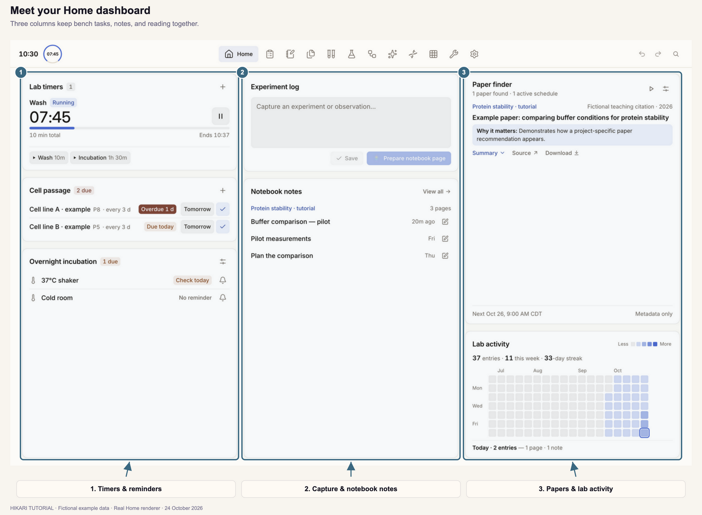

Scroll inside a tile to see additional items in its list.

## 2. Save an experiment log

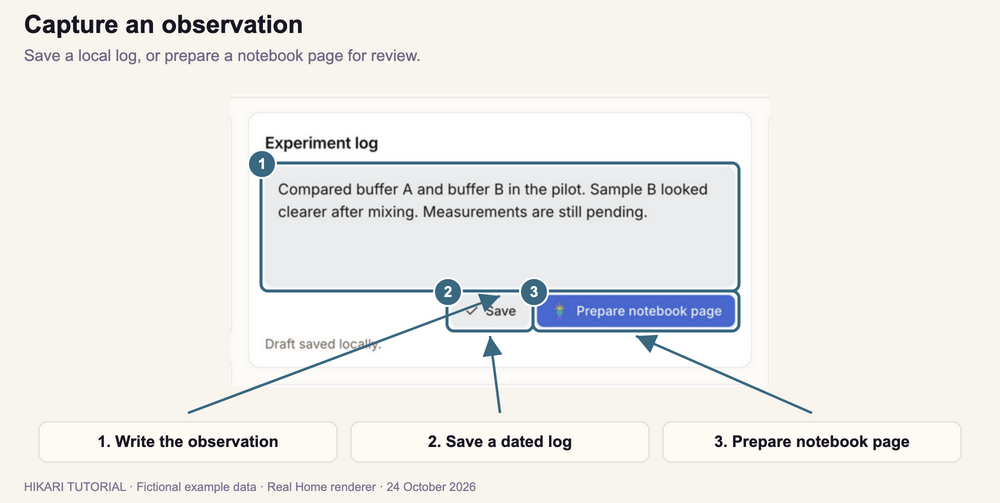

1. Click the text box under **Experiment log**.
2. Type your observation. For example: “Compared buffer A and buffer B. Sample B looked clearer after mixing. Measurements are pending.”
3. Click **Save**.
4. Check that **Logged.** appears and your observation is listed under **Saved today**.

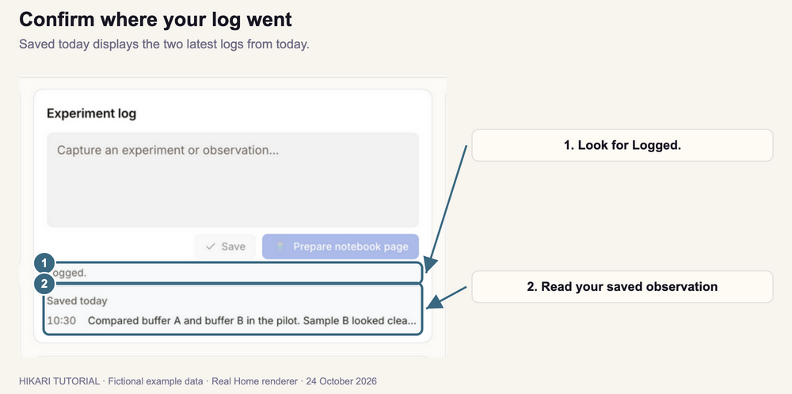

**Saved today** shows today's two latest logs. To add text directly to a notebook page, follow Section 4.

## 3. Prepare a notebook page

If **Prepare notebook page** is missing, connect Codex in **Settings**, then return to Home.

1. Type your experiment details in **Experiment log**.
2. Click **Prepare notebook page** to open the assistant conversation.
3. Select the project scope. Tell the assistant which project and page to use.
4. Answer its questions or add more details in the message box. Use the attachment button to include supporting files.
5. Review the proposed page or addition. Check the destination, sample names, values, and units.

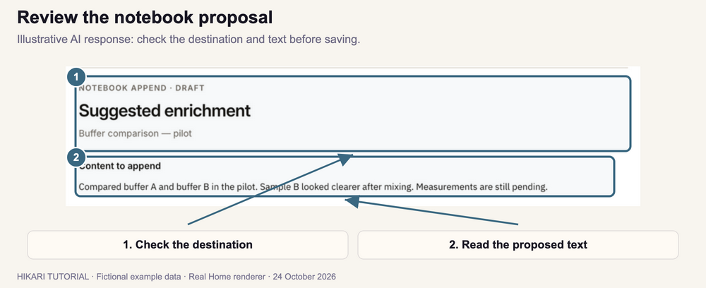

6. Scroll inside the review panel to reach its action buttons.
7. To accept the pictured addition, click **Append to Page**. Click **Reject** to decline it. For a new page, use the save action shown on its review card.

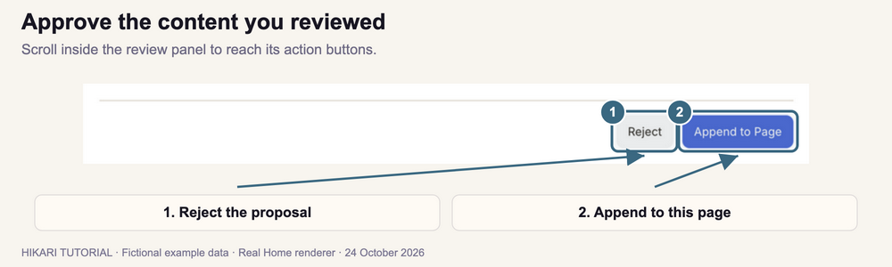

8. Close the conversation to return to Home. Click **Continue notebook review** to reopen it during the current app session.

**Shortcut:** In Experiment log, press **⌘ Enter** on macOS or **Ctrl Enter** on Windows to prepare a notebook page. When AI is unavailable, this shortcut saves the log locally.

## 4. Add a note to a notebook page

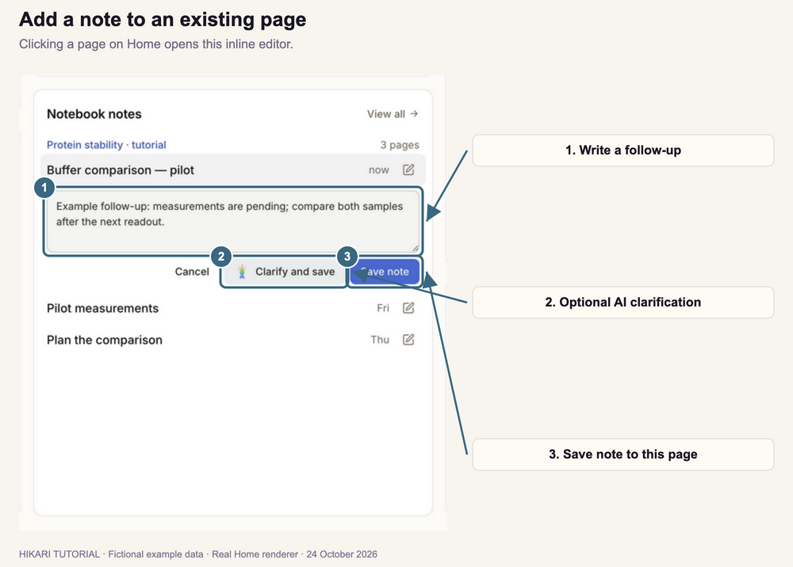

1. Find the project and page under **Notebook notes**.
2. Click the page row to open its note box.
3. Type your follow-up observation.
4. Click **Save note** to append it to that page's results with a date and time.

To improve the wording with AI, click **Clarify and save**. This saves both your original note and the clarified version.

Click **Cancel** to close the note box without saving. Click **View all** to open Notebook and find a page that is not listed on Home.

## 5. Create and start a timer

### Save a timer preset

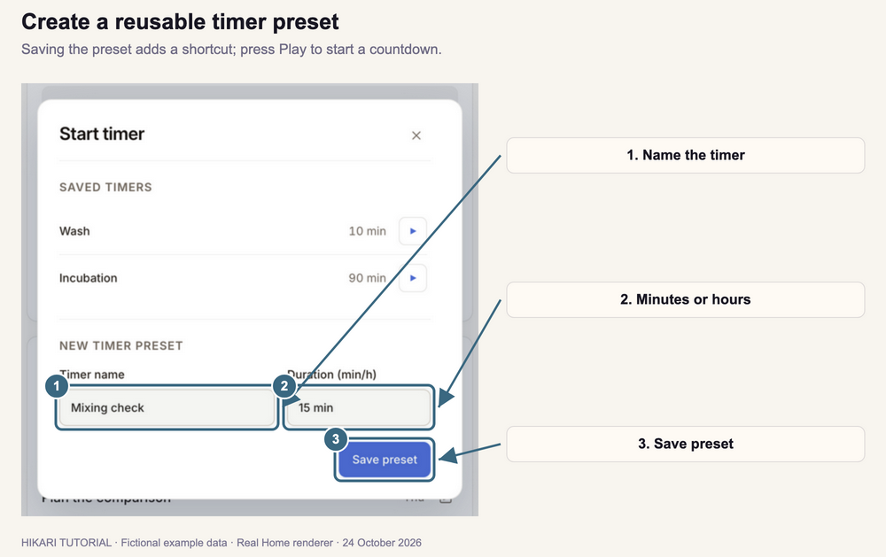

1. Click **+** beside **Lab timers**.
2. Enter a **Timer name**, such as **Mixing check**.
3. Enter the **Duration**, such as **15 min**, **1.5 h**, or **1 h 30 min**.
4. Click **Save preset**.

### Run the timer

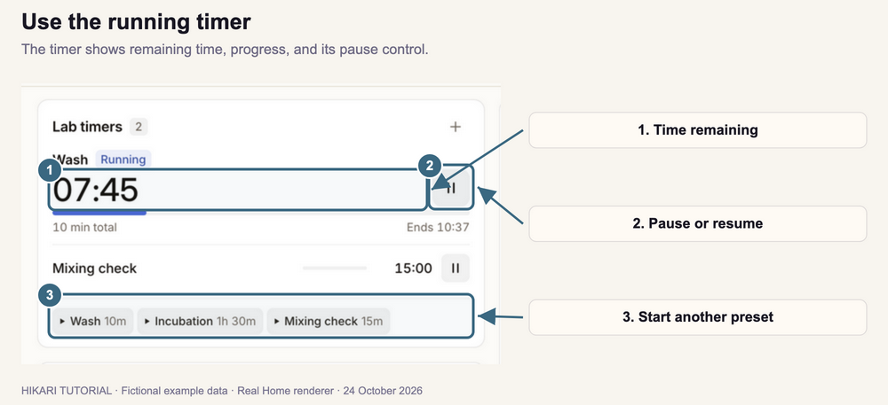

1. Click the preset's **Play** button in the dialog, or close the dialog and click its shortcut on Home. **Save preset** alone does not start the timer.
2. Check the remaining time in the active timer row.
3. Click **Pause** to pause the countdown. Click **Resume** to continue it.
4. Click another preset to start an additional timer.
5. When a timer finishes, click **Dismiss** on its completed row.

You can also check an active timer beside the clock in the top bar.

## 6. Manage cell passage reminders

### Add a reminder

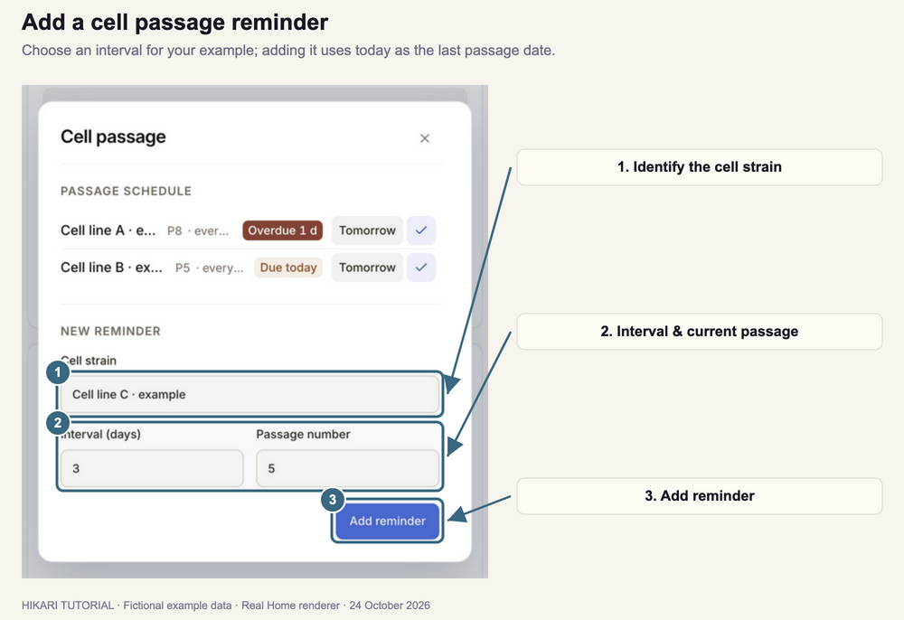

1. Click **+** beside **Cell passage**.
2. Enter the **Cell strain** name.
3. Enter the **Interval (days)** for the reminder.
4. Enter the current **Passage number**.
5. Click **Add reminder**.

The reminder uses today as the last passage date. Its next due date is today plus the interval you entered.

### Update a due reminder

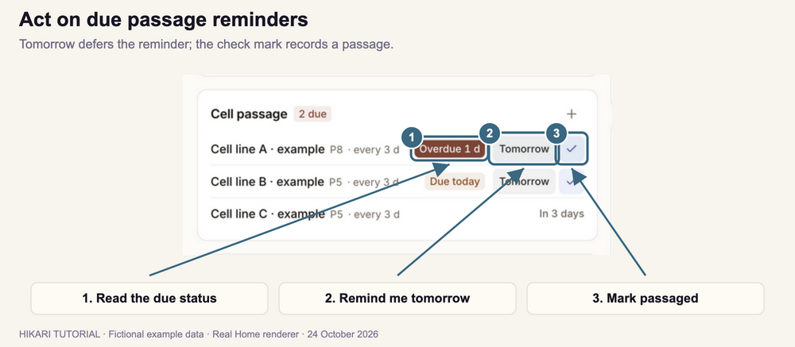

1. Find the row marked **Due today** or **Overdue**.
2. After performing the passage, click its **check mark** (**Mark passaged**). Hikari records today's date, increases the passage number, and schedules the next reminder.
3. To defer the reminder instead, click **Tomorrow**. This leaves the passage number unchanged.

These action buttons appear on due or overdue rows. If a cell-line sample shows **Needs setup**, open it in **Samples** and complete its passage information.

## 7. Set an incubation reminder

### Add a location

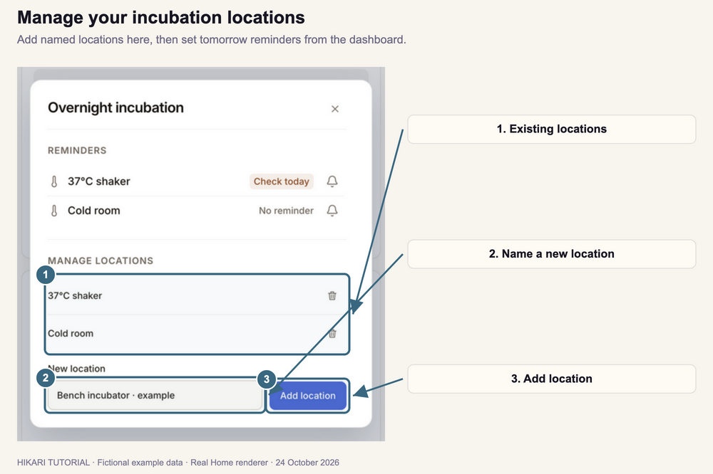

1. Click the sliders icon beside **Overnight incubation** to open **Manage locations**.
2. Enter a name under **New location**, such as **Bench incubator**.
3. Click **Add location**.
4. Close the dialog.

### Set the reminder

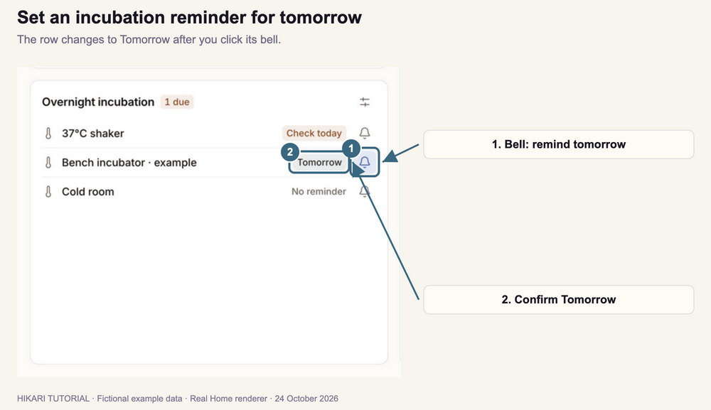

1. Find the location on Home.
2. Click its **bell** button.
3. Check that its status changes to **Tomorrow**.

On the due date, the status reads **Check today**. Click the bell again when you want to set a reminder for the following day.

To remove a location, open **Manage locations** and click the trash icon beside its name.

## 8. Find and open papers

Paper finder appears when the AI connection is available.

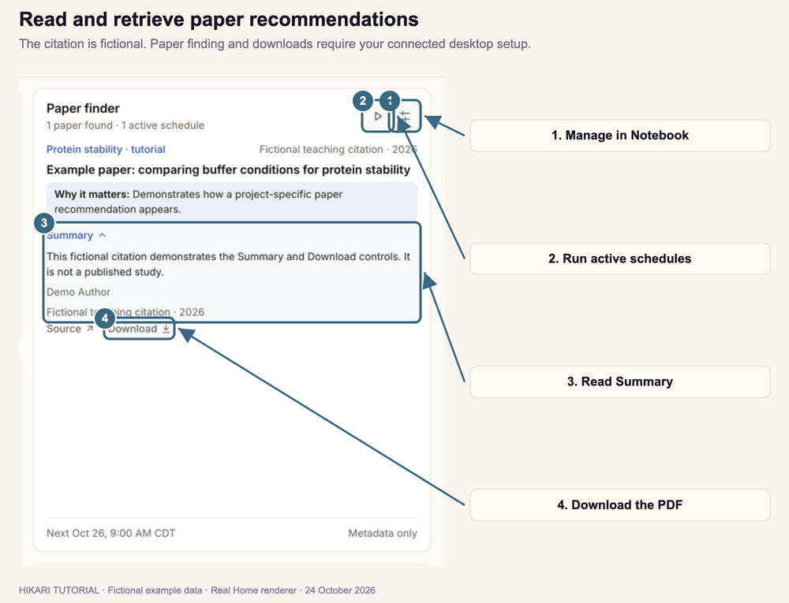

1. Click **Set up paper finding**, or the sliders icon labeled **Manage schedules**, to open Notebook.
2. Open the relevant project's dashboard and find its **Paper finder** controls.
3. Enter your research requirements, frequency, time, and timezone. Save the schedule.
4. Return to **Home**. Click the **Play** icon labeled **Find papers now** to run the active schedules. This runs all enabled schedules.
5. Read a recommendation and expand **Summary** or **Details**. Click **Source** to visit the citation page.
6. Click **Download** to save an available PDF to the associated project.
7. When the card shows **Saved**, click **Open** to read the file in Papers.

**Metadata only** means that the citation has been found but its PDF has not been saved. Use **Download** to retrieve the PDF when available.

## 9. Check lab activity

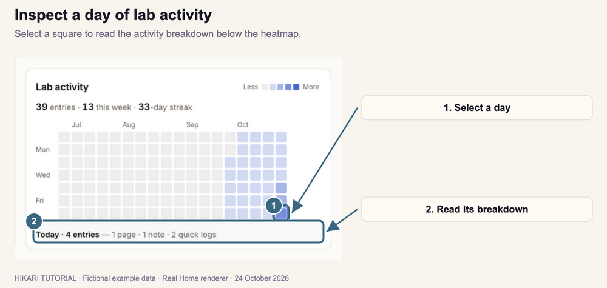

1. Find the **Lab activity** tile.
2. Hover over a square to see its date and activity.
3. Click the square to display that day's breakdown below the heatmap.
4. Select another square to inspect a different day.

Darker squares indicate more recorded activity. The totals above the heatmap show activity across the displayed period and the last seven days.

---

[Next tutorial: Protocols](../02-protocols/index.html)
