# Protocols

How to create, edit, and use your protocol library.

**Follow the numbered steps and the highlighted controls in each screenshot.**

Screenshots use example records and illustrative AI responses.

## 1. Open Protocols

1. Click **Protocols**, the clipboard icon in the top navigation bar.
2. If it is outside the visible navigation bar, open **More modules** and select **Protocols**.
3. Click a protocol in the library on the left. Its contents open on the right.

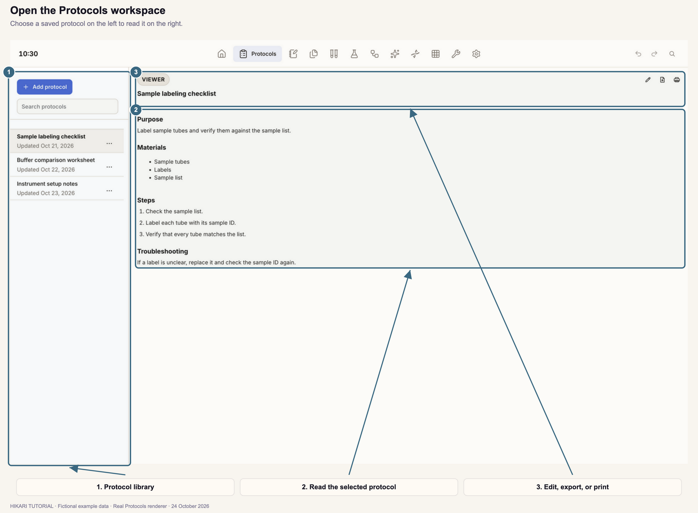

For an empty library, click **Add protocol** or **Create Protocol** to start your first record.

## 2. Find and read a protocol

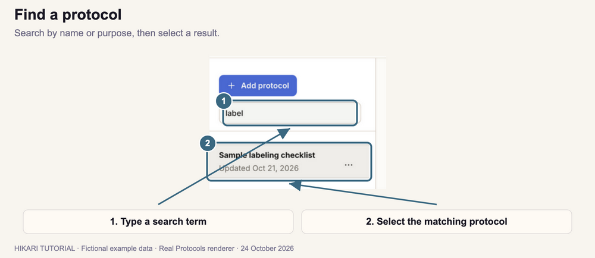

1. Click **Search protocols** above the library.
2. Type part of the protocol's name or purpose.
3. Click a matching row to open it.
4. Read its **Purpose**, **Materials**, **Steps**, and **Troubleshooting** in the right panel. Scroll inside that panel to read longer protocols.
5. Clear the search box, or press **Escape** while it is focused, to show the full library again.

## 3. Create and save a protocol

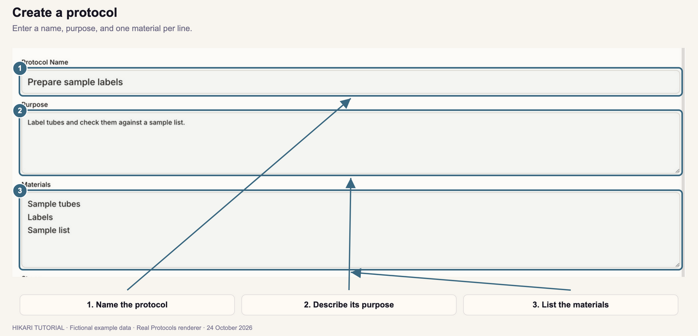

1. Click **Add protocol**.
2. Enter a **Protocol Name**, such as **Prepare sample labels**.
3. Describe the task under **Purpose**.
4. Under **Materials**, enter one item per line. Press **Enter** to start another item.
5. Under **Steps**, write one instruction per line in the order it should be performed. For example:

   ```text
   Check the sample list.
   Label each tube with its sample ID.
   Verify that every tube matches the list.
   ```

6. Add any useful **Troubleshooting** notes.
7. Scroll to the bottom of the editor and click **Save Protocol**.

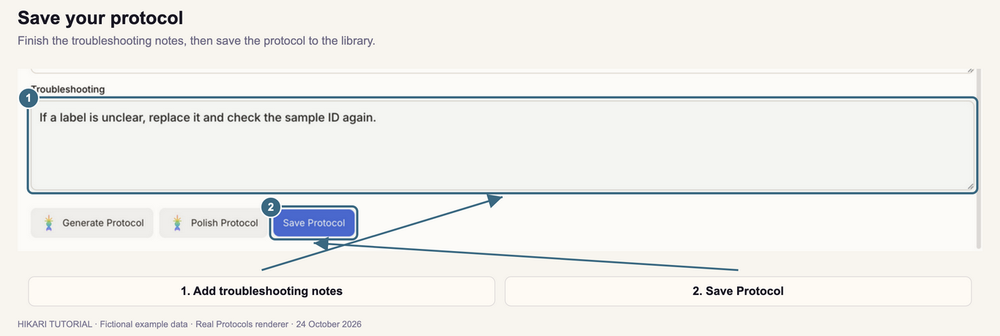

The saved protocol appears in the library and opens in the viewer. Enter a name and at least one step before saving.

## 4. Add reusable fields to steps

Use reusable fields for values or sample identities that you will fill in when using the protocol in Notebook.

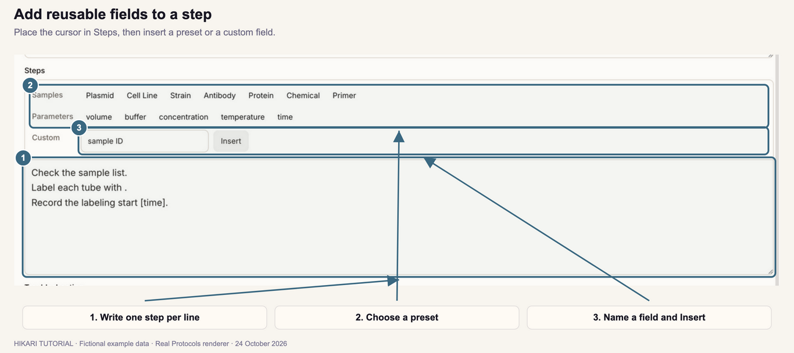

1. Open a protocol in the editor, or click **Add protocol** to create one.
2. Click in **Steps** at the position where the field should appear.
3. To use a preset, click a button above Steps, such as **volume**, **buffer**, **concentration**, **temperature**, or **time**. Sample presets are also available in the **Samples** group.
4. For your own field, enter a name under **Custom**, such as **sample ID**, then click **Insert**.
5. Check the inserted field in the step text. For example: `Label each tube with [sample ID].`
6. Click **Save Protocol**.

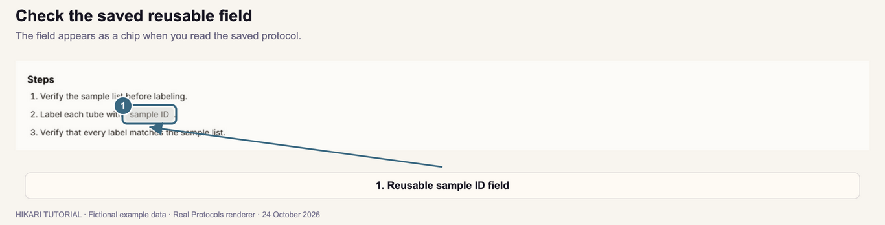

The viewer displays the field as a chip. To change the field or its surrounding instruction, return to the editor. You can also type a field directly in square brackets, such as `[sample ID]`.

## 5. Edit a saved protocol

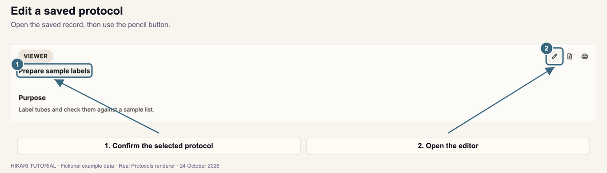

1. Find and select the protocol in the left library.
2. Check its title at the top of the viewer.
3. Click the **pencil** icon labeled **Edit protocol**. You can also open the row's **…** menu and choose **Edit**.
4. Change the name, purpose, materials, steps, or troubleshooting notes.
5. Click **Save Protocol** at the bottom of the editor to update the record.

Save your changes before opening another protocol or leaving the workspace.

## 6. Generate a protocol with the assistant

If the AI controls are missing, connect Codex in **Settings**, then return to Protocols.

1. Click **Add protocol**. **Generate Protocol** is available when creating a new protocol.
2. Scroll to the bottom of the editor and click **Generate Protocol**.
3. Describe what you want in the message box. Include the task, materials or sample type, and the details the result should contain.
4. To provide supporting notes, images, or a PDF, click the **attachment** button and choose your files. Use the remove button on an attachment to exclude it.
5. Click **Generate Protocol** in the dialog.

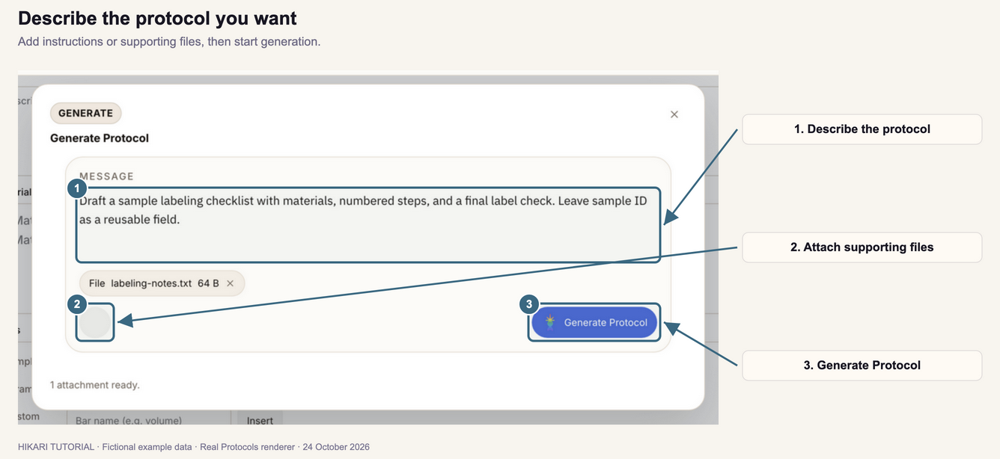

6. Read the generated draft. Scroll through its purpose, materials, steps, and troubleshooting notes.
7. Check the instructions, values, units, and reusable fields.
8. Click **Use Generated Protocol** to load the draft into the editor. To return to your current editor content without applying it, click **Keep Editing**.

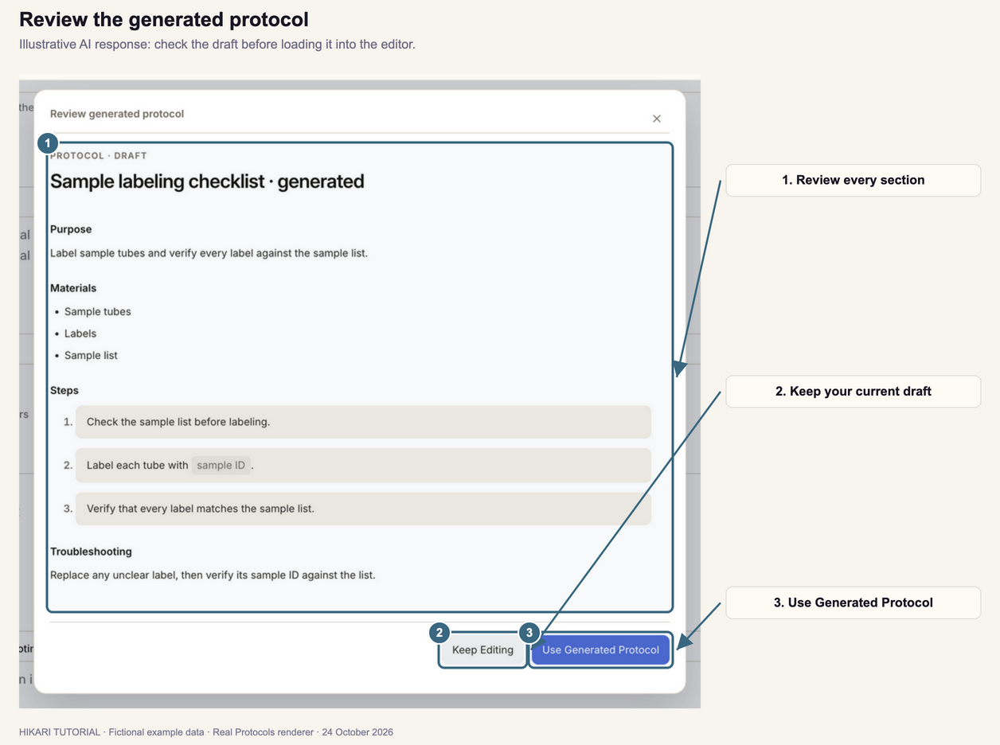

9. Make any further changes in the editor.
10. Click **Save Protocol** to add it to your library.

**Use Generated Protocol** fills the editor. The protocol is saved when you click **Save Protocol**.

## 7. Polish a protocol's wording

1. Open a protocol in the editor, or enter content for a new protocol.
2. Scroll to the bottom and click **Polish Protocol**.
3. Compare **Your Input** on the left with **Polished Protocol** on the right. Scroll inside either preview to read the full text.

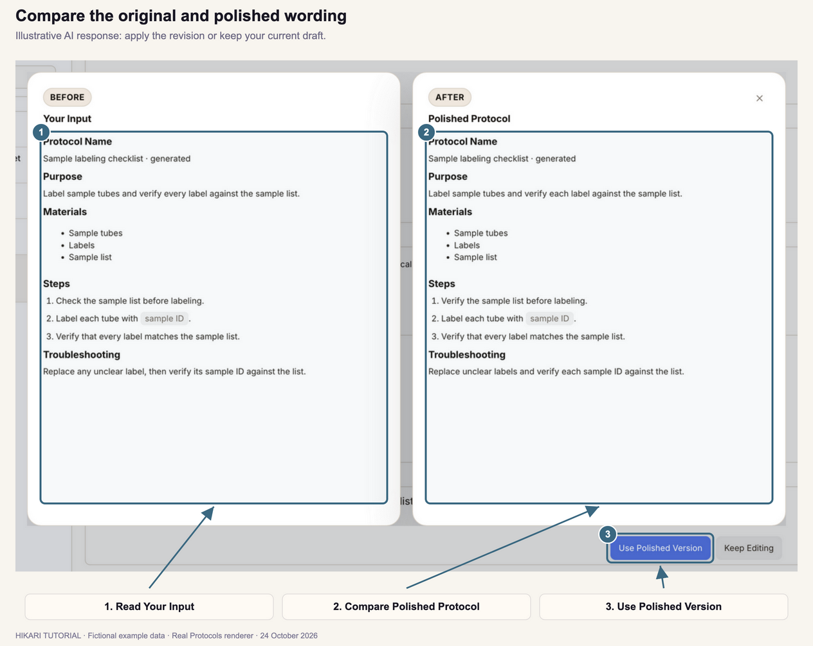

4. Click **Use Polished Version** to load the revised wording into the editor. Click **Keep Editing** to retain your current wording.
5. Review the editor fields and make any final changes.
6. Click **Save Protocol** to save the revised protocol.

Check that names, values, units, and reusable fields still match your intended procedure before saving.

## 8. Import a protocol from JSON

1. Click **Add protocol**.
2. Click the **Import Protocol JSON** icon at the upper right of the new protocol editor.
3. Under **Choose JSON File**, select your file. Alternatively, paste its contents into **Or Paste JSON**. Use one input method; pasted text takes priority if both are present.
4. Click **Import Protocol JSON**.

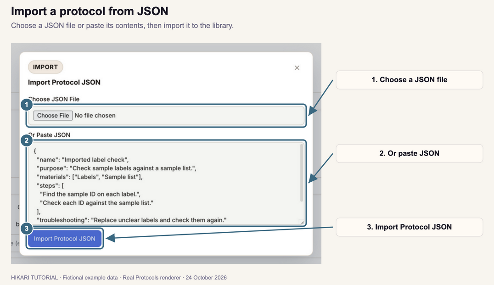

5. Find the imported protocol in the left library and click it to read it.
6. To change it, click **Edit protocol**, make your changes, and click **Save Protocol**.

Import adds records directly to the library. If a record has the same name or identifier as an existing protocol, Hikari adds a separate **Imported Copy**.

To try the import, choose [this example JSON file](examples/label-checklist.json), or paste:

```json
{
  "name": "Imported label check",
  "purpose": "Check sample labels against a sample list.",
  "materials": ["Labels", "Sample list"],
  "steps": [
    "Find the sample ID on each label.",
    "Check each ID against the sample list."
  ],
  "troubleshooting": "Replace unclear labels and check them again."
}
```

For multiple protocols, use an array of protocol objects or an object containing a `protocols` array.

## 9. Export or print a protocol

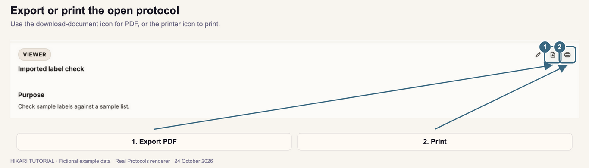

### Export a PDF

1. Select the saved protocol in the library.
2. Click the document-and-download icon labeled **Export PDF** at the top right of the viewer.
3. Save the PDF when prompted, or find it in your configured download location.

You can also open the protocol row's **…** menu and choose **Export PDF**.

### Print

1. Select the saved protocol.
2. Click the **printer** icon labeled **Print**.
3. In the print controls, choose the printer and settings, then confirm printing.

Save editor changes first so the exported or printed copy includes them.

## 10. Delete a protocol

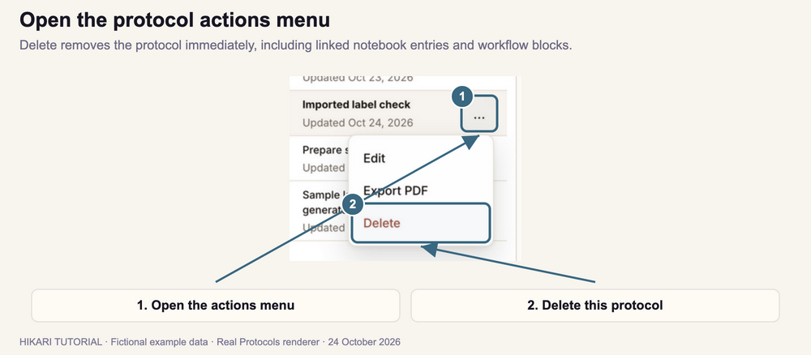

1. Find the protocol in the left library and check its name.
2. Click its **…** button to open **Protocol actions**.
3. Click **Delete** to remove it.

**Delete takes effect immediately.** It also removes notebook entries linked to that protocol and the protocol's blocks from workflows and workflow templates. Check those linked records before choosing Delete.

---

[Previous tutorial: Home dashboard](../01-home-dashboard/index.html) · [Next tutorial: Notebook](../03-notebook/index.html)
