# Notebook

How to record experiments in project notebook pages.

**Follow the numbered steps and the highlighted controls in each screenshot.**

Screenshots use example records and illustrative AI suggestions.

## 1. Open Notebook

1. Click **Notebook** in the top navigation bar.
2. If it is outside the visible navigation bar, open **More modules** and select **Notebook**.
3. Find your project in the left panel. Each project lists its pages with their status: **Suggested**, **Planned**, or **Executed**.
4. Click a page to open it on the right.

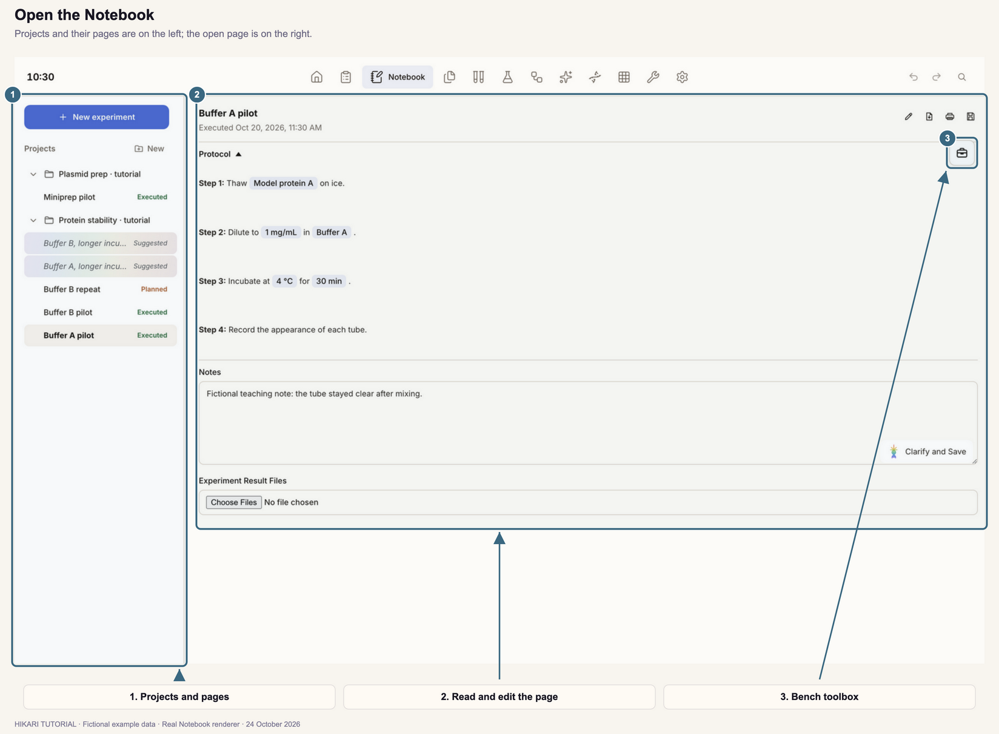

Click the arrow beside a project to collapse or expand its pages. Click the project name to open its dashboard (Section 12).

## 2. Create a project

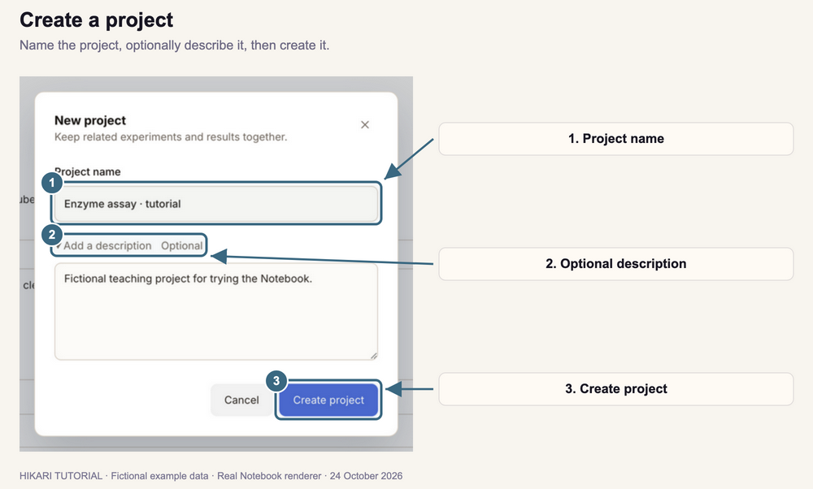

1. Click **New** beside **Projects** in the left panel.
2. Enter a **Project name**, such as **Enzyme assay**.
3. Optional: click **Add a description** and describe the project's goal.
4. Click **Create project**.

The project appears in the left panel and its dashboard opens. Hikari also creates a folder for the project in your workspace folder.

Each project needs a distinct name. If a name matches an existing project or would share its folder, Hikari asks you to choose another.

## 3. Start a new experiment

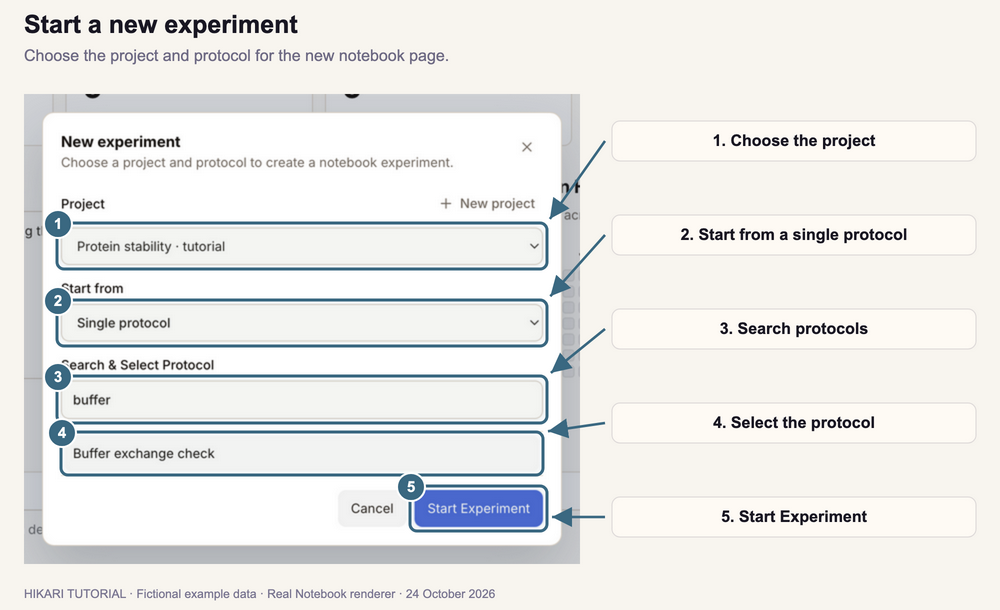

1. Click **New experiment** at the top of the left panel.
2. Under **Project**, choose the project. To create one here, click **New project**.
3. Leave **Start from** set to **Single protocol**.
4. Type part of the protocol name under **Search & Select Protocol**.
5. Click the protocol in the results.
6. Click **Start Experiment**.

A new page opens with the protocol's steps. **It is not saved until you click Save notebook page** (Section 5).

Protocols come from your protocol library. To add one, see [Protocols](../02-protocols/index.html).

To run a workflow instead, choose **Workflow** under **Start from**, select a **Workflow template**, optionally enter a **Process name**, and click **Start process**. The process opens in Workflow.

## 4. Fill in the protocol fields

Fields to fill in appear as small chips in the steps, such as **[buffer]** or **[time]**.

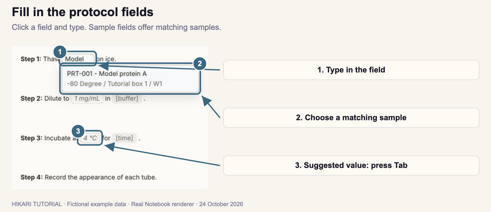

1. Click a field.
2. Type the value.
3. Press **Enter**, or click elsewhere, to keep it. Press **Escape** to cancel the change.
4. For a sample field, such as **[protein]** or **[plasmid]**, type part of the sample's name or code, then click the matching sample. The field is linked to that sample.
5. A grey value in italics is a suggestion from your recent runs of the same protocol. Click the field and press **Tab** to accept it, or type a different value.

Hikari suggests a value only when your recent runs of the protocol all used the same one. It never suggests sample names; choose those yourself.

To start a result table from a field, right-click the field and choose **Add Table**.

When AI is connected, Hikari may name a new page automatically once every field is filled. You can rename it at any time (Section 5).

## 5. Record notes and save the page

### Add notes and result files

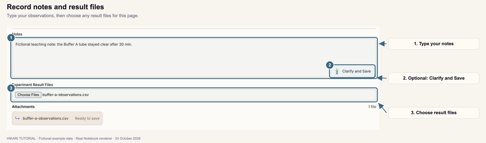

1. Type your observations under **Notes**.
2. To attach data files or images, click **Choose Files** under **Experiment Result Files** and select them. You can also drag files onto the page.
3. Check that each file is listed under **Attachments** as **Ready to save**.

To improve the wording with AI, click **Clarify and Save**. This saves the page with both your original note and the clarified version.

### Save the page

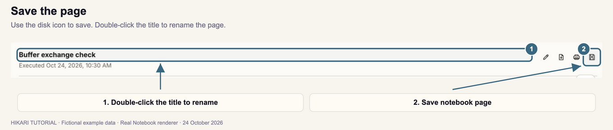

1. Click the disk icon labeled **Save notebook page** at the upper right of the page.
2. Check that the page appears under its project in the left panel.

Hikari copies the attached files into the page's folder in your workspace. A new page you save this way is recorded as **Executed**, with the time shown under its title.

To rename the page, double-click its title, type the new name, and press **Enter**. Press **Escape** to keep the old name. Then click **Save notebook page** to store the new name.

Save your changes before you open another page.

## 6. Use the bench toolbox

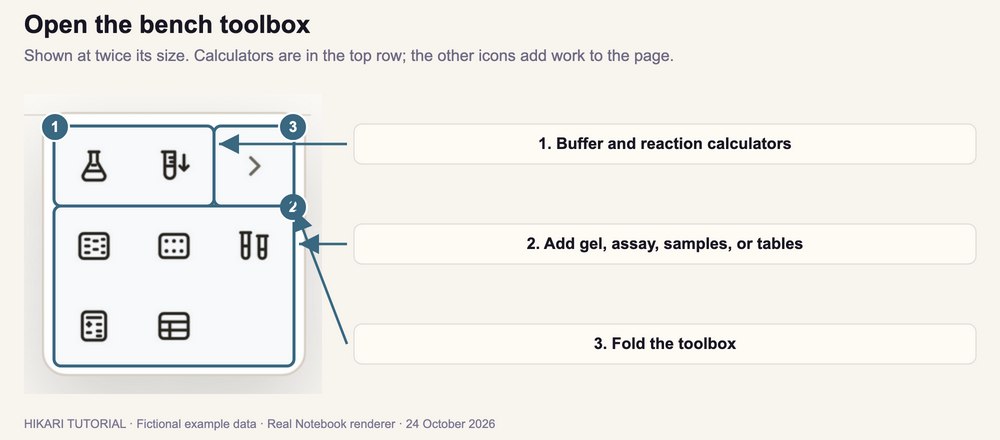

1. Open a page.
2. Click the toolbox icon at the upper right of the page.
3. Choose a tool:

| Icon | Name | Use it to |
| --- | --- | --- |
| Flask | **Buffer preparer** | Calculate how much of each ingredient a buffer needs (Section 8). |
| Tube with arrow | **Fixed volume reaction** | Calculate reagent volumes for a set total volume (Section 8). |
| Gel lanes | **Add gel** | Open Gel to analyze a gel image for this page (Section 9). |
| Plate | **Add assay** | Open Assay with a plate for this page (Section 9). |
| Two tubes | **Add samples** | Record a new sample and link it to this page (Section 9). |
| Calculator | **Molarity calculator** | Add a molarity table (Section 7). |
| Grid | **Add table** | Add a result table (Section 7). |

4. Click **›** (**Fold toolbox**), or press **Escape**, to fold it again.

You can drag the folded toolbox button to another place on the page. Hover over an icon to see its name.

## 7. Add result tables

### Add and fill a table

1. Open the bench toolbox and click **Add table**.
2. Enter the number of **Columns** and **Rows**, then click **Add Table**.
3. Click a cell and type. Press **Enter** to finish the cell.

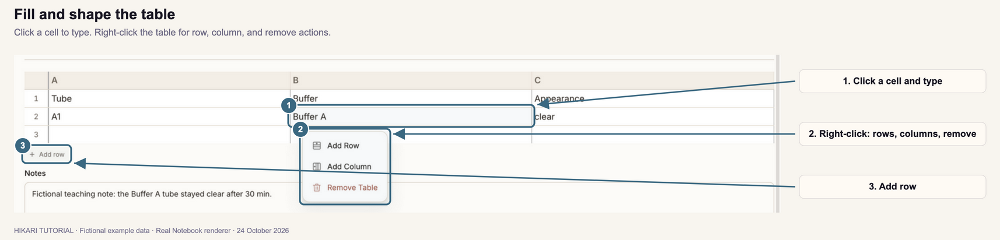

4. To change the table's shape, right-click it and choose **Add Row**, **Add Column**, or **Remove Table**. You can also click **Add row** below the table.
5. Click **Save notebook page** to store the table.

Columns are labeled **A**, **B**, **C**, and rows are numbered. A cell that starts with **=** is a formula, such as `=B2*C2` or `=AVERAGE(B2:B4)`. When a page has more than one table, refer to another table as `Table1:A1`.

### Calculate molarity

1. Open the bench toolbox and click **Molarity calculator**.
2. In a row, enter a name under **Entry**.
3. Fill in any three of **MW (g/mol)**, **Weight**, **Volume**, and **Molarity**.
4. Read the fourth value, which Hikari calculates.

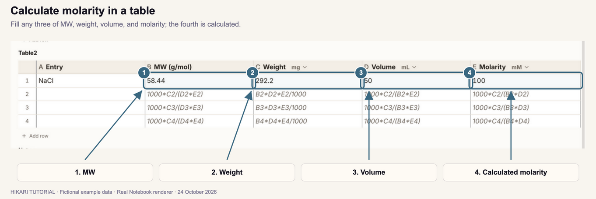

To change a unit, use the menu beside the column name, such as **mg** or **mM**. Values already in that column are converted to the new unit.

## 8. Prepare buffers and reactions

### Buffer preparer

1. Open the bench toolbox and click **Buffer preparer** (the flask). A sheet opens on the page.
2. Enter the buffer's **Volume** and choose its unit. Enter the **pH** if you want to record it.
3. For each ingredient, enter the **Chemical**, its **MW**, and its **Final Conc.**, such as **150 mM**. If an ingredient comes from a stock solution, also enter its **Stock Conc.**
4. Click **+** below the last ingredient to add another one.
5. Read each amount under **Mass/Volume**, and the remaining solvent under **Solvent to add**.

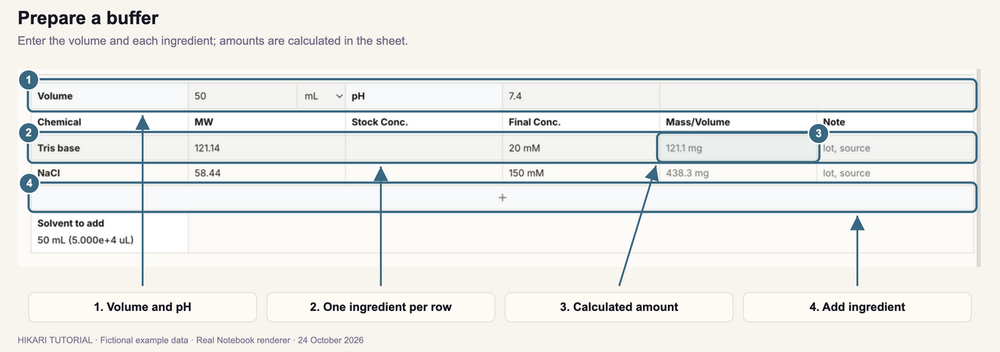

6. Click the flask again to close the sheet. Its table stays on the page.
7. Click **Save notebook page**.

Chemicals from your lab inventory are suggested as you type, with their molecular weight. Use **Note** for a lot number or source.

### Fixed volume reaction

1. Open the bench toolbox and click **Fixed volume reaction**.
2. Enter the **Total volume**, such as **100 uL**.
3. For each reagent, enter its **Stock Conc.** and **Final Conc.**, such as **10 mM** and **1 uM**, or **2000x** and **1x**. Hikari calculates its **Volume**.
4. Click **+** to add another reagent.
5. Read the solvent volume in the last row. You can rename **Solvent**, for example to **Water**.
6. Close the sheet and click **Save notebook page**.

To change a calculation later, click the pencil on its table to reopen it in the toolbox. Click the trash icon to remove it.

## 9. Link samples, gels, and assays

### Add a sample

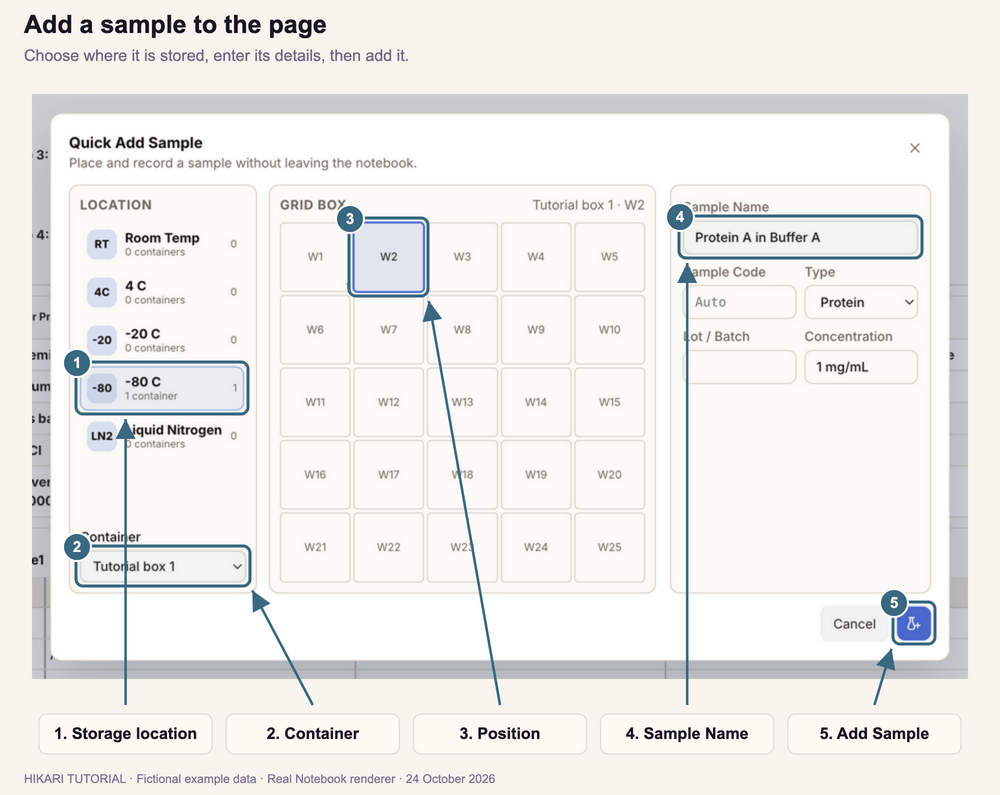

1. Open the bench toolbox and click **Add samples**.
2. Under **Location**, choose where the sample is stored.
3. Choose the **Container**.
4. Click an empty position in the grid. Hikari selects the first empty position for you.
5. Enter the **Sample Name**. Optionally choose its **Type** and enter a **Sample Code**, **Lot / Batch**, or **Concentration**. A code is created for you if you leave it blank.
6. Click the tube-and-plus button labeled **Add Sample**.

The sample is added to your samples, linked to this page, and recorded in a new line under **Notes**. A sample needs a container; if the location has none, add one in Samples first.

### Add a gel or assay

1. Open the bench toolbox.
2. Click **Add gel** to analyze a gel image, or **Add assay** to set up a plate.
3. Complete the work in Gel or Assay.

The gel or assay is linked to this page, and its preview appears on the page. If the page is new, Hikari saves it first.

## 10. Change this page's protocol copy

Each page keeps its own copy of the protocol. Change it when this run differs from the saved protocol.

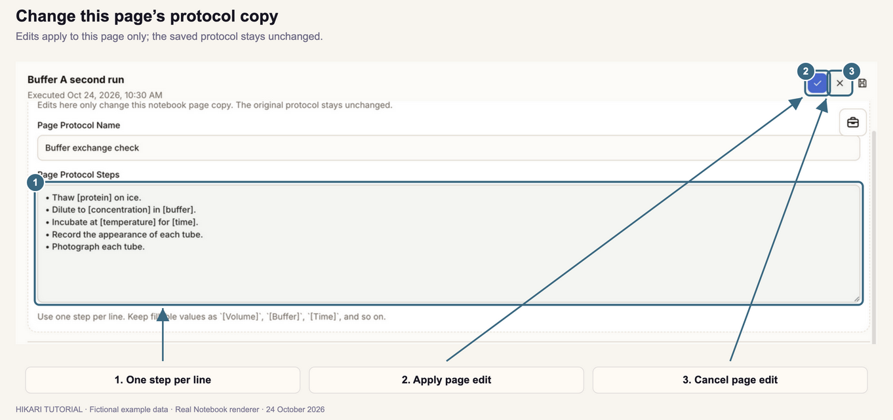

1. Click the pencil icon labeled **Edit page copy** at the upper right of the page.
2. Change the **Page Protocol Name** or **Page Protocol Steps**. Write one step per line, and keep fields in square brackets, such as `[buffer]`.
3. Click the check mark (**Apply page edit**) to apply your changes, or the cross (**Cancel page edit**) to discard them.

**The protocol in your library stays unchanged.** On a saved page, Apply page edit saves the change immediately. On a new page, click **Save notebook page** afterwards. Values entered in fields you remove are dropped from the page.

## 11. Plan and complete experiments

| Status | Meaning |
| --- | --- |
| **Suggested** | A next experiment proposed by the assistant. Shown in italics. |
| **Planned** | An experiment you intend to run. |
| **Executed** | A completed experiment, with the time it was recorded. |

### Accept a suggested experiment

Suggestions appear when AI is connected.

1. Open the project's dashboard and click **Suggest next experiment**. If the project already has a Suggested page, this opens it.
2. Hover over a **Suggested** page in the left panel to read why it was suggested. Click it to open it.
3. Review the steps, values, and notes.
4. Click the calendar icon labeled **Take Into Plan** at the upper right. The page becomes **Planned**.

Hikari may also suggest a next experiment after you complete one.

### Complete a planned experiment

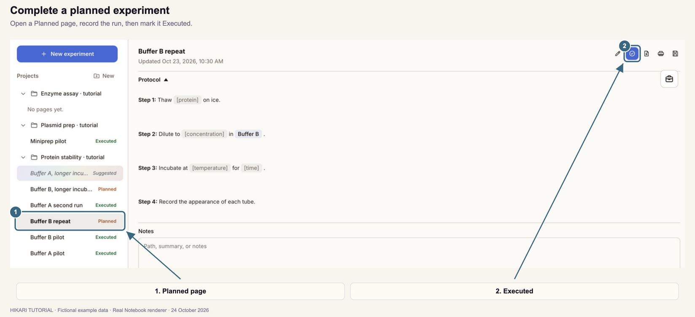

1. Click the **Planned** page in the left panel.
2. Fill in the fields, notes, and results as you run the experiment. Click **Save notebook page**.
3. Click the check-mark icon labeled **Executed** at the upper right.

The page is listed as **Executed**, and the time appears under its title.

## 12. Review a project

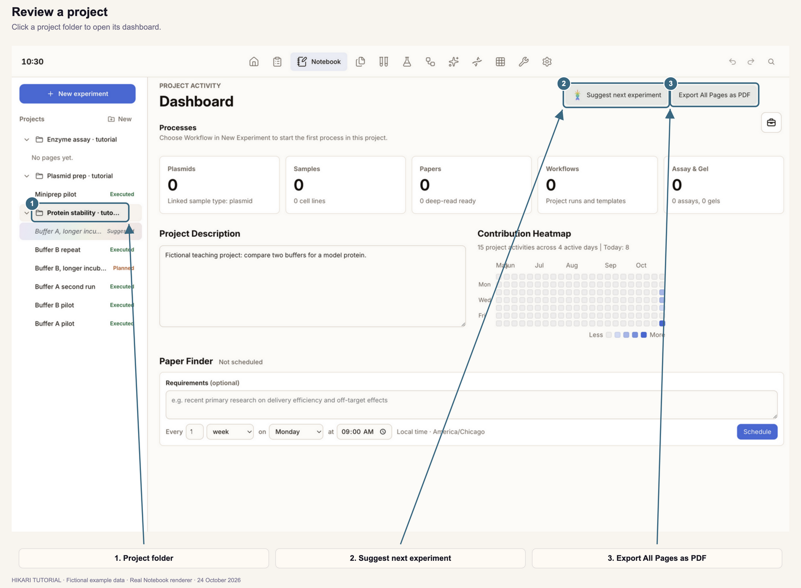

1. Click a project name in the left panel. Its dashboard opens.
2. Review its **Processes**, counts of linked records, and **Contribution Heatmap**.
3. Edit the **Project Description** if needed. Changes are saved as you type.
4. To export every page in the project as one PDF, click **Export All Pages as PDF**.

Use **Paper Finder** on the dashboard to schedule paper searches for the project. See [Find and open papers](../01-home-dashboard/index.html#8-find-and-open-papers).

## 13. Export or print a page

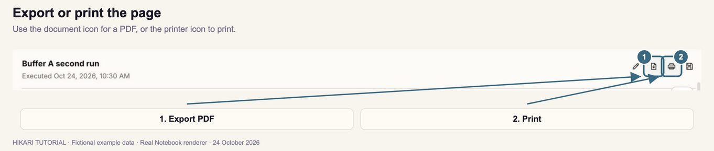

1. Open a saved page.
2. Click the document-and-arrow icon labeled **Export PDF** to save the page as a PDF.
3. Or click the printer icon labeled **Print**, choose your printer and settings, and confirm.

**Save your changes first** so the exported or printed copy includes them. Export and print are available for saved pages only.

Set the PDF page size and staple edge in **Settings** under **Notebook PDF**.

---

[Previous tutorial: Protocols](../02-protocols/index.html) · [Next tutorial: Papers](../04-papers/index.html)
