# Papers

How to build your paper library and read, mark, and search PDFs.

**Follow the numbered steps and the highlighted controls in each screenshot.**

Screenshots use a fictional example paper and an illustrative research brief.

## 1. Open Papers

1. Click **Papers** in the top navigation bar.
2. If it is outside the visible navigation bar, open **More modules** and select **Papers**.
3. Find a folder in the left panel. Click the arrow beside it to show its papers.
4. Click a paper to open its PDF in the middle.

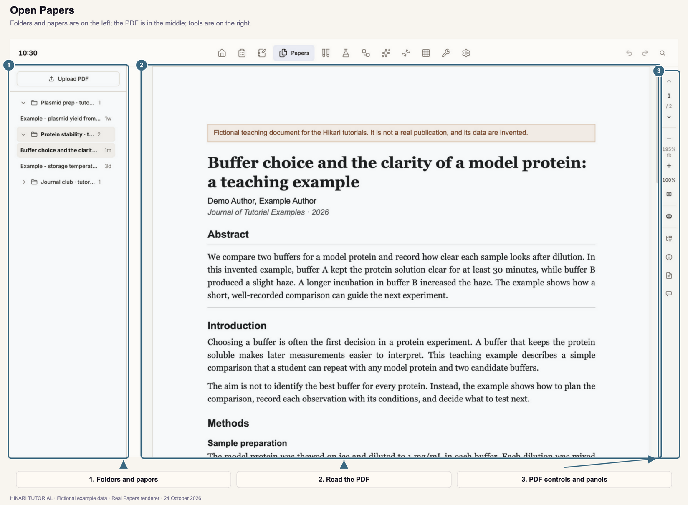

Each project from Notebook has a paper folder. You can also add your own folders (Section 3). The number beside a folder is its paper count, and the time beside a paper shows when it last changed.

A paper opens at the page you last read.

## 2. Add a PDF

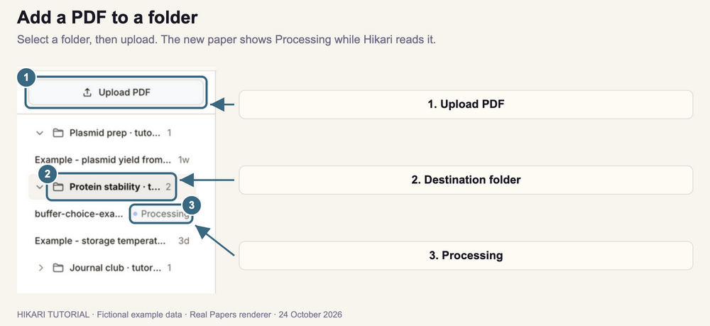

1. Click the folder that should hold the paper.
2. Click **Upload PDF** at the top of the left panel.
3. Choose the PDF file.
4. Find the new paper under the folder. It shows **Processing** while Hikari reads the PDF and prepares its notes.

You can also drag PDF files onto the left panel to add them to the selected folder, or drag one PDF onto the reading area to add it and open it.

Hikari copies each PDF into the folder's location in your workspace. When AI is connected, processing also writes the paper's research brief (Section 11). Without AI, Hikari still extracts the text and figures.

When you open the paper, Hikari takes its title and other details from the PDF where they are available.

To try these steps, use the [example PDF](examples/buffer-choice-example.pdf). It is a fictional teaching document.

PDFs saved by Paper finder, and PDFs found in your workspace folder, are added to the library automatically when you open Papers.

## 3. Organize folders

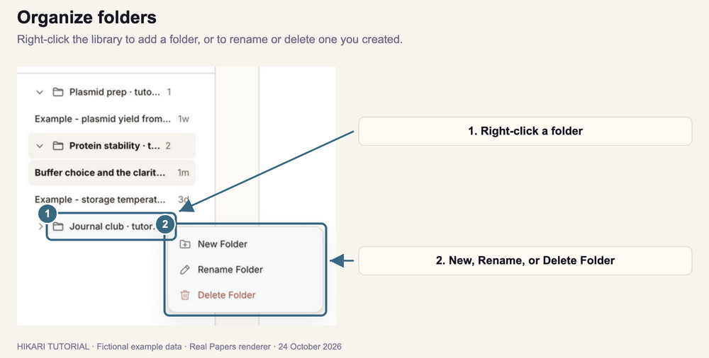

### Add a folder

1. Right-click an empty area or a folder in the left panel.
2. Choose **New Folder**. A folder named **New Folder** appears.
3. Double-click its name, type a new name, and press **Enter**.

Use your own folders for reading lists or journal clubs. Project folders come from Notebook, so rename or delete them there.

### Rename or delete a folder

1. Right-click a folder you created.
2. Choose **Rename Folder**, type the new name, and press **Enter**. You can also double-click the folder name.
3. To remove it, choose **Delete Folder** and confirm. **Deleting a folder also removes its papers from the library.**

### Move a paper

Drag the paper onto another folder. Hikari moves its PDF into that folder's location in your workspace.

## 4. Read and move through a PDF

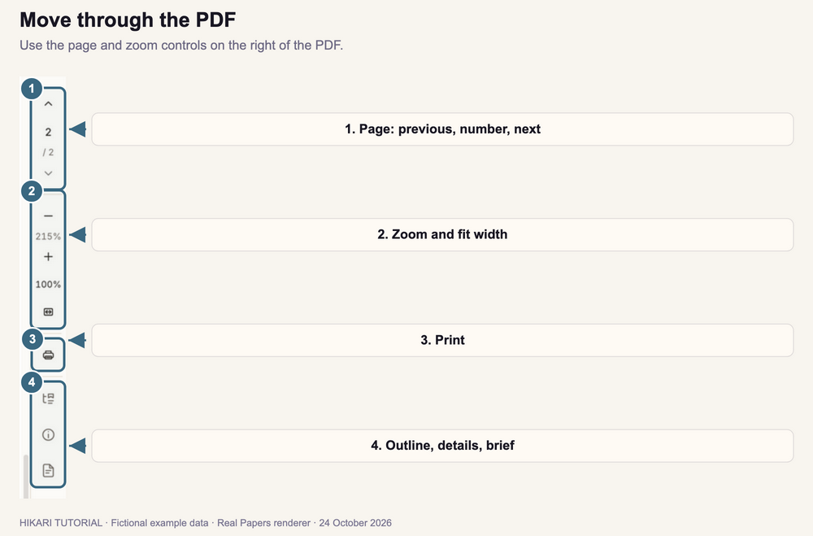

1. Scroll the PDF to read it.
2. To change pages, click the up or down arrow, or type a page number and press **Enter**.
3. To zoom, click **−** or **+**. Click **100%** for actual size, or the fit-width icon to fit the page to the reading area.
4. To print, click the printer icon and confirm in the print controls.

You can also zoom by pinching on a trackpad, or by holding **Ctrl** while you turn the mouse wheel.

Printing uses the stored PDF; your highlights and comments are not printed. If a PDF has fillable form fields, a save icon appears here. Fill in the fields, then click it to save the filled values into the stored PDF.

## 5. Act on selected text

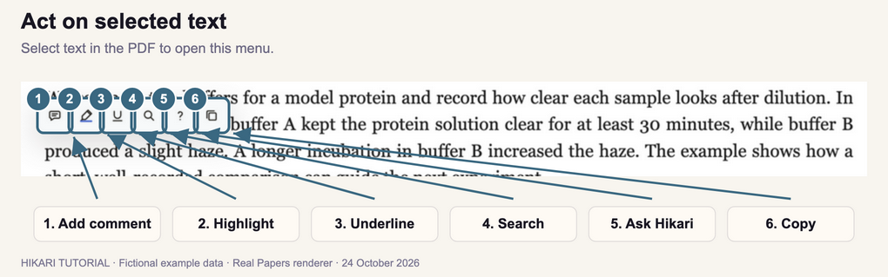

1. Drag across text in the PDF to select it.
2. Choose an action in the menu that appears above the selection:

| Icon | Action | What it does |
| --- | --- | --- |
| Speech bubble | **Add comment** | Saves a note about the selected text (Section 7). |
| Marker | **Highlight** | Highlights the text in yellow (Section 6). |
| U | **Underline** | Underlines the text (Section 6). |
| Magnifier | **Search** | Finds the text in this PDF or your library (Section 8). |
| ? | **Ask Hikari** | Opens the assistant with the selected text (Section 12). Requires AI. |
| Two pages | **Copy** | Copies the text. |

Click elsewhere in the PDF to close the menu.

## 6. Highlight and underline

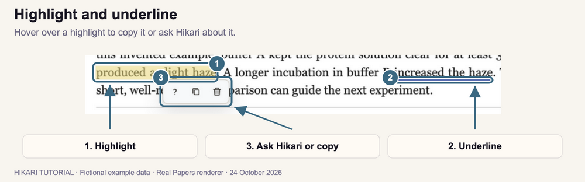

1. Select the text.
2. Click **Highlight** or **Underline** in the menu.
3. To reuse highlighted text later, hover over the highlight and click **Ask Hikari** or **Copy**.
4. To remove a highlight or underline, hover over it and click **Delete** (the trash icon). If it has a comment, the action is labeled **Delete highlight and comment** and removes both.

Highlights and underlines are saved with the paper and appear each time you open it. Click **Undo** in the top bar to restore a deleted annotation.

## 7. Comment on text

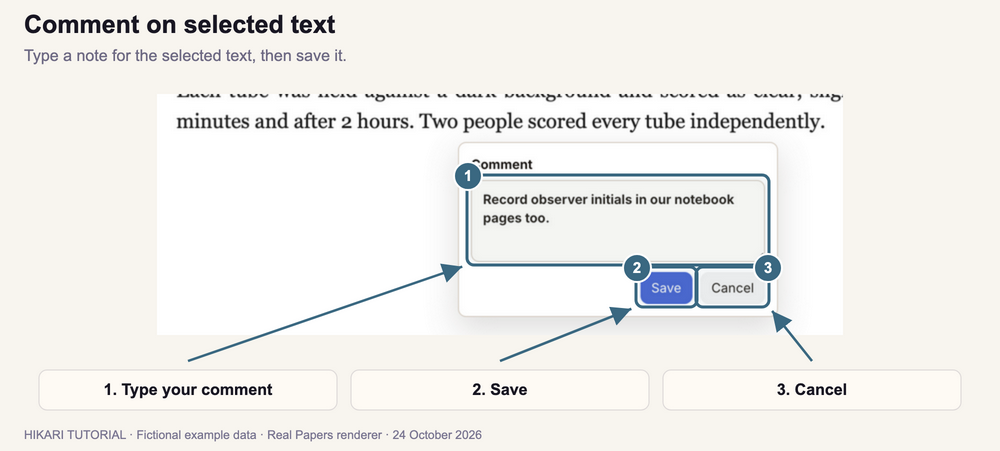

1. Select the text.
2. Click **Add comment** in the menu.
3. Type your note under **Comment**.
4. Click **Save**, or press **⌘ Enter** on macOS or **Ctrl Enter** on Windows. Click **Cancel**, or press **Escape**, to discard it.

Hikari highlights the commented text and saves the comment with the paper. Hover over that highlight to read the saved comment and its author. When you ask Hikari about your papers, it can use your highlights and comments as context. **Paper database** search also finds text in your comments.

## 8. Search for selected text

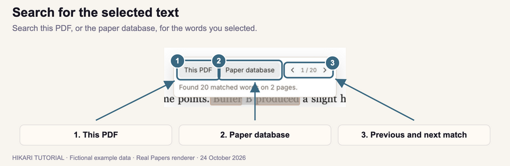

1. Select a word or phrase.
2. Click **Search** in the menu.
3. Click **This PDF** to find it in the open paper. Matches are marked in the PDF.
4. Use the **‹** and **›** arrows to move between matches. The counter shows which match you are on.
5. Or click **Paper database** to count the papers in your library that mention it, including their details and your comments.

Click outside the search box to close it and clear the marks.

## 9. Jump to a section

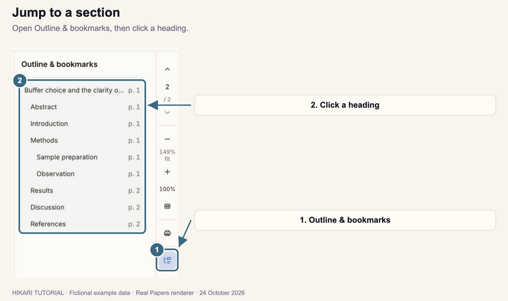

1. Click the **Outline & bookmarks** icon on the right of the PDF.
2. Click a heading to go to its page.
3. Click the icon again to close the panel.

The outline comes from the PDF's own bookmarks. If the PDF has none, the panel reads **No PDF bookmarks found.**

## 10. Check paper details

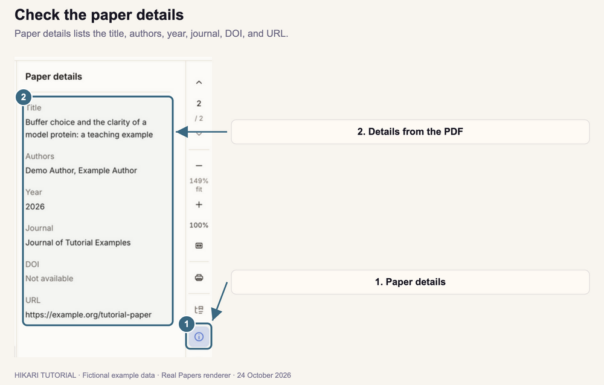

1. Click the **Paper details** icon (an **i** in a circle).
2. Read the **Title**, **Authors**, **Year**, **Journal**, **DOI**, and **URL**.

Details come from the PDF where available. A field reads **Not available** when the PDF does not include it.

## 11. Read the research brief

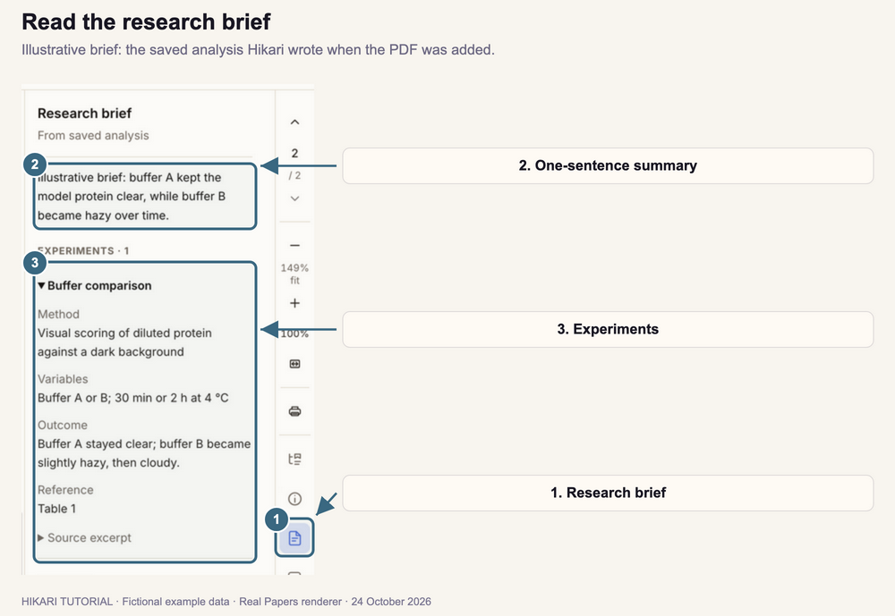

1. Click the **Research brief** icon (a page with lines).
2. Read the one-sentence summary at the top.
3. Under **Experiments**, click an experiment to expand its method, variables, outcome, and reference. Click **Source excerpt** to see the supporting text.
4. Scroll down for **Sections** and **Notable claims**.

The brief is written when the PDF is added while AI is connected. If there is none, the panel reads **No saved research brief for this paper.** **Check the brief against the paper before you rely on it.**

## 12. Ask Hikari about a paper

Asking Hikari requires an AI connection. If the controls are missing, connect Codex in **Settings**, then return to Papers.

1. Open the paper.
2. Click the chat icon at the bottom of the icons on the right (**Ask Hikari**).
3. Type your question and send it. Hikari answers using the open paper.
4. To ask about one passage, select it and click **Ask Hikari** in the selection menu. The selected text is added to the chat.
5. To ask about a figure, click **Select area from paper** below the message box, then drag across the part of the page to attach.

Click the chat icon again to close the chat. Check answers against the paper before relying on them.

---

[Previous tutorial: Notebook](../03-notebook/index.html) · [Next tutorial: Samples](../05-samples/index.html)
