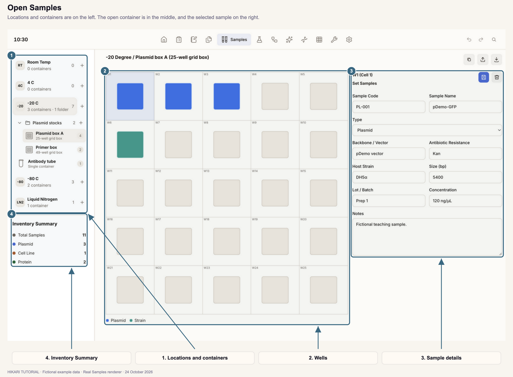
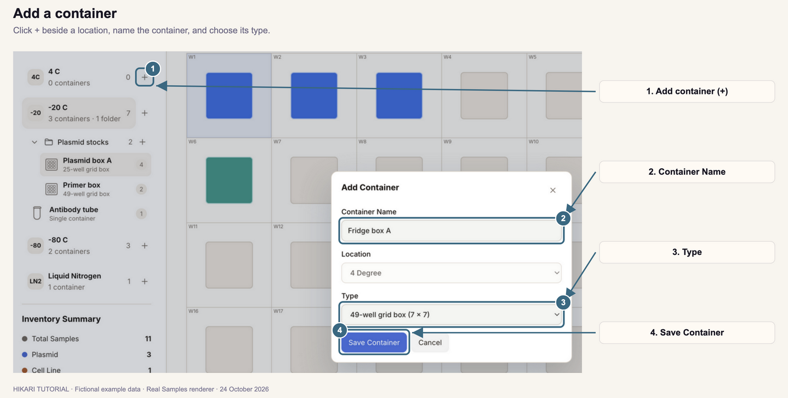
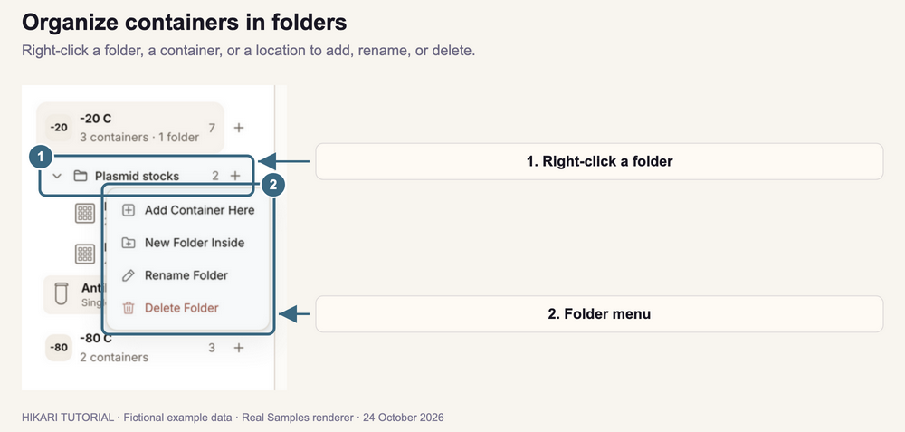
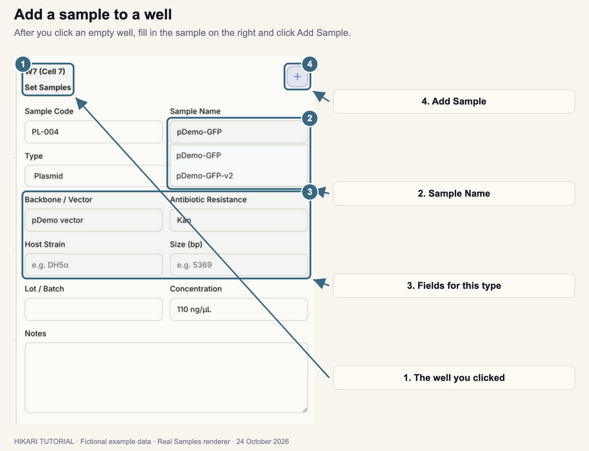
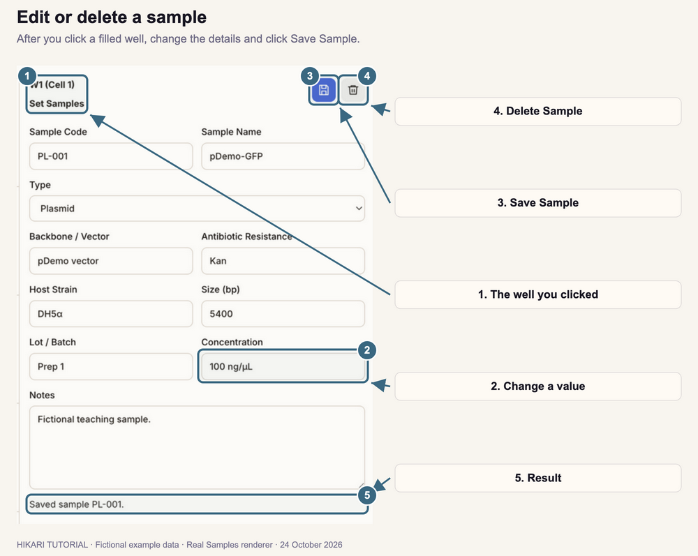
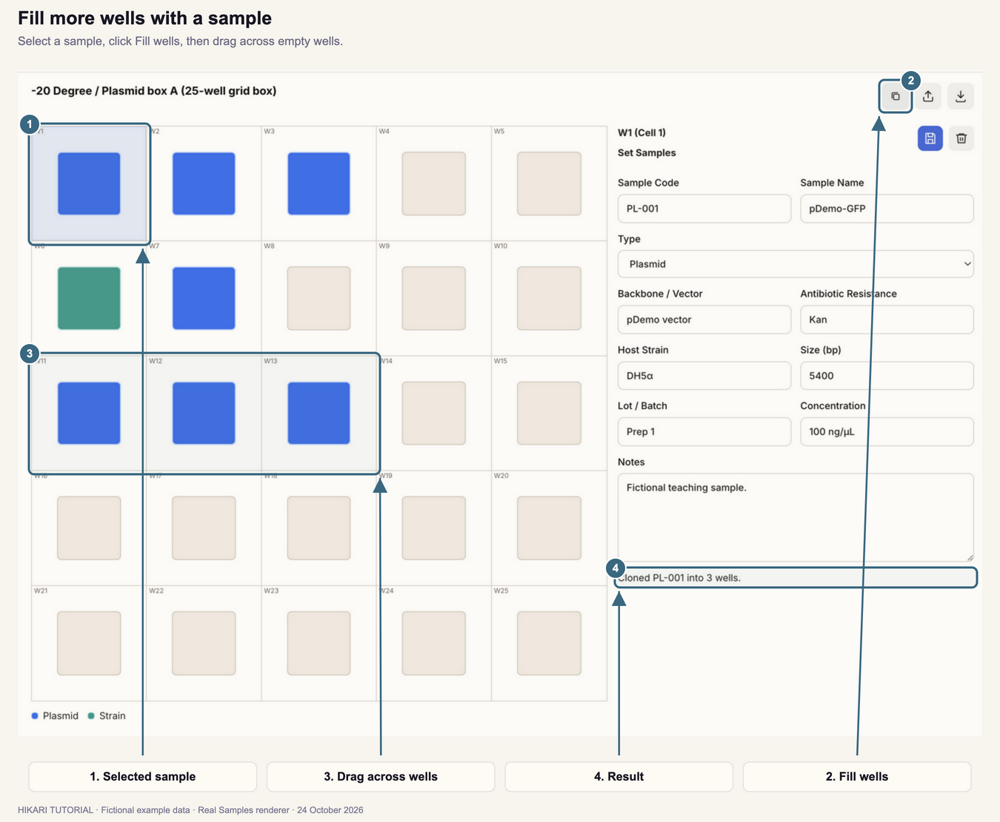
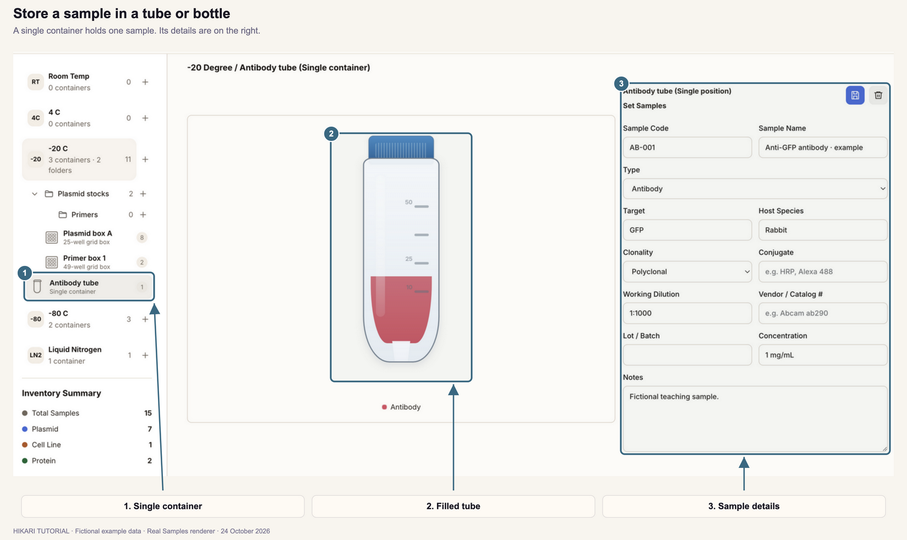
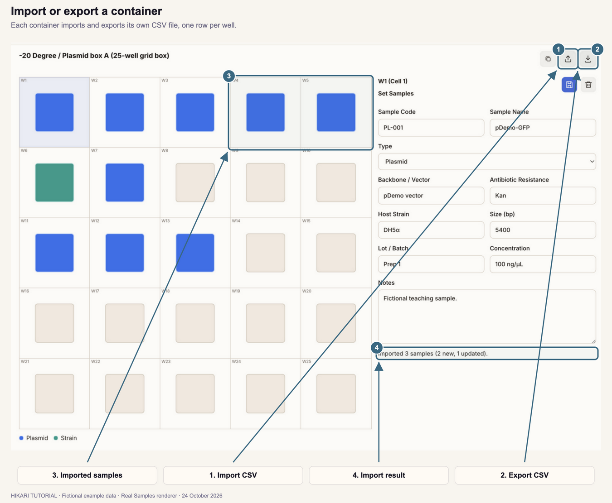
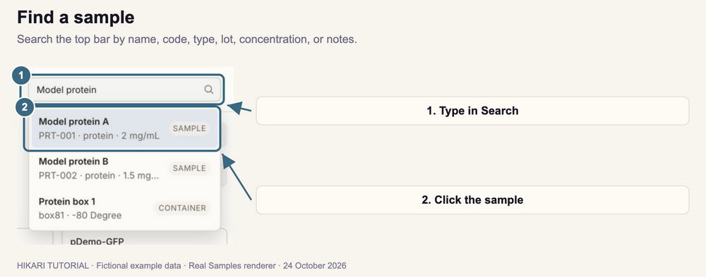

# Samples

How to record where each sample is stored, in boxes, plates, and tubes.

**Follow the numbered steps and the highlighted controls in each screenshot.**

Screenshots use fictional example samples.

## 1. Open Samples

1. Click **Samples** in the top navigation bar.
2. If it is outside the visible navigation bar, open **More modules** and select **Samples**.
3. Click a storage location in the left panel, such as **-20 C**. Its folders and containers appear below it.
4. Click a container to open it. Its wells appear in the middle.
5. Click a well to see its sample on the right.

Each location shows how many containers it has and how many samples they hold. Filled wells are colored by sample type; the legend below the wells shows which color is which. Hover over a well to see its samples.

**Inventory Summary** counts all your samples, and the plasmids, cell lines, and proteins among them.

Hikari saves each container, with its samples, as its own file in the **Samples** folder of your workspace folder.

## 2. Add a container

1. Click **+** beside a location.
2. Enter a **Container Name**, such as **Box A**.
3. Choose its **Type**.
4. Click **Save Container**.

The container opens, ready for samples.

| Type | Positions |
| --- | --- |
| **25-well**, **49-well**, **64-well**, **81-well**, or **100-well grid box** | Square grids. Wells are numbered row by row: **W1**, **W2**, and so on. |
| **Custom grid box** | Enter **Rows** and **Columns**, from 1 to 24 each. |
| **96-well plate** | Wells **A1** to **H12**. |
| **Single container (tube/bottle)** | One sample (Section 8). |

The container is added to the location whose **+** you clicked. To add it inside a folder, use the folder's **+** instead (Section 3).

## 3. Organize containers in folders

### Add a folder

1. Right-click a location, or an existing folder.
2. Choose **New Folder Inside**.
3. Enter a **Folder Name** and click **Create Folder**.

Click the arrow beside a folder to collapse or expand it. Click **+** on a folder's row, or choose **Add Container Here** from its menu, to add a container inside it.

### Rename or delete

| To | Do this |
| --- | --- |
| Rename a container, folder, or location | Double-click its name, type the new name, and press **Enter**. Or right-click it and choose **Rename**. |
| Delete a folder | Right-click it and choose **Delete Folder**. Its containers and folders move up one level; no samples are deleted. |
| Delete a container | Right-click it and choose **Delete Container**. **The samples in it are deleted too.** |

Deletions happen at once, without a confirmation. Click **Undo** in the top bar to restore a deleted container and its samples.

## 4. Add a sample to a well

1. Open a container and click an empty well.
2. Enter a **Sample Code**, such as **PL-004**, or leave it blank to have one created for you.
3. Enter the **Sample Name**.
4. Choose the sample's **Type**. Fields for that type appear below it (Section 5).
5. Optional: enter the type's fields, **Lot / Batch**, **Concentration**, and **Notes**.
6. Click **+** (**Add Sample**) at the upper right.

The well fills with the type's color, and **Created sample** appears below the form.

Every sample needs a name and a code that no other sample uses. If the code is already taken, Hikari shows **Sample code … already exists.** Spaces in a code become hyphens, and characters other than letters, numbers, `.`, `_`, and `-` are removed.

For a **Plasmid**, Hikari suggests names from your **DNA** library as you type. Click a suggestion to use it, or keep typing.

## 5. Choose a sample type

Each type adds its own fields to the form.

| Type | Fields |
| --- | --- |
| **Plasmid** | Backbone / Vector, Antibiotic Resistance, Host Strain, Size (bp) |
| **Cell Line** | Species, Culture Medium, Mycoplasma Test (date) |
| **Strain** | Species, Antibiotic Resistance, Genotype |
| **Antibody** | Target, Host Species, Clonality, Conjugate, Working Dilution, Vendor / Catalog # |
| **Protein** | MW (kDa), Tag, Buffer, Expression Host |
| **Chemical** | CAS #, MW (g/mol), Purity, Vendor / Catalog #, and a chemical structure |
| **Primer** | Sequence (5'→3'), Direction, Tm (°C), Target |
| **Other** | No extra fields |

If you change a sample's type, the old type's fields are not kept when you save.

To attach a structure to a **Chemical** sample:

1. Copy the structure as MOL, SDF, or SMILES, for example from your chemical drawing software.
2. Click **Paste Structure** in the sample form.

For a new sample, the structure is saved when you click **Add Sample**. For an existing sample, it is saved at once.

To rename a type or add your own, see Section 11.

## 6. Edit or delete a sample

1. Click a filled well. Its sample opens on the right.
2. Change any field.
3. Click the disk icon (**Save Sample**). **Saved sample** appears below the form.

Changes are kept only when you click **Save Sample**. If you click another well first, they are discarded.

To delete the sample, click the trash icon (**Delete Sample**). The well becomes empty at once. Click **Undo** in the top bar to restore it.

When a well holds more than one sample, a number appears on the well. Choose the sample under **Linked Sample** to see or edit it.

## 7. Fill more wells with a sample

Use this to record aliquots of one sample across a box or plate.

1. Click the well that holds the sample.
2. Click the two-squares icon (**Fill wells**) at the upper right of the container.
3. Press on an empty well and drag across the other wells to fill. Release the mouse button.

Each well you drag across gets a copy of the sample, and **Cloned … into … wells** appears below the form. Each copy gets its own code: the original code followed by **-2**, **-3**, and so on, such as **PL-001-2**. A well that already holds a sample gets a second one.

You can then edit each copy on its own, for example to record its own **Lot / Batch**.

To cancel before dragging, click **Fill wells** again.

## 8. Store a sample in a tube or bottle

Use a **Single container (tube/bottle)** for a sample that is stored on its own, such as an antibody vial.

1. Add a container and choose **Single container (tube/bottle)** as its **Type** (Section 2).
2. Click the container in the left panel.
3. Fill in the sample on the right and click **+** (**Add Sample**).

The tube fills with the type's color. To change or delete the sample, use **Save Sample** or **Delete Sample**, as for a well (Section 6).

## 9. Import or export a container

Each box or plate can be exported to a CSV file, edited in a spreadsheet, and imported again.

### Export

1. Open the container.
2. Click the download icon (**Export CSV**) at the upper right.
3. Choose where to save the file.

The file has one row per well. Empty wells appear as rows with only the well label, ready to fill in.

### Import

1. Open the container and click any well, so the result can appear in the sample form.
2. Click the upload icon (**Import CSV**) and choose the file.
3. Read the result below the sample form, such as **Imported 3 samples (2 new, 1 updated).**

The file needs a **well** column, with labels such as **W4** or **A1**. Other columns are **code**, **name**, **type**, **lot**, **concentration**, **notes**, and one column for each type field, such as **backbone** or **host_species**. The easiest way to get every column is to export a container first.

- A row whose **code** matches an existing sample updates that sample and moves it to the row's well.
- A row with a new or blank code adds a sample.
- Rows without a **name** are ignored. Rows whose well is not in this container are skipped and counted in the result.

Chemical structures are not included in CSV files.

## 10. Find a sample

1. Click the magnifier at the upper right of the top bar.
2. Type part of the sample's name or code. You can also search by type, lot, concentration, or notes.
3. Click a result labeled **Sample**.

Samples opens the container that holds the sample, with its well selected.

## 11. Manage locations and sample types

Hikari starts with five locations: **Room Temp**, **4 C**, **-20 C**, **-80 C**, and **Liquid Nitrogen**.

### In Samples

- To rename a location, double-click it, or right-click it and choose **Rename Folder**.
- To remove a location, right-click it and choose **Delete Folder**. This works only for an empty location, and never for your last one.

### In Settings

1. Open **Settings** and select **Locations & samples**.
2. Under **Sample storage**, type a name in **Add sample storage location** and click **+** to add a location. Edit a name and press **Enter** to rename it. Click **×** to remove an empty location.
3. Open **Sample type names** to rename a type, such as **Cell Line**. To add your own type, enter its name in **Add sample type** and click **+**. A type you added can be removed when no sample uses it.

Types you add have no extra fields.

## 12. Use samples in notebook pages

Samples you record here can be linked to notebook pages:

- In a protocol field for a sample, such as **[protein]**, type part of the sample's name or code and choose it. See [Fill in the protocol fields](../03-notebook/index.html#4-fill-in-the-protocol-fields).
- To record a new sample while you work, use **Add samples** in the bench toolbox. See [Link samples, gels, and assays](../03-notebook/index.html#9-link-samples-gels-and-assays).

A sample added from a notebook page is stored in the container and position you choose, and appears here.

---

[Previous tutorial: Papers](../04-papers/index.html) · [Next tutorial: Chemicals](../06-chemicals/index.html)
