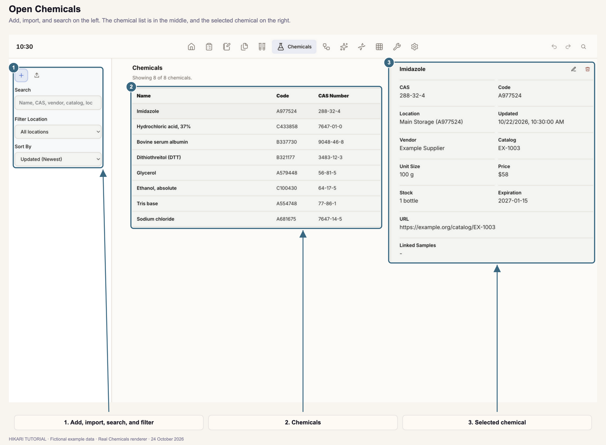
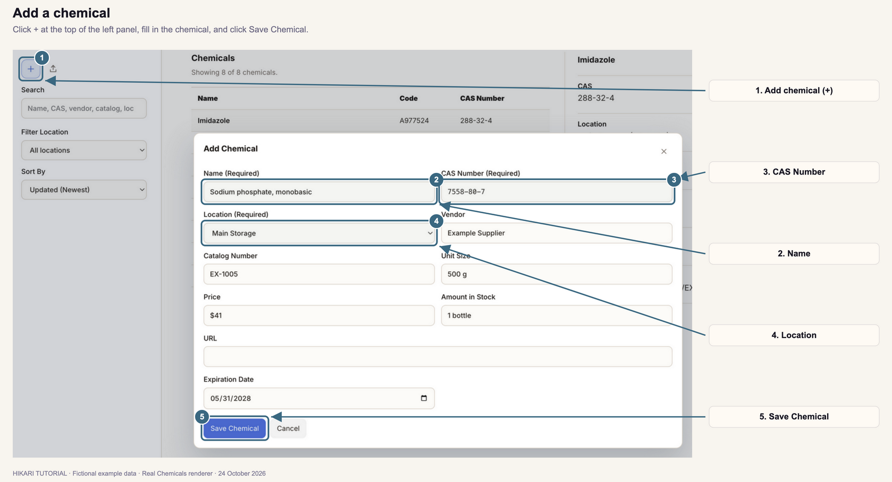
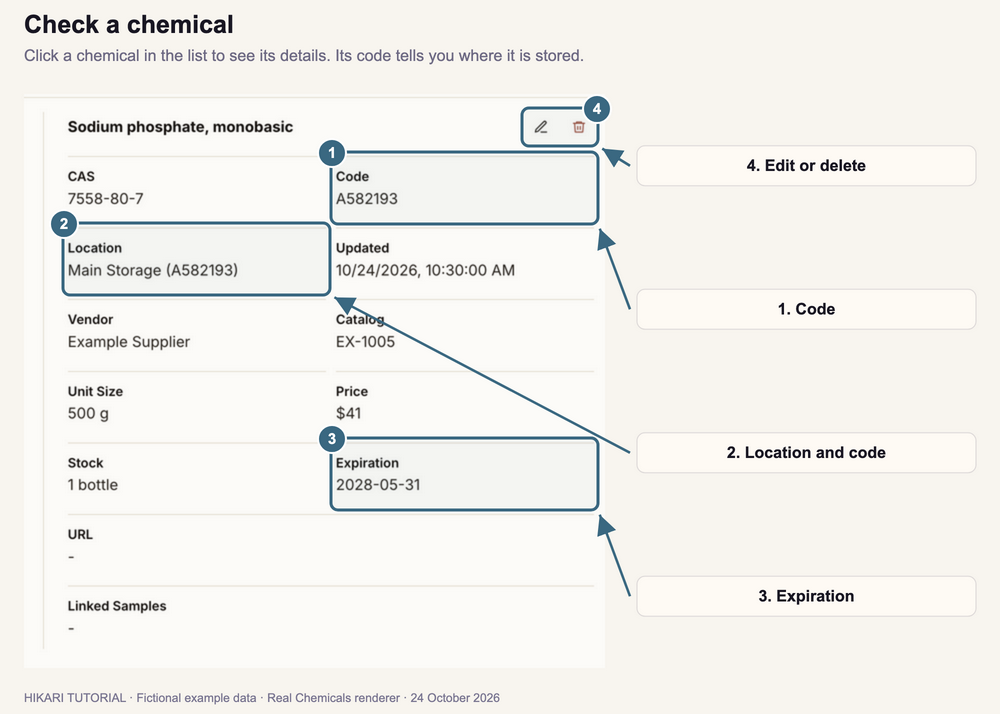
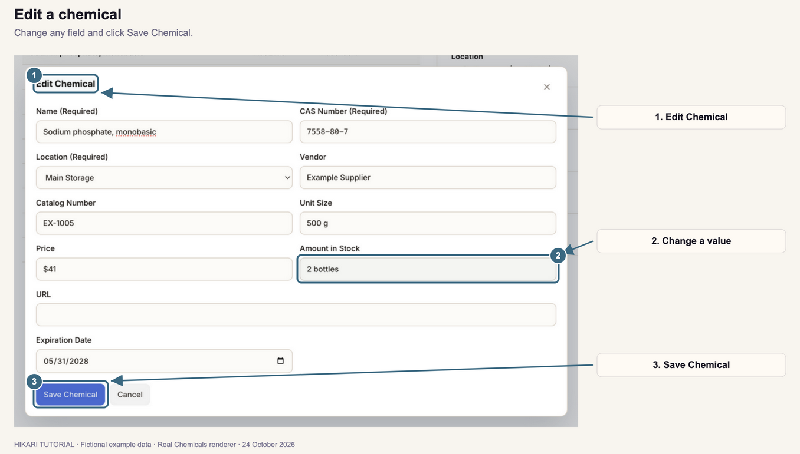
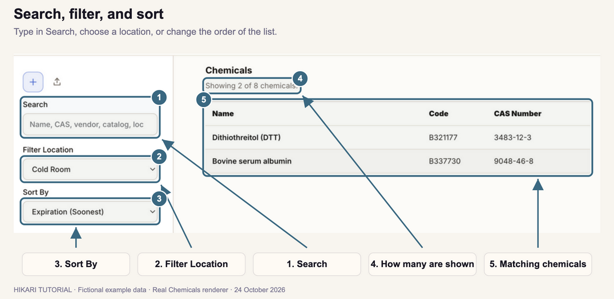
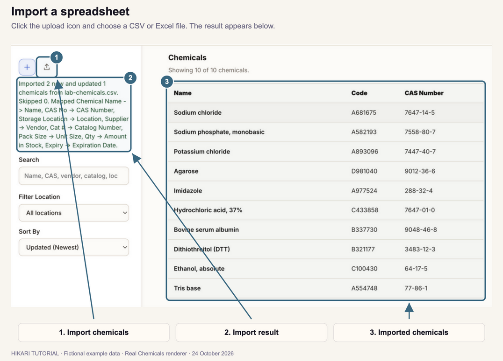

# Chemicals

How to keep track of the lab's chemicals and reagents: where each one is stored, how much is left, and when it expires.

**Follow the numbered steps and the highlighted controls in each screenshot.**

Screenshots use fictional example records. Supplier names, catalog numbers, and prices are examples.

## 1. Open Chemicals

1. Click **Chemicals** in the top navigation bar.
2. If it is outside the visible navigation bar, open **More modules** and select **Chemicals**.
3. Click a chemical in the list. Its details appear on the right.

The list shows each chemical's **Name**, **Code**, and **CAS Number**. Above it, Hikari shows how many chemicals match your search, such as **Showing 8 of 8 chemicals.**

Hikari saves the chemical inventory in your workspace folder.

## 2. Add a chemical

1. Click **+** (**Add chemical**) at the top of the left panel.
2. Enter the **Name**, such as **Sodium phosphate, monobasic**.
3. Enter the **CAS Number**, such as **7558-80-7**.
4. Choose the **Location** where it is stored.
5. Optional: fill in the other fields.
6. Click **Save Chemical**.

The chemical appears in the list with its code, and its details open on the right.

| Field | What to enter |
| --- | --- |
| **Name**, **CAS Number**, **Location** | Required. |
| **Vendor**, **Catalog Number** | Where to reorder it. |
| **Unit Size** | The size of one bottle or pack, such as **500 g**. |
| **Price** | The price, as you want it recorded, such as **$41**. |
| **Amount in Stock** | How much you have, such as **2 bottles**. |
| **URL** | The product page. |
| **Expiration Date** | Choose a date. |

To close the dialog without saving, click **Cancel**, click outside it, or press **Escape**.

To add a location to the **Location** list, see Section 7.

## 3. Check a chemical and its code

1. Click the chemical in the list.
2. Read its details on the right: **CAS**, **Code**, **Location**, **Vendor**, **Catalog**, **Unit Size**, **Price**, **Stock**, **Expiration**, and **URL**.

Hikari gives every chemical a code, such as **A582193**, to write on its label:

- The letter is its location. Each location gets its own letter the first time a chemical is stored there: **A**, **B**, **C**, and so on.
- The number comes from its CAS number. A chemical keeps the same number when you move it, and chemicals with the same CAS number in the same location share a code.
- An imported chemical without a CAS number gets the next free number for its location instead.

## 4. Edit or delete a chemical

To edit a chemical:

1. Select it in the list.
2. Click the pencil icon (**Edit chemical**) above its details.
3. Change any field, such as **Amount in Stock**.
4. Click **Save Chemical**.

If you change its **Location**, the letter in its code changes to the new location's letter.

To delete a chemical, select it and click the trash icon (**Delete chemical**). **It is deleted at once, without a confirmation.** Click **Undo** in the top bar to restore it.

## 5. Search, filter, and sort

1. Type in **Search**. The list shows chemicals whose name, CAS number, vendor, catalog number, location, code, or unit size contains what you type.
2. To show one location, choose it under **Filter Location**. Choose **All locations** to show every location again.
3. To change the order, choose an option under **Sort By**.

| Sort By | Order |
| --- | --- |
| **Updated (Newest)** or **(Oldest)** | By when each chemical was last saved. |
| **Name (A-Z)** or **(Z-A)** | Alphabetical. |
| **Location Number (Low-High)** or **(High-Low)** | By code: grouped by location letter, then by number. |
| **Expiration (Soonest)** or **(Latest)** | By expiration date. Chemicals without a date come last. |

Use **Expiration (Soonest)** to see which chemicals expire next.

## 6. Import a spreadsheet

Use this to add many chemicals at once, or to update amounts from an order list.

1. Prepare a CSV or Excel file (.csv, .xls, or .xlsx) with column names in the first row and one chemical per row.
2. Click the upload icon (**Import chemicals**) at the top of the left panel.
3. Choose the file.
4. Read the result below the buttons, such as **Imported 2 new and updated 1 chemicals from lab-chemicals.csv.** The result also lists which column was used for each field.

Hikari recognizes common column names, for example:

| Field | Column names |
| --- | --- |
| Name | **Name**, **Chemical Name**, **Compound**, **Reagent**, **Product Name** |
| CAS Number | **CAS**, **CAS No**, **CAS Number** |
| Location | **Location**, **Storage Location**, **Shelf**, **Freezer**, **Cabinet** |
| Vendor | **Vendor**, **Supplier**, **Manufacturer**, **Brand** |
| Catalog Number | **Catalog Number**, **Cat #**, **SKU**, **Product Number** |
| Unit Size | **Unit Size**, **Pack Size**, **Size** |
| Price | **Price**, **Cost**, **Unit Price** |
| Amount in Stock | **Stock**, **Qty**, **Quantity**, **On Hand** |
| URL | **URL**, **Link**, **Website** |
| Expiration Date | **Expiration**, **Expiry**, **Exp Date**, **Use By** |

When AI is connected, Hikari asks it to match any columns it does not recognize. Otherwise, those columns are ignored.

How rows are imported:

- A row updates an existing chemical with the same CAS number. If there is none, it updates one with the same catalog number (and vendor, if given), and then one with the same name and location. Any other row adds a new chemical.
- When a row updates a chemical, empty cells keep the values already recorded.
- Rows without a name are skipped. The file needs a name column.
- A location that is not in your list yet is added to it. Rows without a location go to a location named **Imported**.
- Dates can be written as **2028-03-01**, as Excel dates, or in other common formats.

## 7. Set up storage locations

Hikari starts with three chemical locations: **Main Storage**, **Cold Room**, and **Fume Hood**.

1. Open **Settings** and select **Locations & samples**.
2. Under **Inventory locations**, type a name in **Add approximate location**, such as **Shelf B**.
3. Click **Add Location**.

The location appears in the **Location** list when you add or edit a chemical, and under **Filter Location**. To remove a location from these lists, click **Delete** beside it.

These locations are separate from the sample storage locations in Samples. See [Samples: Manage locations and sample types](../05-samples/index.html#11-manage-locations-and-sample-types).

## 8. Use chemicals elsewhere

- **Buffer preparer:** chemicals you record here are suggested as you type an ingredient in the **Buffer preparer**, in a notebook page's bench toolbox or in **Tools**. See [Prepare buffers and reactions](../03-notebook/index.html#8-prepare-buffers-and-reactions).
- **Top-bar search:** click the magnifier at the upper right and type a chemical's name, CAS number, vendor, catalog number, location, unit size, or amount. Click a result labeled **Chemical** to open it here.
- **Ask Hikari:** when AI is connected, ask questions such as "Do we have imidazole?" or "Where is the NaCl?" Hikari answers from your chemical inventory.

---

[Previous tutorial: Samples](../05-samples/index.html) · [Next tutorial: Workflows](../07-workflows/index.html)
