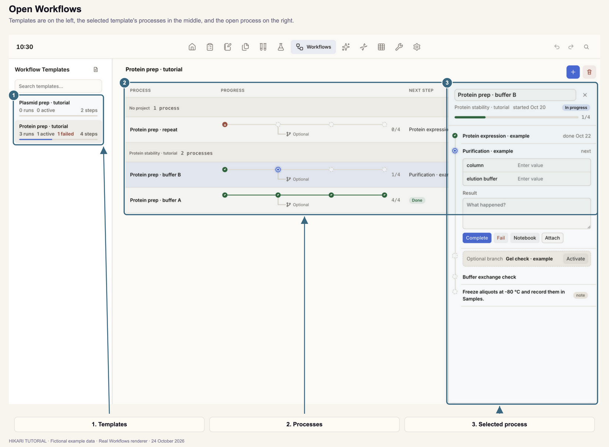
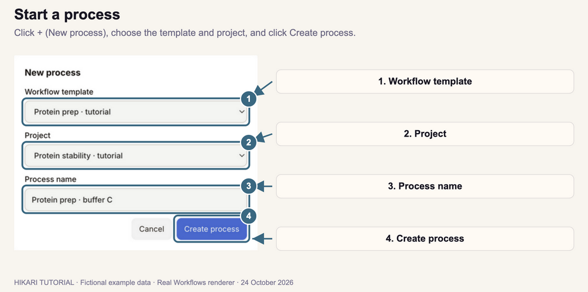
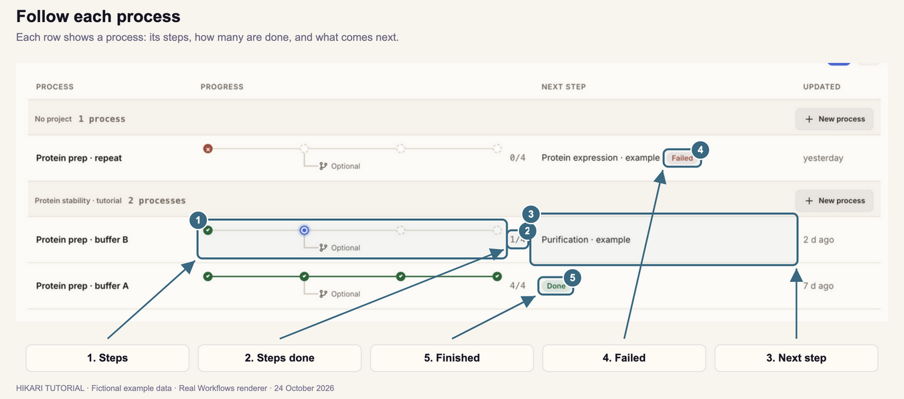
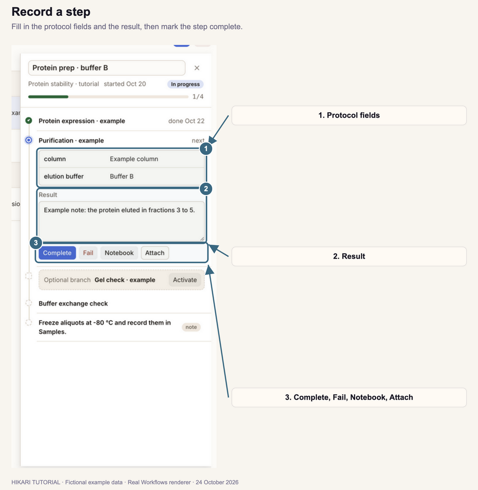
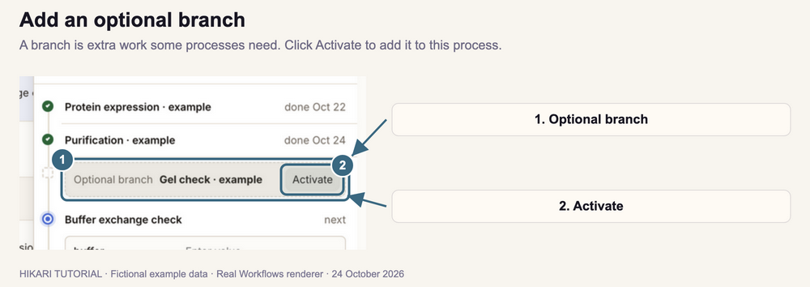
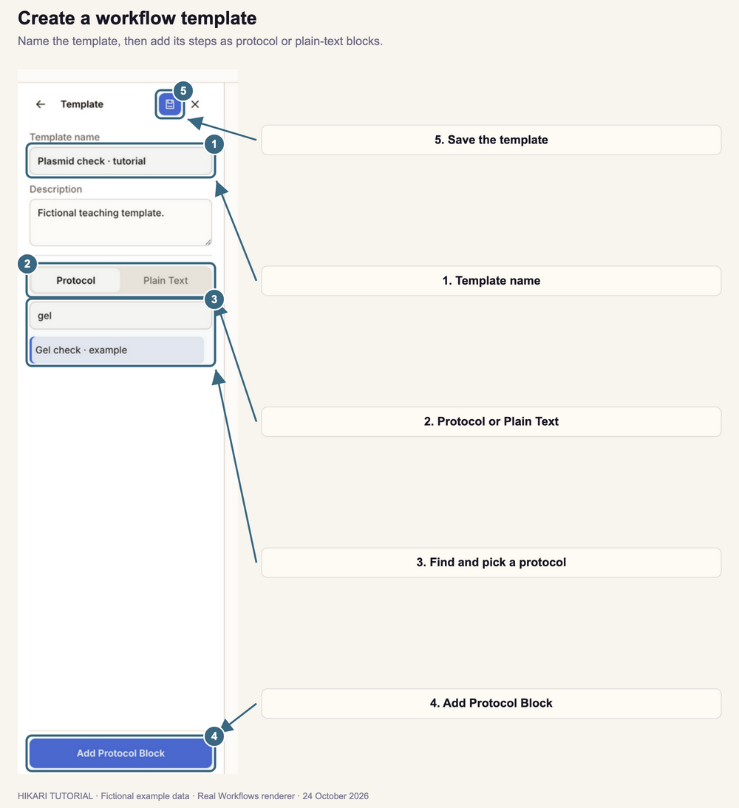
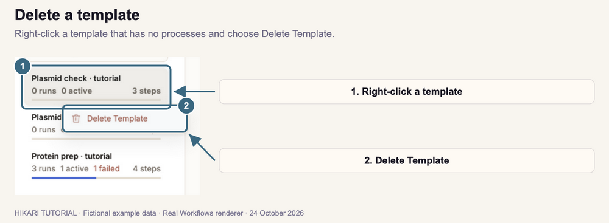
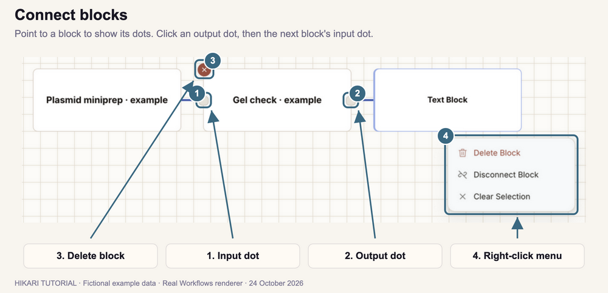

# Workflows

How to run multi-step work, such as expressing and purifying a protein, as a series of protocols: start a process from a template, record each step, and follow every process's progress in one place.

**Follow the numbered steps and the highlighted controls in each screenshot.**

Screenshots use fictional example records.

A **template** is the plan: its steps and the order they go in. A **process** is one run of that plan, such as one protein prep. You can start many processes from the same template.

## 1. Open Workflows

1. Click **Workflows** in the top navigation bar.
2. If it is outside the visible navigation bar, open **More modules** and select **Workflows**.
3. Under **Workflow Templates** on the left, click a template. Its processes appear on the right.
4. Click a process to open it beside the list.

Each template on the left shows how many processes (runs) it has, how many are in progress (active) or have a failed step, and its number of steps. To find a template, type in **Search templates**.

## 2. Start a process

1. Select the template on the left.
2. Click **+** (**New process**) at the upper right.
3. Check the **Workflow template**.
4. Choose a **Project**, or leave **No project**.
5. Optional: enter a **Process name**. If you leave it blank, the process is named after the template, such as **Protein prep · tutorial 4**.
6. Click **Create process**.

The process appears under its project and opens at its first step.

To start a process in a particular project, click **New process** on that project's heading in the list. You can also start one from Notebook: see [Start a new experiment](../03-notebook/index.html#3-start-a-new-experiment).

## 3. Follow each process

Processes are grouped by project. Each row shows:

| Column | What it shows |
| --- | --- |
| **Process** | The process name. |
| **Progress** | One dot per step, in order, and how many steps are done, such as **1/4**. |
| **Next step** | The step to do next. **Failed** or **In progress** appears beside it when that applies; **Done** when every step is complete. |
| **Updated** | When the process last changed. |

| Dot | Meaning |
| --- | --- |
| Green check | Complete. |
| Blue ring | The next step. |
| Red cross | Failed. |
| Dashed circle | Not done yet. |
| **Optional** fork | An optional branch starts here (Section 5). |

Hover over a dot to see its step. Click a dot to open that step.

A step stays locked until the steps before it are complete.

## 4. Record a step

1. Click a process in the list. It opens on the right at its next step.
2. Fill in the protocol fields, such as **column** and **elution buffer**. These are the fields of the step's protocol; see [Add reusable fields to steps](../02-protocols/index.html#4-add-reusable-fields-to-steps).
3. Type what happened under **Result**.
4. Click **Complete**.

Values and results are saved when you click outside the field. A plain-text step, labeled **note**, shows its instruction instead of protocol fields.

When you click **Complete**, the step gets a green check and the next step opens. Hikari also saves the step as an **Executed** notebook page in the process's project, with its fields and result.

The other buttons:

| Button | What it does |
| --- | --- |
| **Fail** | Marks the step failed. Click **Retry** to try it again. |
| **Reopen** | Shown on a completed step. Marks it not done again. |
| **Notebook** | Opens the step's notebook page, to add notes, tables, or samples. Until the step is complete, the page is **Planned**. |
| **Attach** | Choose result files. Hikari copies them into the process's folder in your workspace and lists them under the step. |

Click a step's name to show or hide its fields. To close the process, click **×** at the upper right of its panel.

## 5. Add an optional branch

Some templates include extra steps that only some processes need, such as an additional gel check.

1. Open the process.
2. Find the **Optional branch** card, after the step it starts from.
3. Click **Activate**.

The branch's steps are added to the process, and to its count of steps. To remove the branch again, open its first step and click **Skip branch**. This is possible only while none of the branch's steps are complete.

## 6. Rename or delete a process

- To rename a process, open it, click its name at the top of its panel, type the new name, and click outside the field.
- To delete a process, open it and click the trash icon (**Delete process**) at the upper right. **It is deleted at once, without a confirmation.** Click **Undo** in the top bar to restore it. Notebook pages made from its steps are kept.

## 7. Create a workflow template

1. Click the document icon (**Template editor**) beside **Workflow Templates**.
2. Enter a **Template name**, and optionally a **Description**.
3. Add each step as a block:
   - For a protocol, keep **Protocol** selected, type part of the protocol's name under **Search protocols**, click the protocol, and click **Add Protocol Block**.
   - For an instruction, select **Plain Text**, type it, such as **Send the plasmid for sequencing.**, and click **Add Text Block**.
4. Connect the blocks in order in the **Graph Editor** (Section 8).
5. Click the disk icon (**Save Current Graph**).
6. Click the back arrow at the top of the left panel to return to your templates.

A template needs a name and at least one block. To leave without saving, click **×** (**Cancel**).

A saved template cannot be edited. To change the steps, create a new template, then delete the old one. Processes you already started keep their own copy of the steps.

### Delete a template

1. Right-click the template under **Workflow Templates**.
2. Choose **Delete Template**.

The template is deleted at once. Click **Undo** in the top bar to restore it.

**Delete Template** is available only for a template with no processes, because processes are listed under their template. Delete its processes first (Section 6).

## 8. Connect and arrange blocks

1. Point to a block. Its input dot appears on the left, and its output dot on the right.
2. Click the output dot of the first block.
3. Click the input dot of the next block. A line connects them.

| To | Do this |
| --- | --- |
| Move a block | Drag it by its title. |
| Delete a connection | Click the line, or right-click it and choose **Delete Connection**. |
| Delete a block | Click the red **×** at its upper left, or right-click it and choose **Delete Block**. |
| Select several blocks | Drag across an empty part of the graph, or hold **Shift** and click each block. Right-click one of them to delete or disconnect them all. |
| Cancel connecting | Press **Escape**. |

### How Hikari orders the steps

The steps run from the top-left block along its connections. Where a block connects to more than one next block, the one at the most similar height continues the main steps. Each other connection starts an **optional branch** (Section 5).

Place the main steps in a row from left to right, and put optional steps below the step they follow.

---

[Previous tutorial: Chemicals](../06-chemicals/index.html)

[Next tutorial: DNA](../08-dna/index.html)
