# DNA

How to open, edit, compare, and organize DNA sequences.

**Follow the numbered steps and the highlighted controls in each screenshot.**

Screenshots use fictional teaching sequences. They demonstrate the controls rather than a validated experimental construct.

## 1. Open DNA and find a sequence

1. Click **DNA**, the double-helix icon in the top navigation bar. If it is outside the visible bar, open **More modules** and select **DNA**.
2. Choose **Saved** or **Unsaved** in the library on the left.
3. Expand a folder to see its sequences. Use **Search sequences** to filter names.
4. Click a sequence once to preview its map on the right.
5. Double-click the sequence to open its bases and feature tracks.

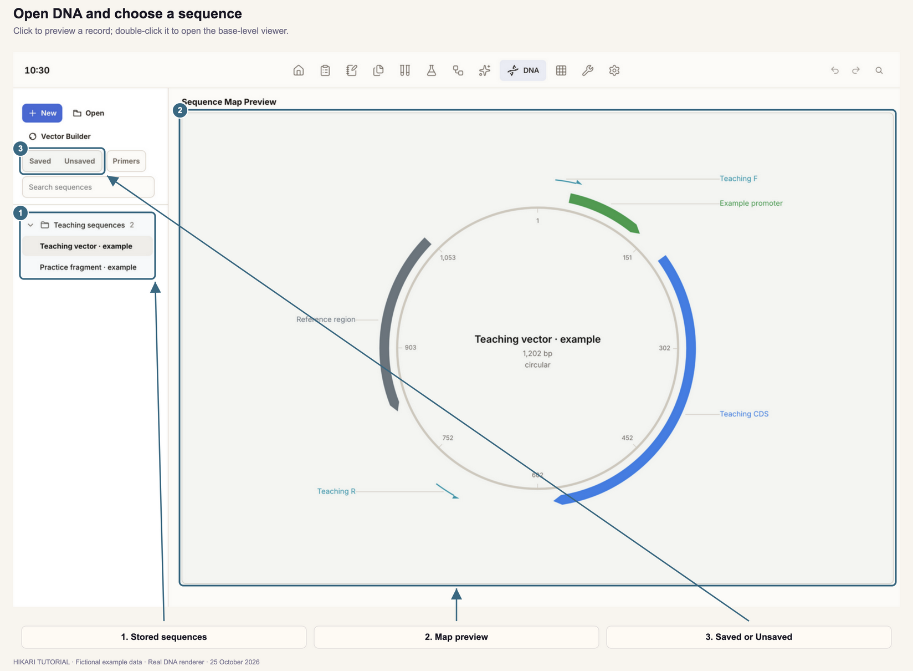

Circular records appear as a ring; linear records appear as a linear map. Hover over feature shapes to identify them. Use a pinch gesture or **Ctrl + scroll** over a map to zoom, then scroll to reach the area you want.

## 2. Load sequence text or a file

### Paste sequence text

1. Click **New** in the left rail.
2. Paste raw DNA, FASTA, FASTQ, or GenBank text into **DNA Sequence**.
3. Choose **Linear** or **Circular** to match the sequence.
4. Click **Load Sequence**.

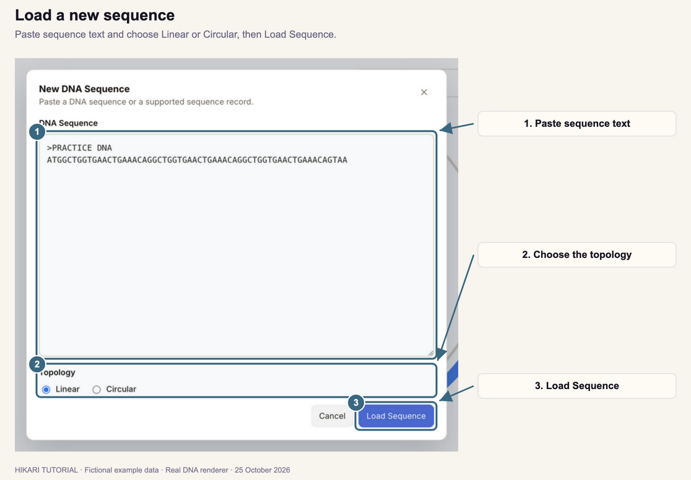

For a short practice record, paste:

```text
>PracticeDNA
ATGGCTGGTGAACTGAAACAGGCTGGTGAACTGAAACAGGCTGGTGAACTGAAACAGTAA
```

### Open a file

1. Click **Open** in the left rail.
2. Choose a supported sequence file, such as GenBank, FASTA, FASTQ, or a plain sequence text file.
3. Read the loaded sequence in the viewer. Use **Save** to keep it in the Saved library.

You can also use [the example GenBank file](examples/teaching-vector.gbk) supplied with this tutorial. It includes a circular map and example features.

## 3. Save a sequence

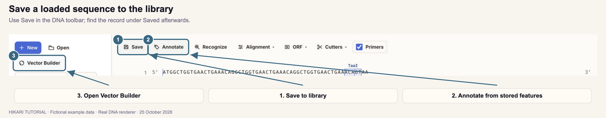

1. Load or open the sequence you want to keep.
2. Click **Save**, the disk icon in the DNA toolbar.
3. Choose **Saved** in the library and find the record.
4. To change its name, right-click its library row and choose **Rename Sequence**. Enter the name and press **Enter**.

**Saved** contains records you explicitly saved. **Unsaved** contains automatically retained working records, including imported GenBank records and newly confirmed designs. Promote a working record to Saved with **Save**.

For records already in the library, annotation and base changes are saved back to the active record. Keep a separate copy of a sequence file when you want to preserve the original before editing.

## 4. Read and select bases

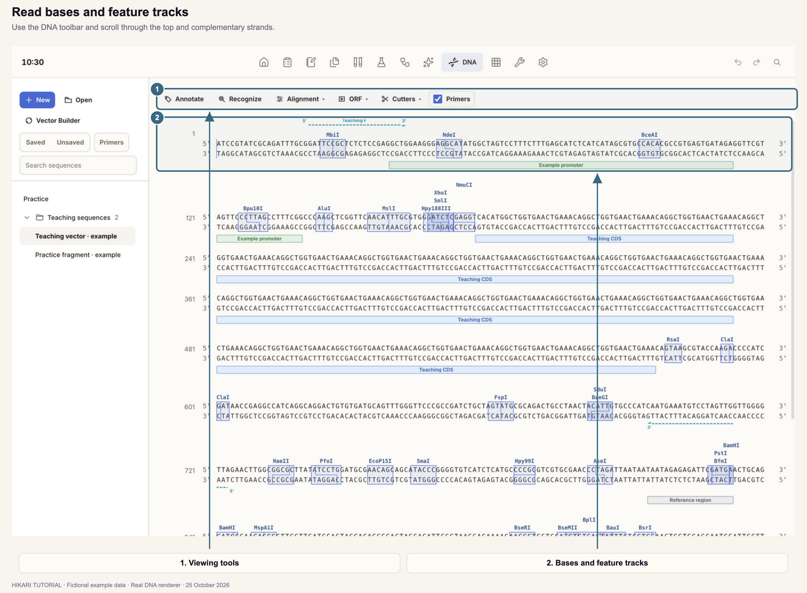

1. Double-click a library record to open the sequence viewer.
2. Scroll through the sequence. Use the coordinate labels to locate bases, and compare the top strand with its complementary strand below.
3. Click a feature bar to select its range and inspect its details.
4. To select a custom range, drag across the bases from the beginning to the end of the range.
5. Right-click the highlighted range to open its actions.

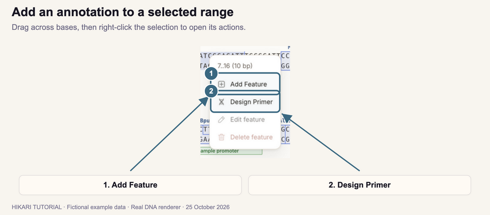

To return to the map-preview library, click **DNA** in the top navigation bar.

## 5. Add and edit annotations

### Add a feature

1. Select a range of bases.
2. Right-click the selection and choose **Add Feature**.
3. Enter a **Name** and **Type**, such as `misc_feature` for a general annotation.
4. Check **Strand**, **Start**, and **End** against the range you intend to annotate.
5. Add a **Description** if useful.
6. Click **Save Feature**.

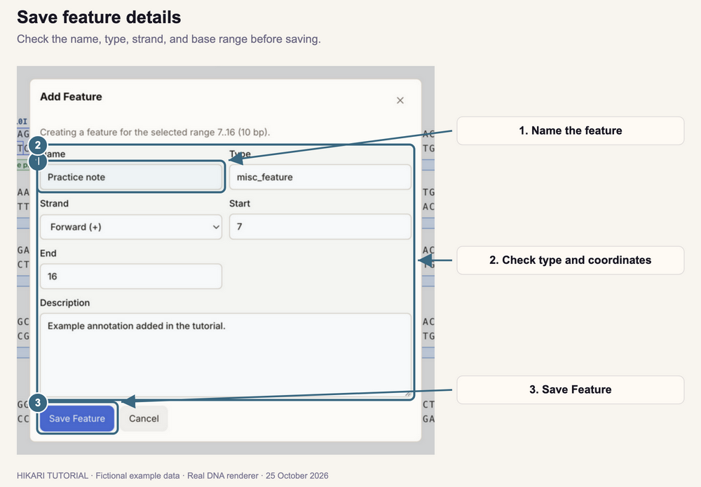

### Change or remove an annotation

1. Select the feature in the sequence tracks.
2. Right-click it and choose **Edit** followed by the feature's name, or **Delete** followed by its name.
3. For an edit, update the metadata and click **Save Feature**.

Deleting a feature removes its annotation. To remove DNA bases, use the sequence-editing controls instead.

### Match features from your library

Click **Annotate** in the DNA toolbar to look for matching DNA and protein features in your stored sequence library. Inspect the resulting annotations before continuing. If no stored features match, the sequence may receive no new annotations.

## 6. Insert, replace, or delete bases

### Insert bases

1. Right-click the base boundary where you want to insert DNA, without leaving a range selected.
2. Choose **Insert Sequence…**.
3. Enter the DNA bases in **Sequence**.
4. Check the edit action and click **Apply**.

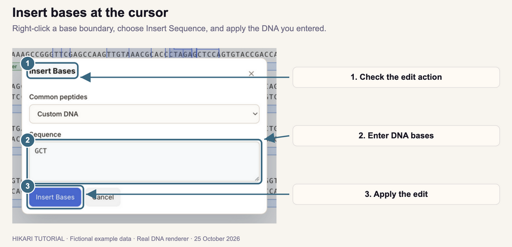

The insertion dialog also offers **Common peptides**. Choose a listed peptide when you want its coding DNA, and check the ORF reference, orientation, and any codon-boundary feedback shown before applying it.

### Replace or delete a range

1. Drag across the bases you want to change.
2. Type replacement DNA to open the replacement dialog, or press **Delete** / **Backspace** to open the deletion dialog.
3. Review the replacement or deletion and apply it.

You can also select the range in **Vector Builder**, right-click it, and use its base-edit actions.

For a circular sequence, right-click a base boundary and choose **Set Sequence Start Here** to make that position the start of the record. This changes the displayed origin and coordinates.

## 7. View ORFs and translation

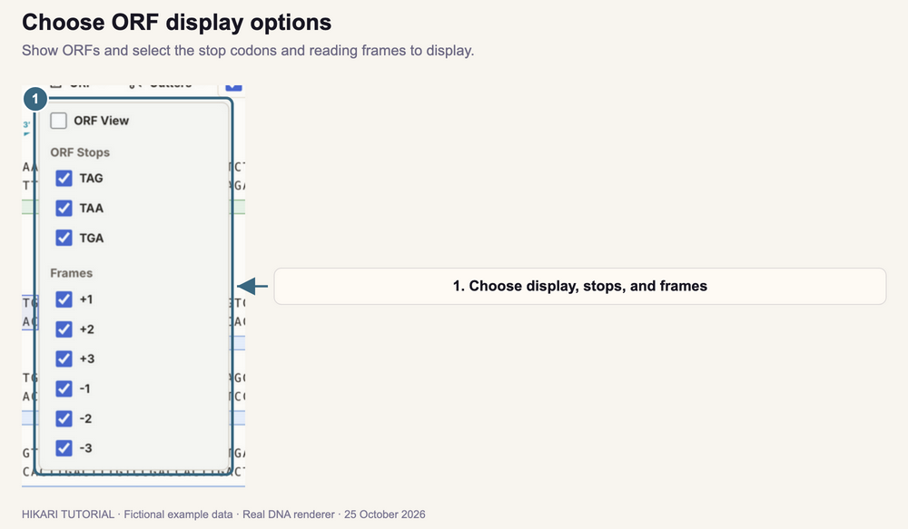

1. Click **ORF View** in the DNA toolbar.
2. Enable the ORF display option.
3. Select the stop codons you want included: **TAG**, **TAA**, and **TGA**.
4. Select the forward and reverse reading frames to display: **+1**, **+2**, **+3**, **−1**, **−2**, and **−3**.
5. Close the menu and select an ORF track to inspect its amino-acid translation.

Use the frame and stop-codon controls to narrow the displayed tracks when the view becomes crowded.

## 8. Show restriction sites and primers

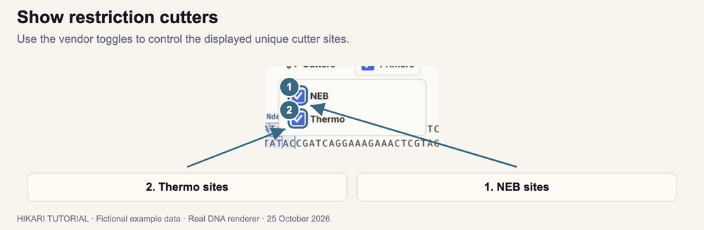

1. Click **Cutters** in the DNA toolbar.
2. Enable **NEB**, **Thermo**, or both to show unique cutter sites from those catalogs.
3. Close the menu and inspect the site labels at their sequence positions.
4. Use the **Primers** checkbox beside the toolbar menus to show or hide primer-binding tracks.

Hover over a displayed primer to inspect its name and sequence. The primer's hover card provides copy and Primer Library controls.

## 9. Align a read to a reference

1. Open the sequence that will serve as the reference.
2. Click **Alignment**, then **Open Sequence**.
3. Choose **Align Copied Sequence** and paste your query, or choose **Align With File** and select the read file. The file picker also supports AB1 / ABI sequencing reads.
4. If the input contains multiple records, choose the intended **Query Record**.
5. Click **Run Alignment**.

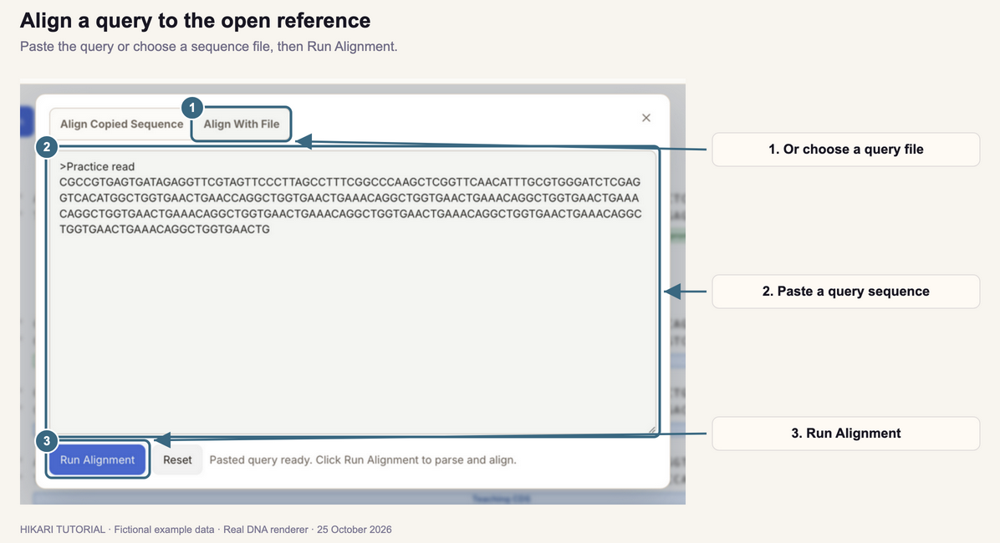

6. Compare the aligned query row with the reference at the same coordinates. Scroll through the aligned region to inspect differences.

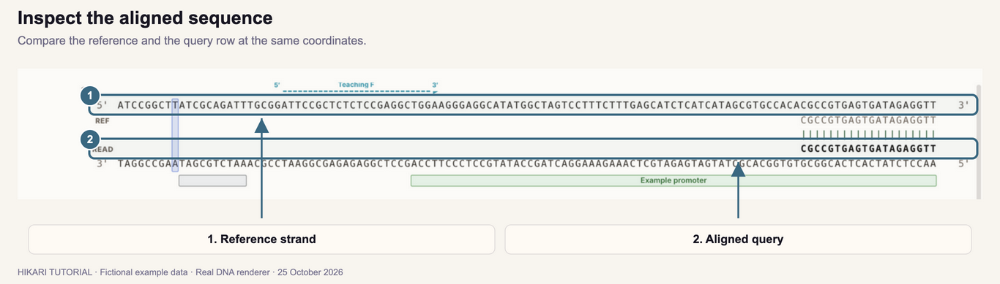

7. Open **Alignment** again to use **Show Alignment**, or choose an available result from **Saved**.

To compare another read, use **Open Sequence** again. Keep the intended reference record open while loading the query.

## 10. Use Vector Builder

1. Open the sequence you want to work on.
2. Click **Vector Builder** in the left rail.
3. Click a feature on the map to locate its range in the **Bases** panel.
4. Pinch or use **Ctrl + scroll** to zoom the map. Scroll the map area to move around it.
5. Use the **Cutters** and **Primers** switches above the map to control those tracks.

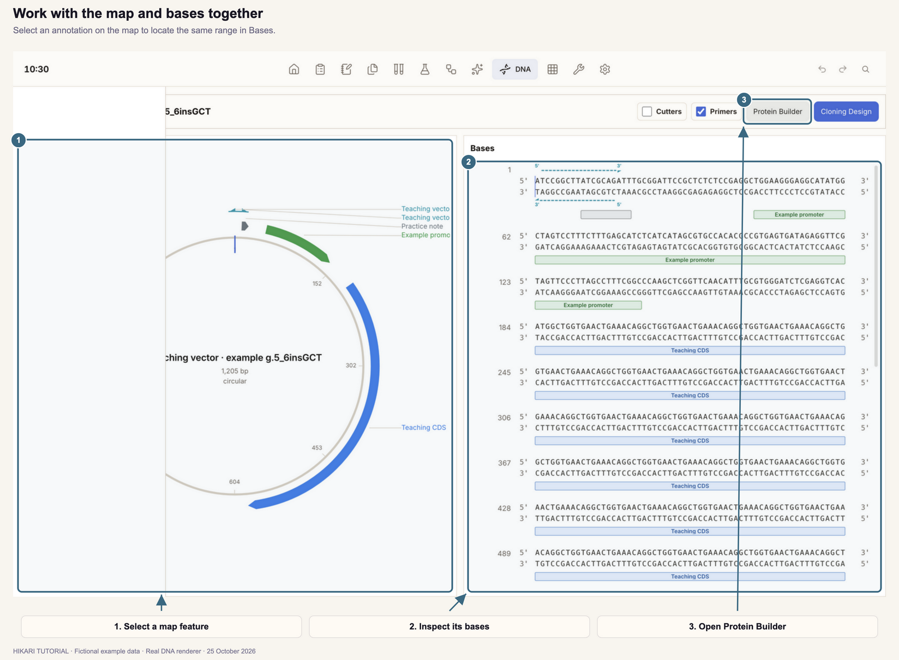

6. Right-click a feature or a selected range to open its actions.
7. Choose the operation you need, such as inserting bases before or after the selected feature, deleting the selected bases, or replacing the feature.

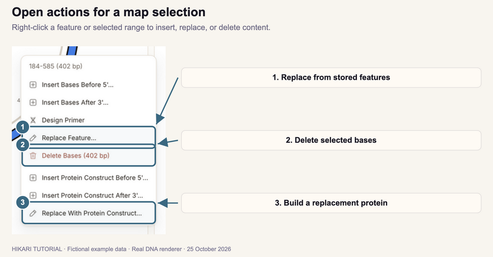

For **Replace Feature…**, search the stored feature library, choose the feature and its source, inspect the preview, and click **Confirm**.

Use the back arrow labeled **Back to DNA** to return to the sequence viewer.

## 11. Build a protein construct

### Add blocks

1. Open **Vector Builder**, then click **Protein Builder** in its toolbar.
2. Inspect the starting **Assembly Chain**. It can already contain the current DNA's coding sequence, a tag, and a cleavage site. Hover over a block to reveal its controls, and remove any blocks you do not want.
3. Click **+ Protein** beside **Assembly Chain**.
4. Under **Enter sequence**, provide a **Protein name** and choose **Amino-acid sequence** or **DNA coding sequence**.
5. Paste the sequence and click **Add to Chain**.

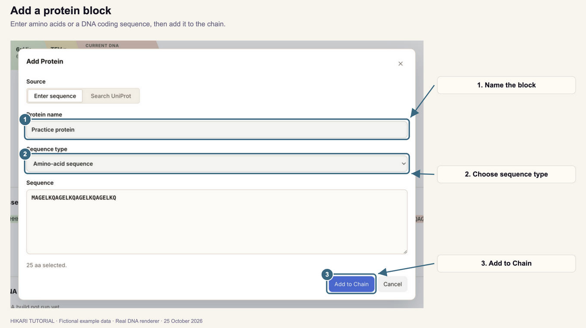

You can use **Search UniProt** instead: enter a query, run the search, select a result, choose the sequence or region, and add it to the chain.

6. Expand a group under **Common Blocks** and click a tag, linker, protease site, or 2A peptide to add it.
7. Use each block's move controls to arrange the chain from N terminus to C terminus. Use its edit or remove control when needed.
8. Review the assembled amino-acid sequence. Click the sequence to edit it directly if required.

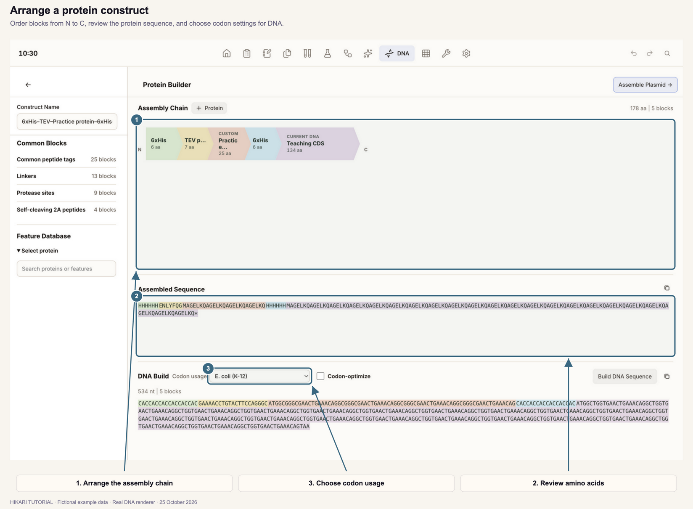

### Review DNA and continue

1. Choose the **Codon usage table** for the DNA output. Enable **Codon-optimize** when you want to regenerate stored coding DNA using that table.
2. Click **Build DNA Sequence** and inspect the DNA output.
3. Use the copy controls to copy the assembled protein or DNA sequence.
4. To continue with a stored backbone, click **Assemble Plasmid**, choose the backbone, review the assembly summary, and use **Next Step**.
5. If you opened Protein Builder from a map insertion or replacement action, use **Insert Into Vector** to apply the construct at that target instead.
6. Continue through the cloning review before confirming the design.

## 12. Review a cloning design

1. Make the intended sequence edit, or build an insertion through Protein Builder.
2. Click **Cloning Design** when it is available. It is also accessible from the Vector Builder toolbar.
3. Choose a **Route** from the left panel.
4. Click **Design Primers**.
5. Read the plan, primer information, and any warnings or review messages. Select another route and run **Design Primers** again if needed.

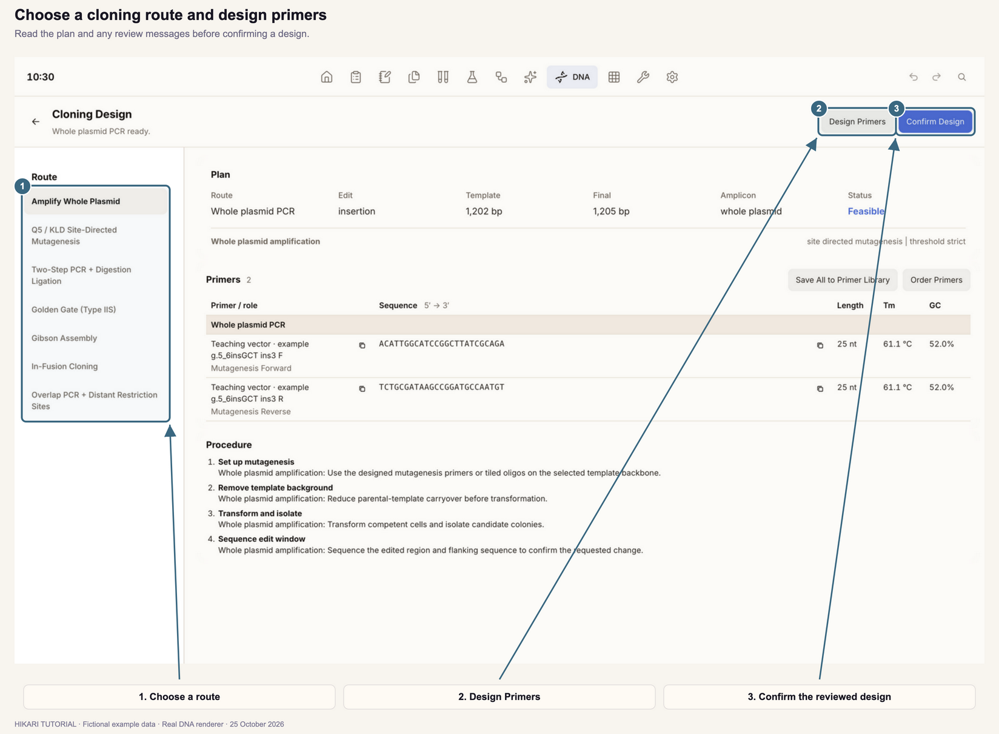

6. Use **Save All to Primer Library** to keep the displayed primers when that action is available.
7. Click **Confirm Design** when you want to save the working product and generated primer record. Find the resulting records under **Unsaved**, inspect them, and use **Save** for records you want in Saved.

A plan can retain a review status after confirmation. Read its messages; confirmation does not clear them. **Order Primers** is offered only for a feasible plan.

Use **Back to Sequence** to return without confirming the design.

## 13. Save and export primers

### Save a primer

1. Show the **Primers** track in the sequence viewer or Vector Builder.
2. Hover over a primer-binding feature to open its card.
3. Use the save-to-library control in that card to keep the full oligo in **Primer Library**.

To design a primer for a selected range, right-click the range and choose **Design Primer**, then inspect the displayed primer information.

### Select primers

1. Click **Primers** beside the library's **Saved** and **Unsaved** buttons.
2. Use **Search primers** to find an entry.
3. Edit the name in its row if needed, and check the sequence.
4. Tick the primers you want to export, or use the header checkbox to select the visible entries.
5. Click **Export Selected to IDT**.

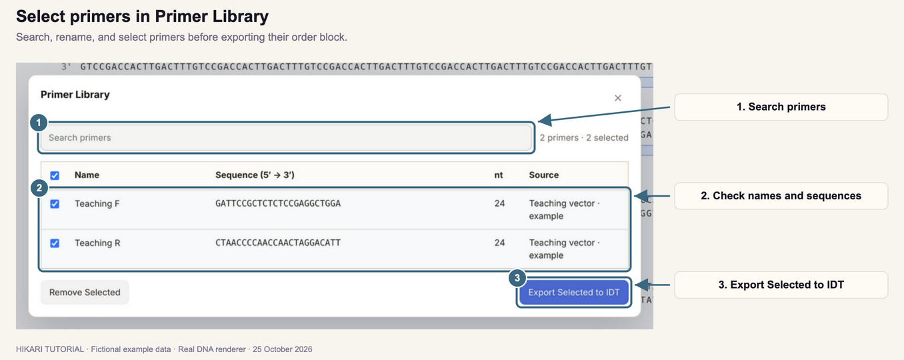

### Copy the order block

1. Choose **Scale** and **Purification** in **Order Primers**.
2. Review the **Order block** and any messages above it.
3. Click **Copy IDT Block** or **Copy CSV**.
4. Paste the copied text into the ordering workflow you use and review it there before submitting an order.

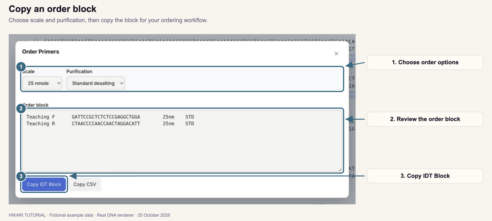

Copying the block does not place an order. To remove library entries, select them in Primer Library and click **Remove Selected**.

## 14. Organize the sequence library

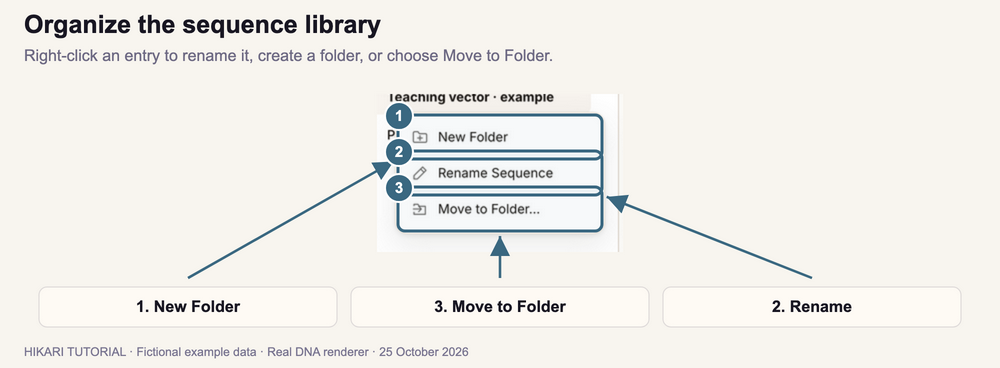

### Rename an entry

1. Right-click the sequence's row in the library.
2. Choose **Rename Sequence**.
3. Type the new name in the row and press **Enter**. Press **Escape** to cancel the rename.

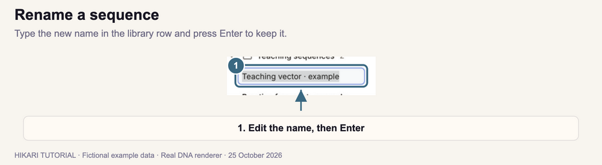

### Use folders

1. Right-click in the library and choose **New Folder**.
2. Type the folder name and press **Enter**.
3. Right-click an entry and choose **Move to Folder**, then enter the destination folder name in the prompt. You can also drag an entry onto a folder.
4. Expand or collapse a folder with its disclosure arrow.
5. To rename a folder, right-click its row and choose **Rename Folder**.

For a regular folder, **Delete Folder** removes the folder and returns its entries to the unfiled library; it does not delete their sequence records. Project-linked folders are managed with their projects.

---

[Previous tutorial: Workflows](../07-workflows/index.html) · [Next tutorial: Plate](../09-plate/index.html) · [All tutorials](../index.html)
