# Plate

How to define an assay plate, enter results, calculate transformed values, and prepare a chart.

**Follow the numbered steps and the highlighted controls in each screenshot.**

The screenshots use a fictional 24-well plate with Sample A and Sample B. The numbers are for learning the interface.

## 1. Open Plate

1. Click **Plate** in the top navigation bar. If it is outside the visible bar, open **More modules** and choose **Plate**.
2. Choose **Setup** to define the plate layout, sample IDs, and concentrations.
3. Choose **Analyze** to enter measurements, transform values, group wells, and plot the results.

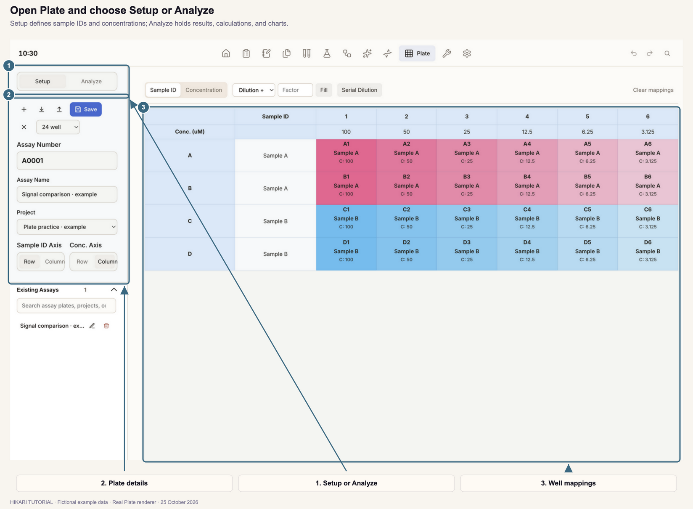

Saved plate records are called **assays** in the interface. Use the disclosure arrows beside sections such as **Existing Assays** and **Data Analysis** to expand or collapse them.

## 2. Create a plate

1. In **Setup**, click **Create new assay**, the plus icon at the top of the left rail.
2. Choose the **Plate Type**: 6, 12, 24, 48, 96, 384, or 1536 wells. Choose **24 well** to follow this example.
3. Enter an **Assay Name**, such as `Plate tutorial · practice`.
4. Choose a **Project** if you want to associate the assay with one.
5. Continue with the mapping steps below, then click **Save** when the layout is ready.

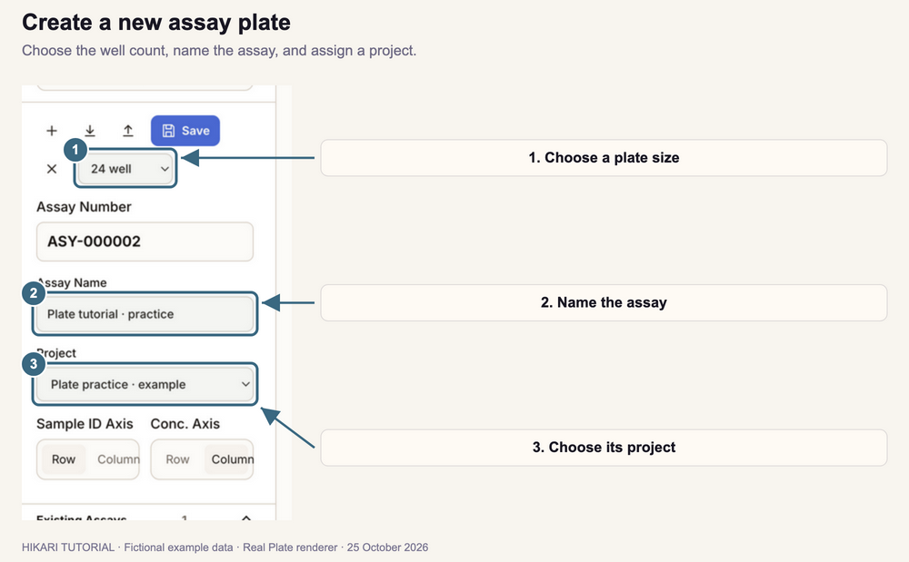

The **Assay Number** identifies the record. Use the assay name to describe the run so you can find it later.

## 3. Map samples to wells

### Fill an entire row or column

1. Under **Sample ID Axis**, choose **Row** or **Column**. The concentration axis uses the other direction.
2. Enter sample IDs in the editable headers beside the plate.
3. Repeat a sample ID when more than one row or column belongs to that sample. In this example, rows A and B use `Sample A`; rows C and D use `Sample B`.
4. Check the well labels in the preview before proceeding.

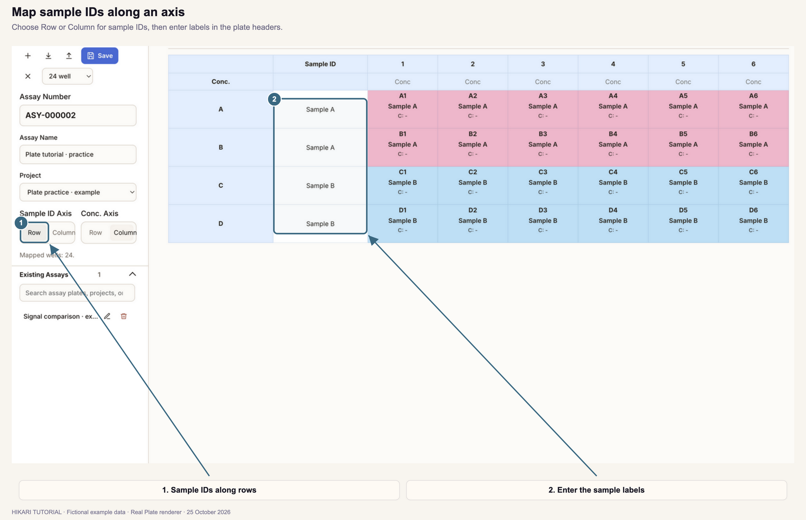

Changing a header applies its value along that axis. For a sample arranged across columns instead, choose **Column** before entering the labels.

### Change one well

1. Above the plate, choose **Sample ID** or **Concentration**, depending on the value you want to change.
2. Click inside the individual well's field.
3. Enter the replacement value. For example, change D6's sample ID to `Blank` when that is the label you intend to use.
4. Inspect the neighboring wells to confirm the change belongs to the intended position.

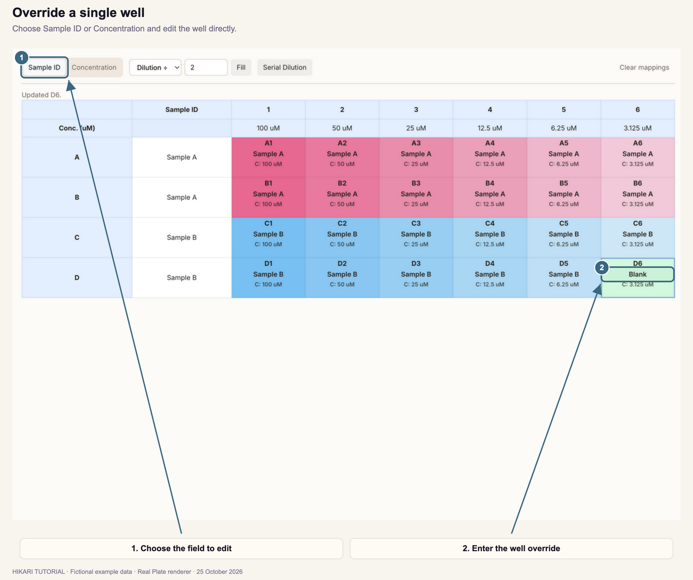

**Clear mappings** removes the current well assignments. Use it when you want to rebuild the layout, then save the revised plate.

## 4. Fill a concentration series

1. Choose **Concentration** above the plate.
2. Enter a starting concentration in the first concentration header. This example uses `100 uM`.
3. Choose **Dilution ÷** in the fill-method menu.
4. Enter the **Factor**. A factor of `2` divides each successive value by two.
5. Click **Fill** and inspect the completed headers and wells.

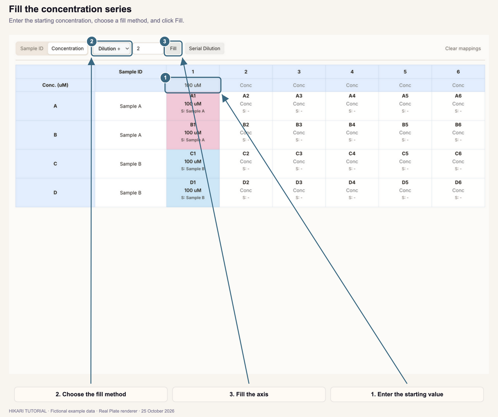

For the six columns in this example, the series becomes `100`, `50`, `25`, `12.5`, `6.25`, and `3.125 uM`.

The fill-method menu also offers:

| Method | What to enter |
| --- | --- |
| **Dilution ÷** | A starting concentration and a positive division factor. |
| **Linear** | Concentrations at the start and end of the intended range; intermediate values are evenly spaced. |
| **Log** | Positive concentrations at the start and end of the range; intermediate values are spaced logarithmically. |

Use consistent concentration units, and review the resulting values after filling or changing a header.

## 5. Review a serial dilution plan

1. Finish the sample IDs and concentration series in **Setup**.
2. Click **Serial Dilution** above the plate.
3. Enter **Volume per well**.
4. Enter the stock concentration for each listed sample.
5. Read the calculated dilution tables and the messages above them. Check the concentration units and the direction of the series.
6. Close the dialog with its top-right **Close** button. Save the assay when you have finished editing its setup.

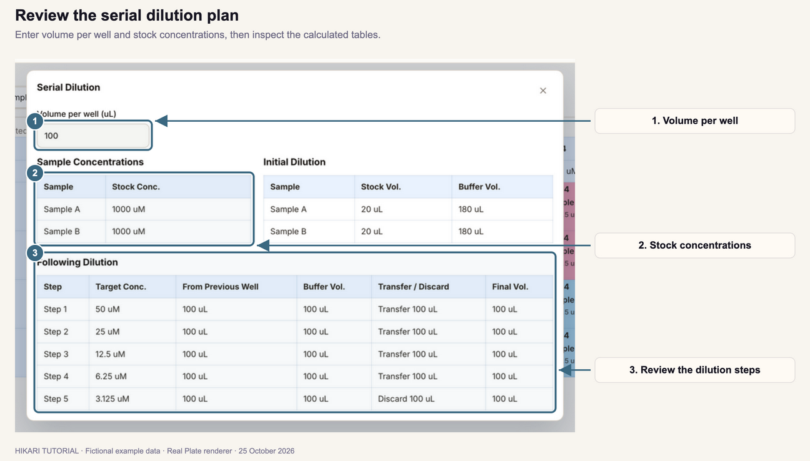

The example shows `100` for volume per well and `1000 uM` stocks solely to demonstrate where these fields appear. Enter the values appropriate to your own plate when using the planner.

## 6. Import or export a layout CSV and save

### Prepare or reuse a layout

1. In **Setup**, click **Export CSV template**, the downward-arrow icon in the left rail.
2. Open the downloaded CSV and fill or revise the well assignments.
3. Click **Import CSV**, the upward-arrow icon, and choose the layout file.
4. Read the import status beneath the setup fields and inspect the plate preview.
5. Click **Save**, the disk icon, to keep the assay definition.

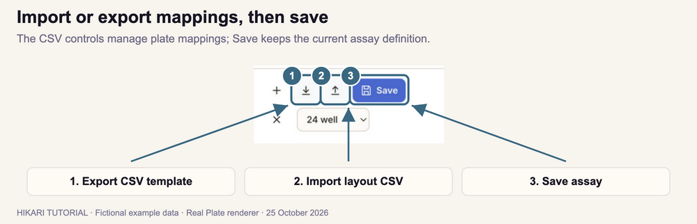

The template uses these headers:

```csv
well,row,column,sample_id,concentration
A1,A,1,Sample A,100 uM
A2,A,2,Sample A,50 uM
```

You can practice with [plate-layout.csv](examples/plate-layout.csv). Select **24 well** before importing this example, then check that its 24 positions match the preview.

The Setup CSV contains sample and concentration mappings. Use the **Import** control in **Analyze** for measurement results.

## 7. Enter results in Analyze

1. Save the plate setup, then click **Analyze**.
2. Expand **Existing Assays** and choose the plate you want to analyze.
3. Find **Plate results · Table1** in the lower workspace. The chart appears above it, with **Data Analysis** controls in the left rail.

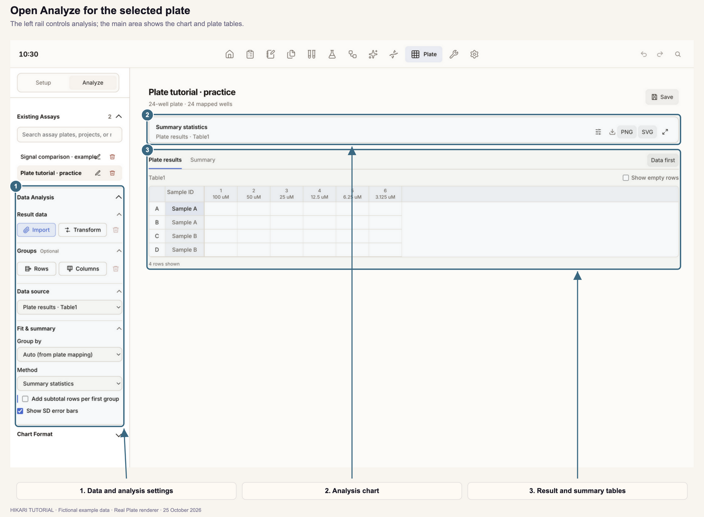

### Type or paste measurements

1. Click a mapped well's result cell to edit it.
2. Type the measurement and press **Enter** to finish the edit.
3. To enter a block from a spreadsheet, copy the numeric cells, select the destination starting well in Table1, and paste.
4. Check the row and column positions against the original data. Values for unmapped wells are skipped.
5. Use **Save results**, the disk icon beside the chart title, after reviewing the plate.

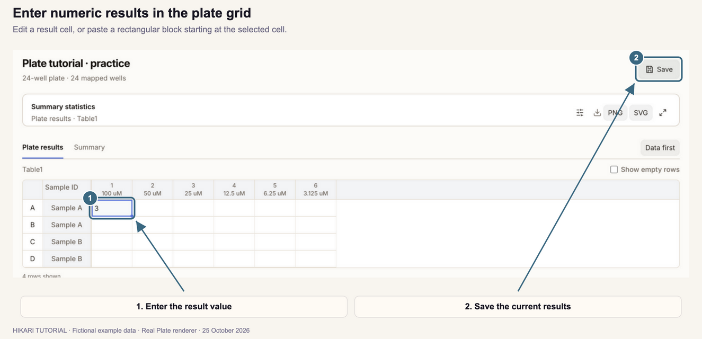

Result edits are saved as you finish each edit or paste. Analysis updates from the current values. The **Clear results** trash icon under **Result data** removes the plate's entered measurements; check the selected assay before using it.

## 8. Import a result file

1. Select the correct assay in **Analyze**.
2. Under **Data Analysis > Result data**, click **Import**.
3. Choose a CSV or Excel file (`.csv`, `.xls`, or `.xlsx`).
4. If several possible result matrices are found, choose one in **Select Result Matrix**.
5. Compare its preview with your plate: check the row labels, column labels, dimensions, and values.
6. Click **Use This Matrix**.
7. Inspect the imported values in Table1 and the updated chart.

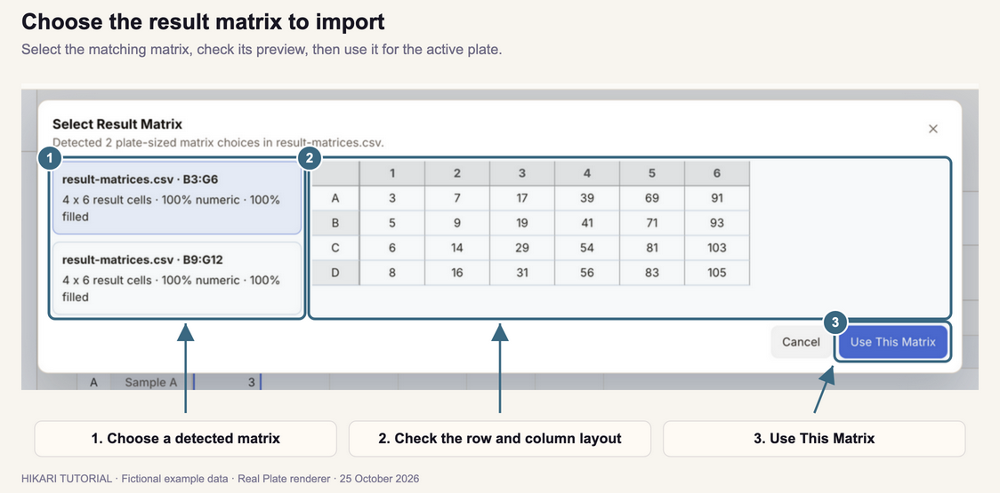

If the file has only one detected matrix, the import can proceed directly. Importing fills the matched wells and keeps the source file as an attachment to the assay.

The supplied [result-matrices.csv](examples/result-matrices.csv) contains two fictional 4 × 6 blocks so you can practice selecting a matrix. Use it with the example 24-well layout. Review existing results before importing another file into the same assay.

## 9. Calculate a transformed plate

1. Under **Result data**, click **Transform**.
2. Open the **Transformed** table tab. This is **Table2**; the original measurements remain in Table1.
3. Click a Table2 well cell and enter a formula beginning with `=`.
4. Press **Enter** to calculate it.
5. Check the displayed value and any error notice before filling more wells.

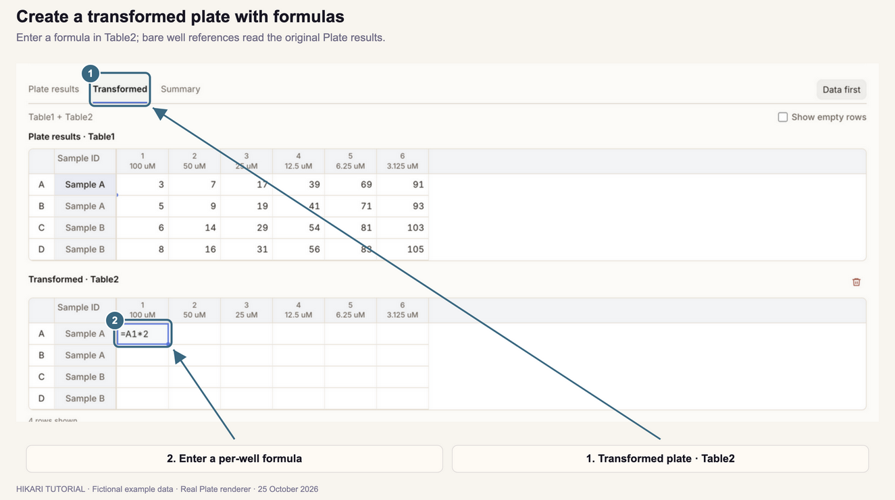

For example, entering `=A1*2` in Table2's A1 cell doubles the measurement in Table1's A1 cell. A bare well reference such as `A1` reads Table1.

Use explicit table references when needed:

| Formula | Meaning |
| --- | --- |
| `=Table1:A1*2` | Double the original A1 measurement. |
| `=Table2:A1+1` | Use the calculated value from Table2's A1 in another cell. |

Avoid formulas that refer back to themselves. Correct cells marked with formula errors before analyzing their transformed values.

### Choose the analysis data source

1. Expand **Data source** in the left rail.
2. Choose **Plate results · Table1** to analyze the original measurements, or **Transformed plate · Table2** to analyze the calculated values.
3. Check the chart and **Summary** after switching sources.

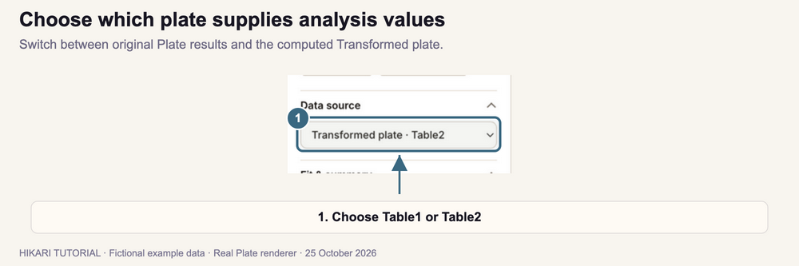

Only numeric transformed cells contribute when Table2 is selected. Fill all the transformed wells you intend to analyze; blank Table2 cells do not automatically borrow Table1 values. Formula edits save as you finish editing. To remove the transformed plate, use its **Remove transform** trash icon.

## 10. Create custom row or column groups

1. Open the **Plate results** table.
2. Drag across the well cells covering the rows or columns you want to group.
3. Under **Data Analysis > Groups**, click **Rows** to add the selected rows as a group, or **Columns** to group the selected columns.
4. Repeat with other selections as needed.
5. Under **Fit & summary**, choose **Custom groups** in **Group by** to use those groups in the analysis.

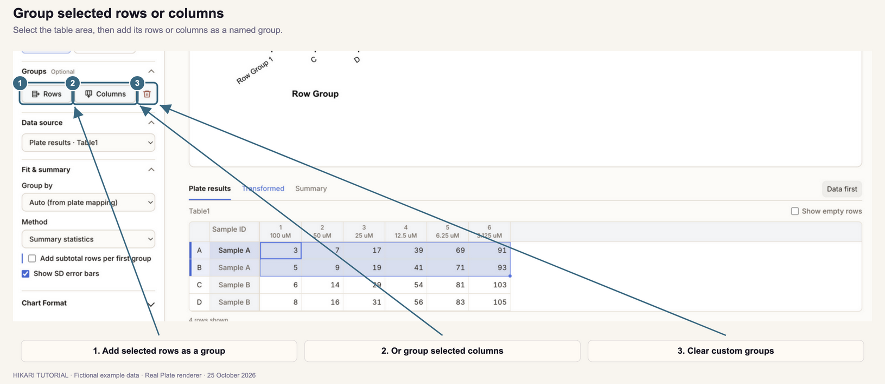

For example, selecting A1 through B6 and clicking **Rows** groups rows A and B. Use **Clear groups**, the trash icon beside Rows and Columns, to discard custom group definitions and start again.

## 11. Choose an analysis and inspect the summary

### Summarize replicates

1. Expand **Data Analysis > Fit & summary**.
2. Choose **Group by**. For the example plate, **Sample ID × Concentration** keeps each sample and concentration combination together.
3. Choose **Summary statistics** under **Method**.
4. Leave **Show SD error bars** selected if you want them in the chart.
5. Open the **Summary** table tab to inspect the calculated results.

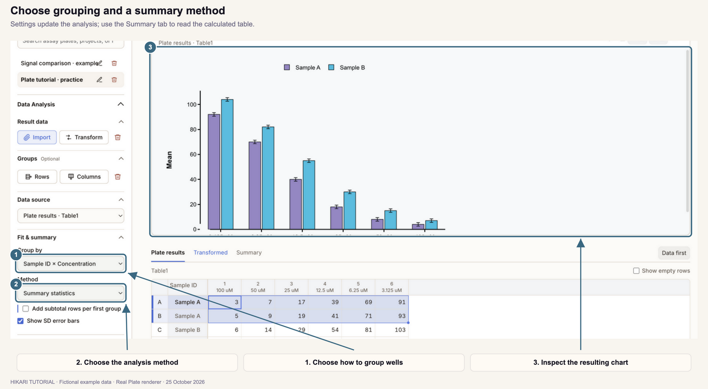

The controls update the analysis as you change them. Other grouping choices include sample ID, concentration, plate row, and plate column.

### Fit a curve

1. Choose a grouping that separates the series you want to compare, such as **Sample ID**.
2. Choose a fitting method. The example uses **Linear fit** to demonstrate the controls.
3. Set **X Axis**, such as **Concentration**.
4. Inspect the data points and fitted curves in the chart.
5. Read **Summary** for the fit output. Review any message about missing values or an unsuccessful fit.

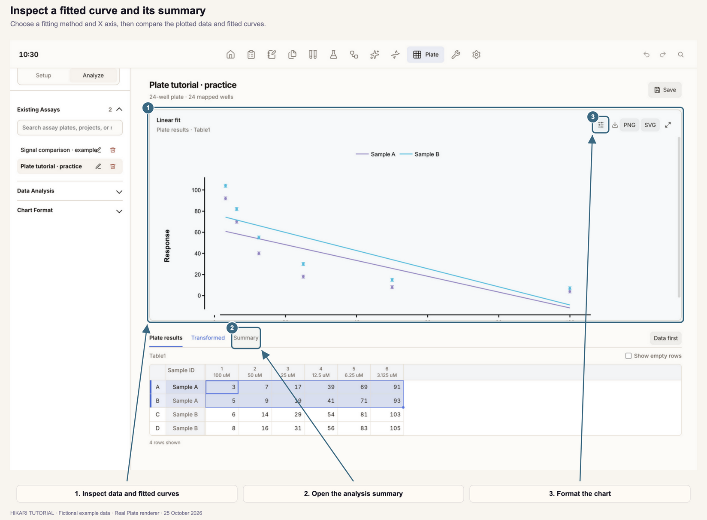

The Method menu also contains sigmoidal, hyperbola, polynomial, Padé, and one-phase exponential fits, plus plate QC, Z-scores, comparisons to a control, and normalization. Choose the method that fits your intended analysis.

When a method shows **High control (100%)** or **Low control (0%)**, enter the corresponding group label or sample ID from your plate. For a sigmoidal fit, **Asymmetric (5PL)** enables the five-parameter option; polynomial fits show **Polynomial Order**. Recheck the summary whenever you change a method or control assignment.

## 12. Format the chart

1. Click **Chart Format** beside the chart title.
2. Use its tabs to choose the part of the chart you want to change.
3. In **Frame**, adjust the background and frame settings.
4. Click **Save preset as…**, the disk icon beside **Preset**, when you want to reuse the current formatting. Give the preset a name in the prompt.

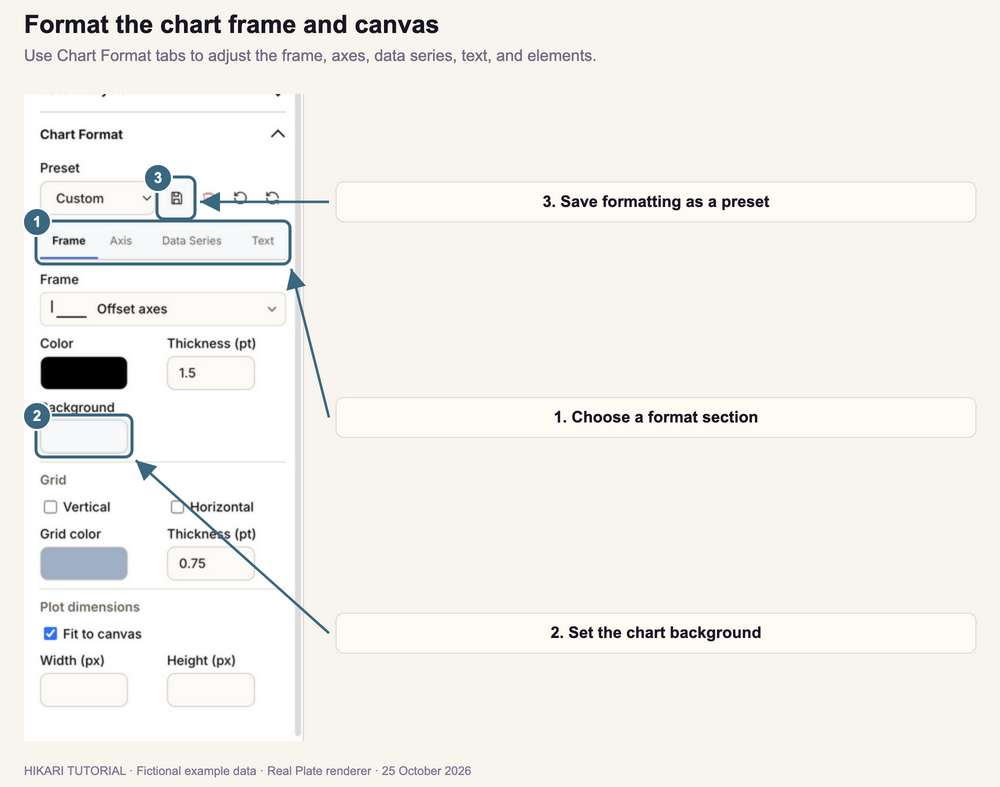

The format sections are **Frame**, **Axis**, **Data Series**, **Text**, and **Elements**. Expand the relevant section and inspect the chart as you change its controls.

### Change axes

1. Open the **Axis** tab.
2. Choose the X-axis and Y-axis scales. Options include linear and logarithmic scales.
3. Keep the automatic range selected, or turn it off and enter the desired limits.
4. Inspect the chart to make sure the intended points remain visible. Logarithmic axes require positive values.

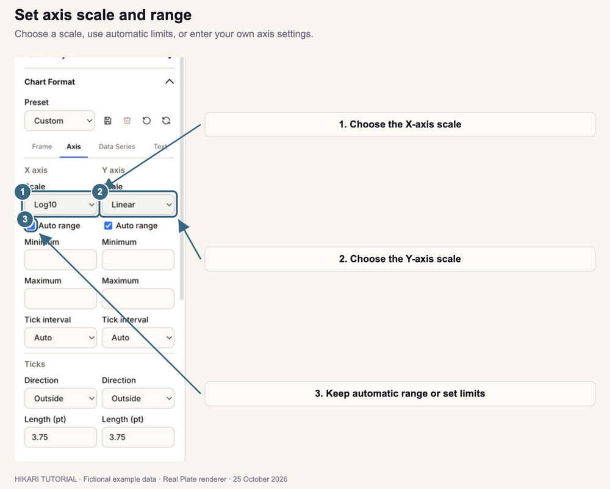

Formatting is retained with the assay. Use the preset and reset controls when you want to apply a saved style or return settings to their defaults.

## 13. Export or enlarge a chart

1. Check the selected assay, data source, analysis method, and chart formatting.
2. Click **PNG** above the chart to export a raster image, or **SVG** to export a vector image.
3. Follow the save or download prompt and open the exported image to inspect it.
4. For a larger view while working, click **Focus chart**, the expand icon at the top-right of the chart. Click it again to return to the regular workspace.

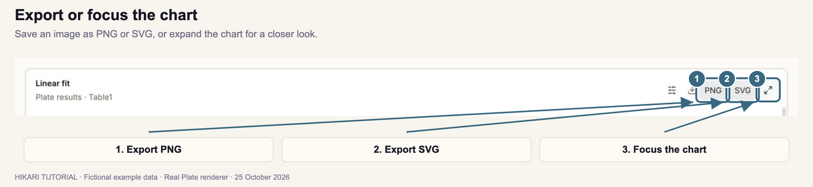

## 14. Find, edit, or delete an existing plate

### Reopen and edit

1. Return to **Setup** and expand **Existing Assays**.
2. Search by assay name, project, or notes.
3. Find the intended record and click its **Edit** pencil icon.
4. Update the name, project, sample mappings, or concentrations.
5. Click **Save** to keep those setup changes.

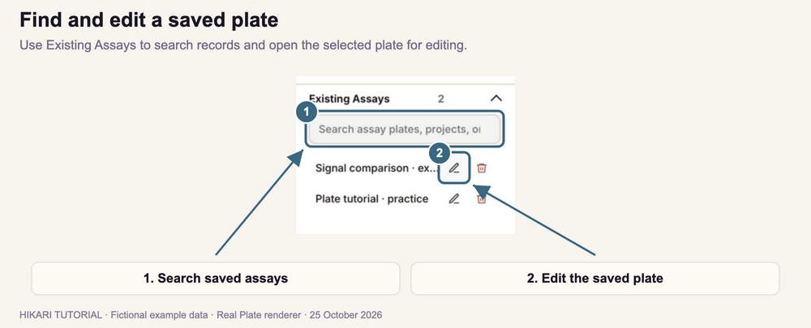

In **Analyze**, use its Existing Assays list to switch the plate whose results and chart you are viewing.

### Delete a record

1. In Setup's **Existing Assays** list, find the assay you intend to remove.
2. Check its name and assay number.
3. Click that row's **Delete** trash icon. The record is removed from the list.

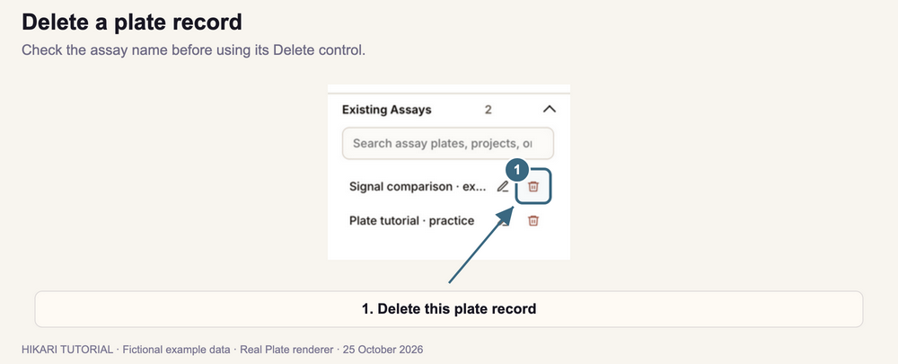

---

[Previous tutorial: DNA](../08-dna/index.html) · [Next tutorial: Gel](../10-gel/index.html) · [All tutorials](../index.html)
