# Gel

How to open gel images, define lanes and bands, read measurements, and assemble an exported figure.

**Follow the numbered steps and the highlighted controls in each screenshot.**

The screenshots use simulated images for learning the interface. You can follow along with [simulated-gel.png](examples/simulated-gel.png) and [simulated-control.png](examples/simulated-control.png).

## 1. Open Gel and load an image

1. Open **More modules** in Hikari's top navigation bar and choose **Gel**.
2. At the top of the **Gels** navigator, click **Add gel**, the image-and-plus icon.
3. Choose **Image files…** and select your image. Common image formats and TIFF files are supported.
4. To add several gels, select several files. You can also drag image files onto the gel navigator or viewer.
5. Click a gel's entry in the navigator to open it for processing.

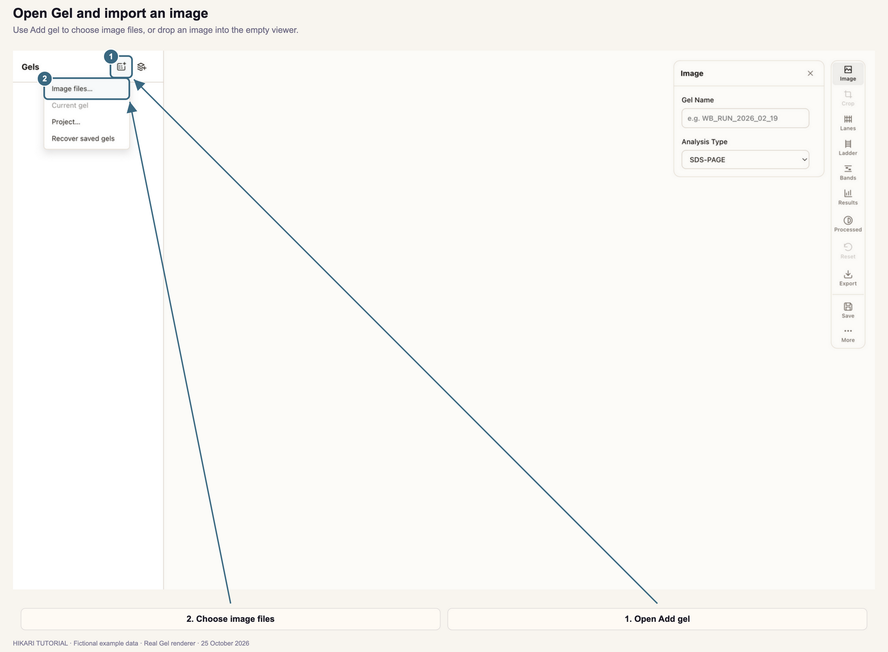

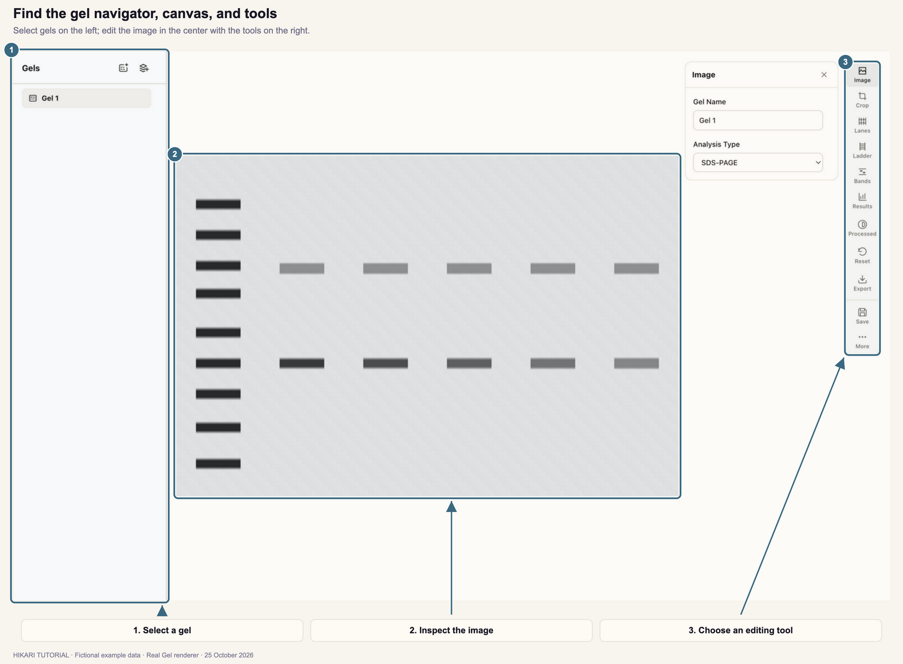

The vertical toolbar on the right opens **Image**, **Crop**, **Lanes**, **Ladder**, **Bands**, **Results**, and **Processed**. Click an open category again, or its panel's close button, to make more room for the image.

A project can hold up to 16 gel layers. New imports appear in the navigator so you can return to their images and settings.

These categories are tools you can revisit as needed. For a first measurement, work through the image preparation, lanes, and band-window sections below. Ladder calibration is optional when you only need band intensities.

## 2. Name the gel and choose its type

1. Select the gel in the navigator.
2. Click **Image** in the right toolbar.
3. Enter a descriptive **Gel Name**, such as `Target signal · example`.
4. Choose **Analysis Type**: **SDS-PAGE**, **Western Blot**, or **DNA/RNA Agarose**.
5. You can also name a gel by double-clicking its navigator entry, typing the name, and pressing **Enter**.

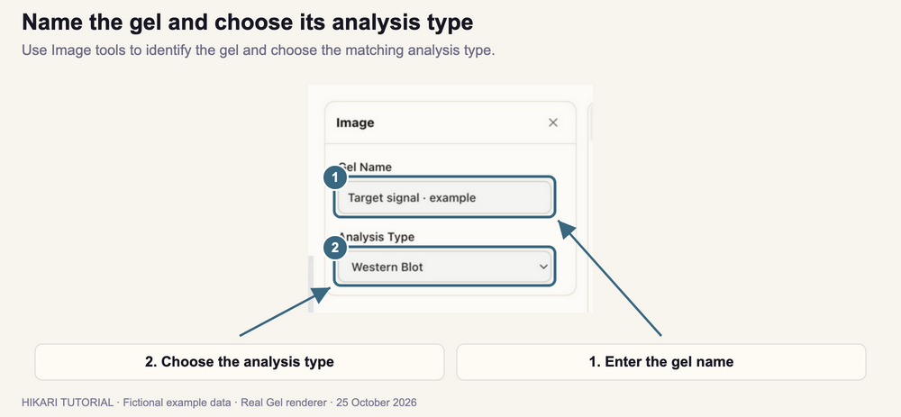

The gel's name is also used as its caption when you arrange it in a stack. Name the second practice image `Loading control · example` to make the two layers easy to identify.

## 3. Crop and straighten the image

1. Click **Crop** in the right toolbar.
2. Drag the crop-box edges or corners to choose the area to keep.
3. Adjust **Straighten** to correct a small rotation. Use **90°** for a quarter-turn.
4. Click **Done** to apply the crop, or press **Enter**.
5. Use **Cancel** or **Escape** to leave the previous image intact.

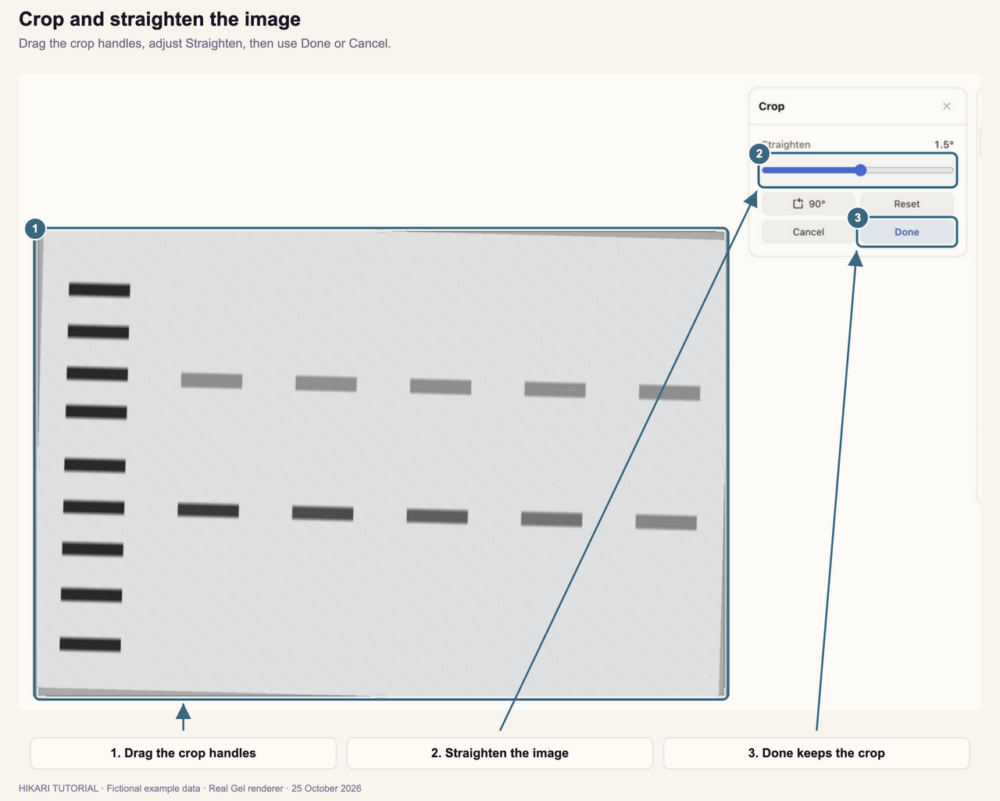

**Reset** inside Crop brings back the full original image and clears rotation in the crop preview. Click **Done** to keep that reset. Finish or cancel cropping before switching to another tool.

Crop before placing lanes and band windows so those selections correspond to the image you intend to measure.

## 4. Adjust the processed preview

1. Click **Processed** in the right toolbar.
2. Adjust **Denoise Strength** and **Contrast Boost** while watching the image.
3. Turn **Processed view** off to compare with the original image.
4. Turn it on again to return to the processed preview.
5. Close the panel when ready. Closing it keeps the chosen settings and preview.

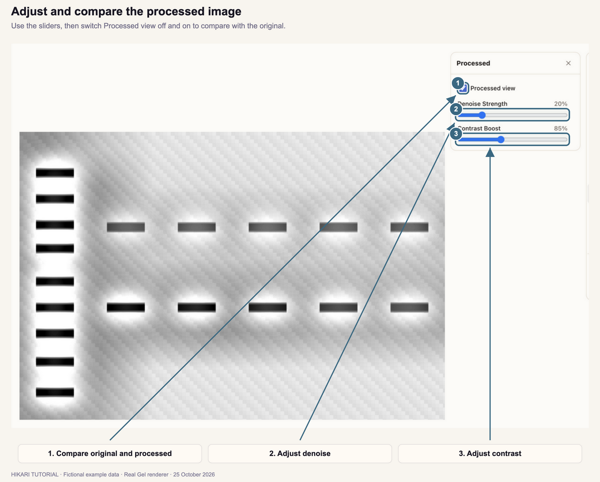

The example slider values show how the controls work. Review your own image after each adjustment, especially where faint bands or background variation are present.

## 5. Detect and adjust lane dividers

### Start with automatic detection

1. Open **Lanes**.
2. Enter the expected number of **Lanes**, including the ladder lane. The practice image has `6`.
3. Click **Auto-detect**.
4. Inspect every boundary. Confirm that each lane encloses the intended vertical track and that blank lanes have not been missed.

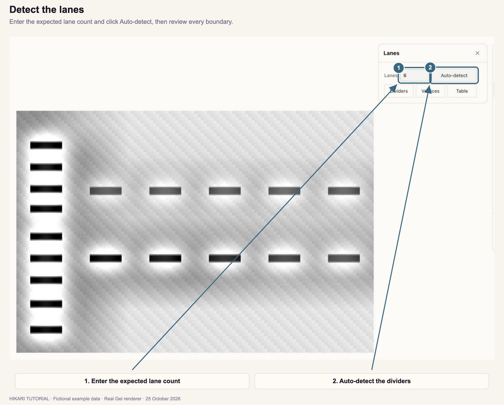

### Correct the boundaries

1. While **Dividers** is active, drag an existing divider horizontally to move it.
2. Click on the image to add a missing boundary.
3. To remove a boundary, right-click near it and choose **Remove divider**.
4. Check the leftmost and rightmost boundaries; these define the outside edges of the gel area.
5. Click **Finish dividers** when all lanes are correct.

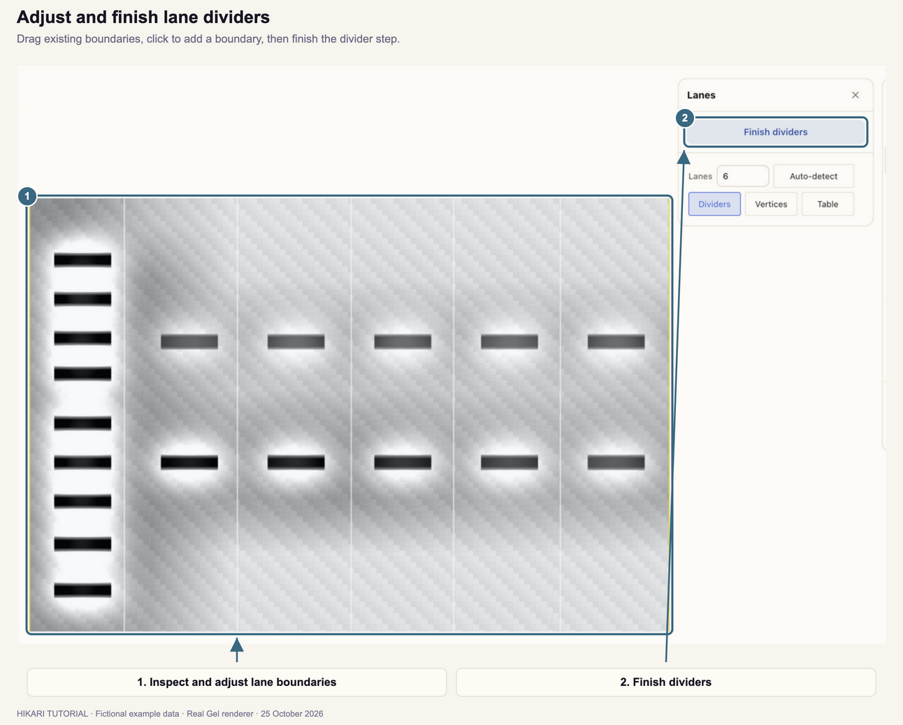

You can place dividers manually without Auto-detect. Turn on **Dividers**, place the two outer boundaries and the boundaries between lanes, then finish. Return to Dividers whenever the segmentation needs correction.

## 6. Correct tilted lanes with Vertices

1. Finish the lane dividers.
2. Under **Lanes**, click **Vertices**.
3. Find the lane's corner handles at the top and bottom of the image.
4. Drag a corner horizontally so the lane follows its track. Check the neighboring lane along a shared boundary.
5. Click **Vertices** again to leave the tool.

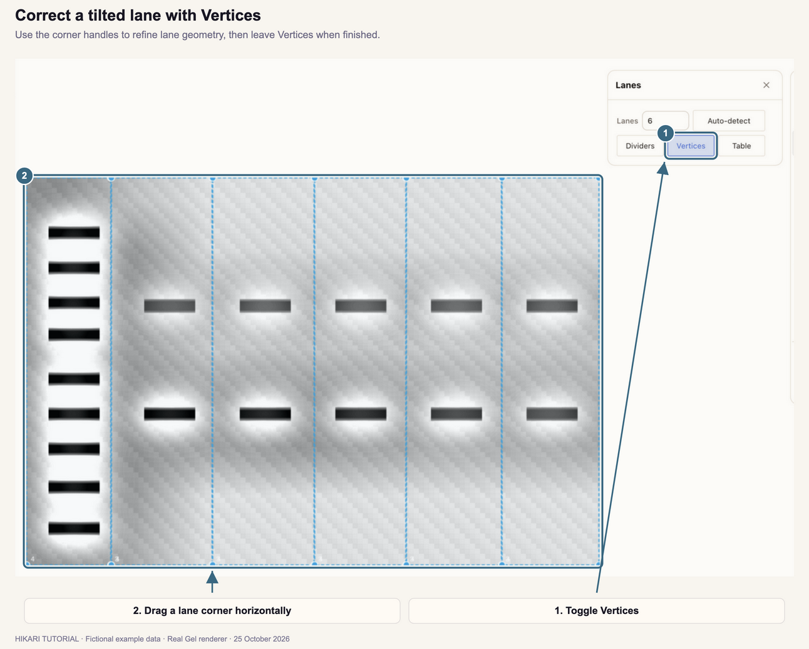

The top and bottom corners stay on the image's top and bottom edges. Use Crop to change the overall image area; use Vertices to refine the lane boundaries within it.

## 7. Select and label the ladder

### Choose a ladder lane and preset

1. Open **Ladder** after finishing the lane dividers.
2. Click **Pick lane**, then click inside the ladder lane on the image.
3. Choose the **Ladder Preset** that matches the ladder you used.
4. Click **Detect** to detect and label its bands.
5. Inspect the labels against the actual ladder pattern before using the calibration.

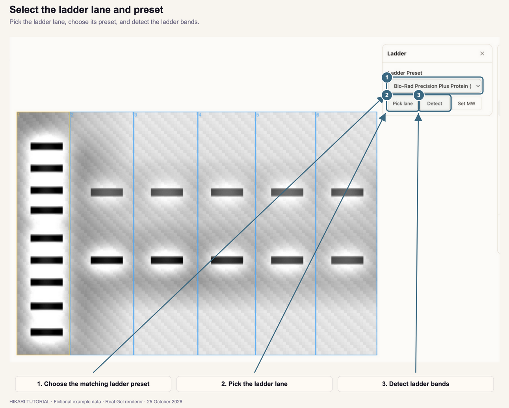

**Detect** and **Set MW** become available after you pick a ladder lane. The preset displayed in the example is for demonstrating the controls; choose the preset corresponding to your own image.

### Enter or correct a band size

1. Click **Set MW** to turn on ladder labeling.
2. Click a band inside the ladder lane.
3. Enter its known size in the small field beside the band.
4. Press **Enter** to keep the label. Press **Escape** to cancel the entry.
5. With Set MW still active, click a labeled band to edit its value, or drag its label to correct its vertical position.
6. Click **Set MW** again when finished.

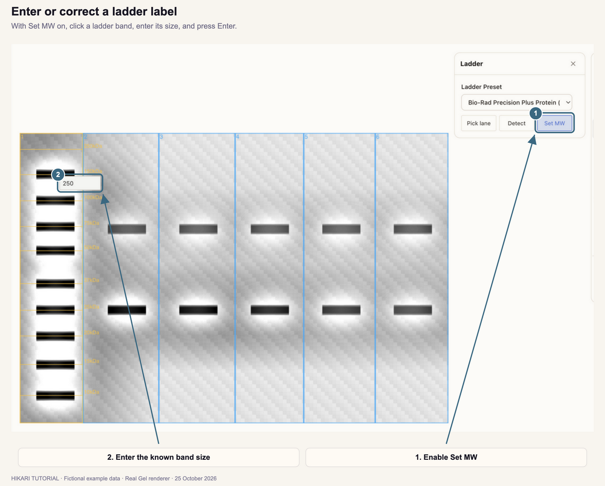

Read the unit shown for the selected ladder and analysis type. Protein ladders use kDa; nucleic-acid ladder presets use their corresponding size units. Size estimates depend on the selected lane and correct ladder labels.

## 8. Set the band measurement window

### Use one window across the lanes

1. Open **Bands**.
2. Click **Top**, then click just above the target band region on the gel.
3. The tool moves to **Bottom**. Click just below the region.
4. Inspect the two horizontal edges across all lanes. Revisit Top or Bottom to adjust an edge.
5. Check that the intended bands lie inside the window.

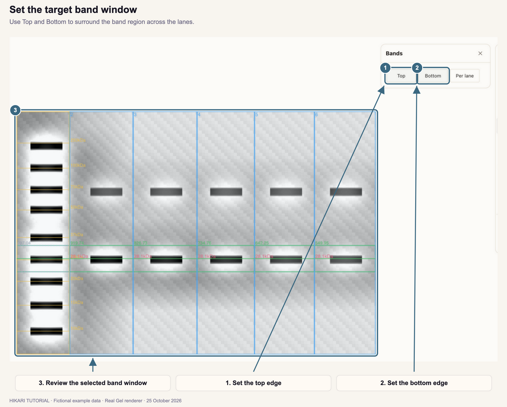

### Give each lane its own window

1. Click **Per lane** when the target region needs a different window in each lane.
2. Top becomes active. Click the top edge within the intended lane, then click its bottom edge.
3. Continue placing pairs of edges for the remaining lanes. Watch the active Top or Bottom button as you work.
4. Review each lane's window before reading the results.

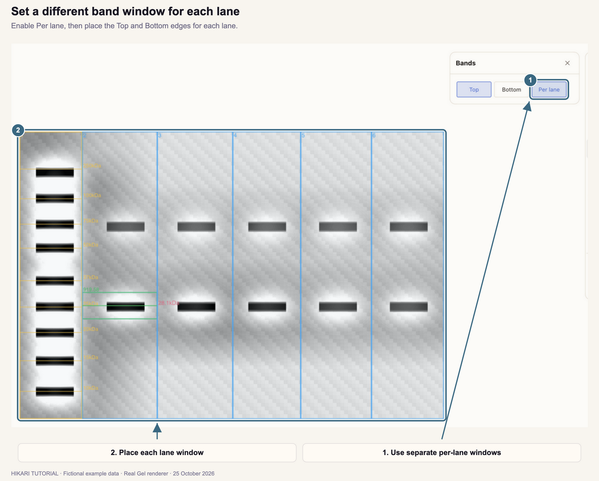

Turn **Per lane** off to return to the shared window. Clicking the image only changes selections while a tool such as Top, Bottom, Dividers, or Set MW is active.

## 9. Read band intensities and lane profiles

### Open the measurement table

1. After defining the lanes and band window, open **Results**.
2. Click **Band intensity**.
3. Compare the bar graph with the measurement rows below it. The table lists lane, label, and band intensity.
4. Click **Copy table** to copy the headers and rows for pasting into a spreadsheet.
5. Close the floating window with its top-right close button when finished.

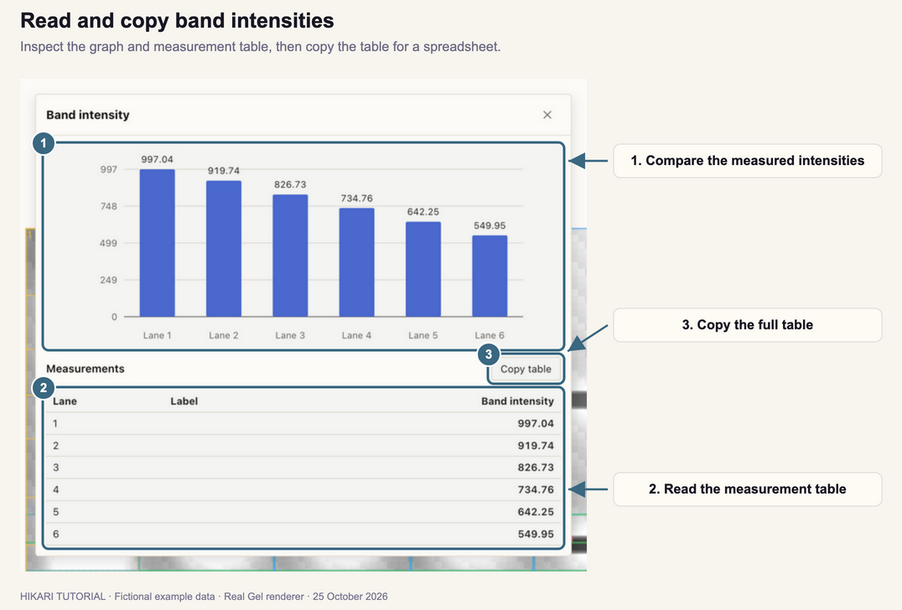

If the window explains that measurements are unavailable, return to Lanes and Bands and check that the dividers are finished and a target window is defined. Add lane labels using section 11 to make the measurement rows easier to identify.

### Inspect a lane's profile

1. In **Results**, choose a lane under **Lane intensity**.
2. Inspect the profile to see how intensity changes from the top to the bottom of that lane.
3. Choose another lane to compare profiles.
4. Click **Band integration** when you want to define integration regions manually.

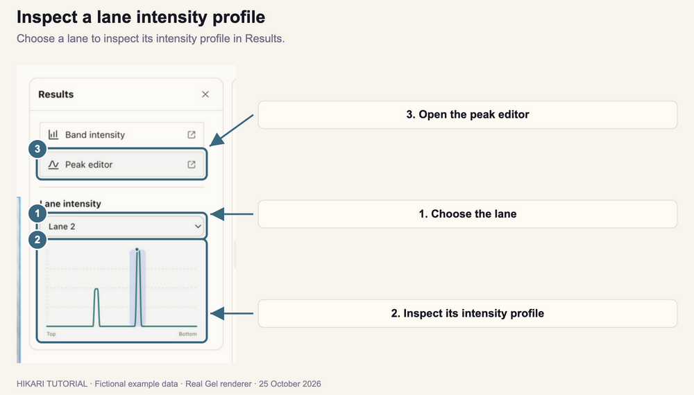

You can move floating result windows by dragging their title bars. **Escape** closes the front window; reopening it lets you return to the results without leaving the gel.

## 10. Define manual peak areas

### Add a baseline region

1. Open **Results > Band integration**. Its floating window is titled **Band integration**.
2. Choose the **Lane** to inspect.
3. Select **Baseline**.
4. Click the profile at one side of the region you want to integrate, then click the other side.
5. Inspect the baseline, shaded area, and resulting table row.

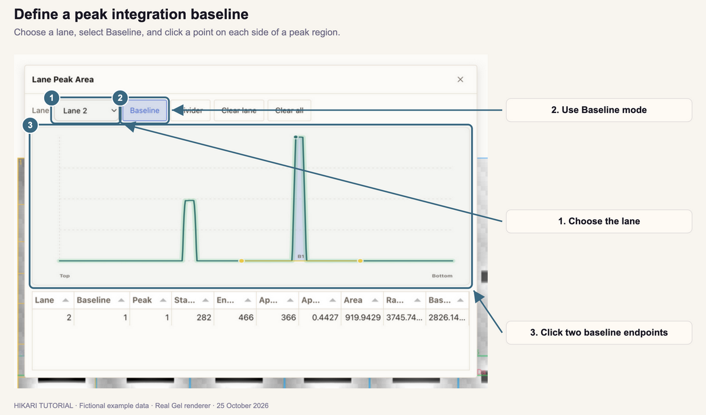

The two clicks choose positions along the lane profile. Add another pair of endpoints to define another region. Check the region's boundaries and the calculated area before continuing.

### Split a region

1. Create a complete baseline region first.
2. Select **Divider**.
3. Click inside the existing region to insert a vertical divider.
4. Read the separate peak areas in the table.
5. Use **Clear lane** to discard the current lane's manual integrations, or **Clear all** to clear them across lanes.

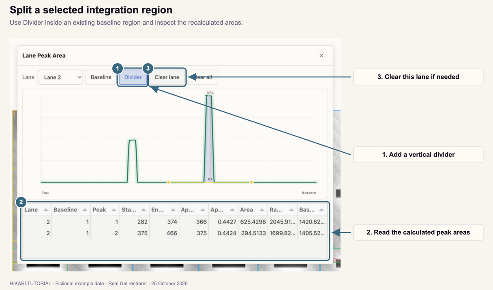

Use the lane selector to work on another lane. Close the window when finished; use **Save** on the gel to retain your work.

## 11. Add a lane table to the figure

1. Open **Lanes**, then click **Table**.
2. Click **Add table**. This becomes available after you finish the lane dividers.
3. Enter a row label in the left-hand field. For sample names, use `Label`.
4. Enter each lane's value in the aligned fields above the image.
5. Click **Add row** for another row of descriptions or conditions.
6. Use **Include ladder lane** to choose whether the ladder appears in the figure and its table.

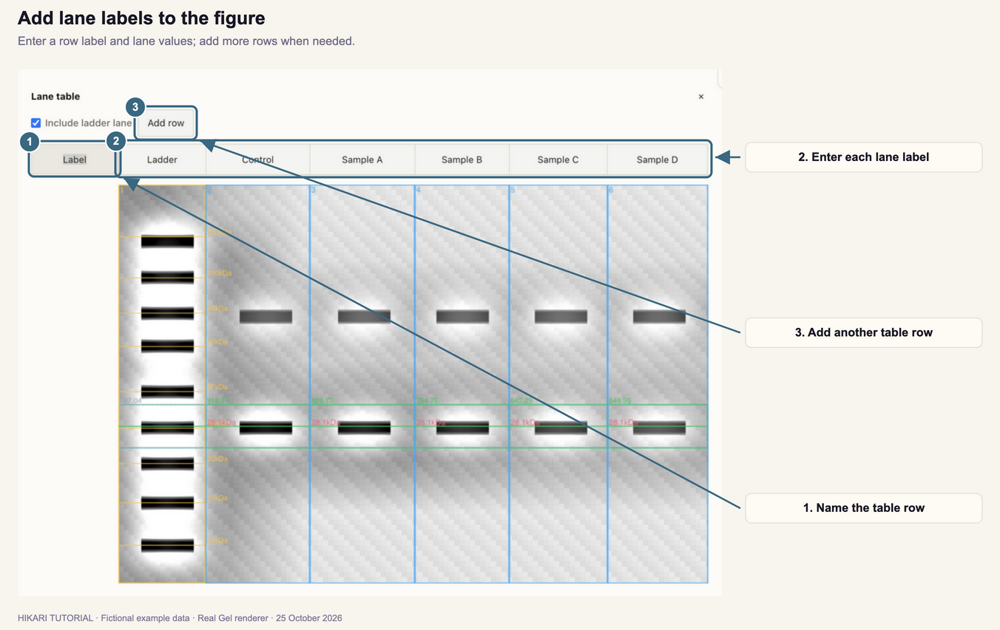

The table follows the gel's placement and appears in PNG and PowerPoint exports. In a stack, each gel retains its own table. Edit that table in the individual gel's processing view.

The practice row uses `Ladder`, `Control`, and Sample A through Sample D. The row named `Label` also supplies labels in the Band intensity window.

## 12. Save and reopen a gel

1. Check the gel name, image settings, lane boundaries, ladder labels, band window, and any table or peak edits.
2. Click **Save** in the right toolbar while viewing the individual gel.
3. To continue with another image, select its entry in the **Gels** navigator.
4. Click the original gel's entry to return to it.

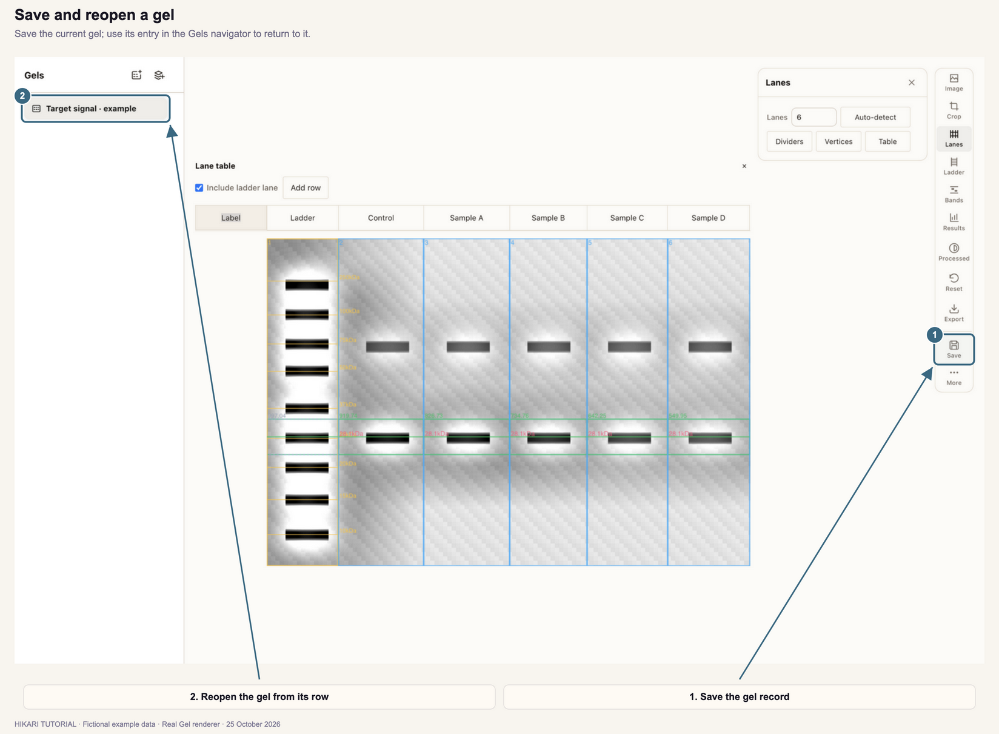

Imported images are kept in the configured Gel storage, and the workspace also retains its layers and stack arrangement automatically. Use the gel's Save action to keep the current record, and section 16 for a portable project file you can reopen separately.

If a save reports an error, correct the storage issue and retry before closing the workspace.

## 13. Combine gels in a stack

### Add a stack and its members

1. Import the gels you want to arrange together. For this example, add [simulated-control.png](examples/simulated-control.png) as a second gel.
2. Prepare each gel's lanes and target region in its processing view, and save it.
3. At the top of the navigator, click **Add stack**, the stacked-layers-plus icon.
4. Drag a gel entry onto the stack's entry. Repeat for the other gels.
5. Click the stack's name to open its combined preview.

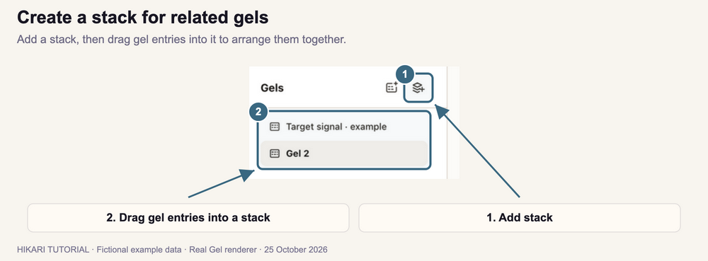

### Arrange the figure

1. In the stack preview, click a blot to select it.
2. Drag the blot to adjust its position. Moving it above or below another blot changes the order.
3. Drag its top or bottom edge to crop the visible vertical region.
4. Drag a side edge to resize it and align its lanes with the other blots.
5. Open **Exact values** in Layout tools when you want to inspect or enter the placement numerically.
6. Use **Process gel** to return to the selected gel's analysis tools. Click the stack or its **Layout** entry to return to the combined figure.

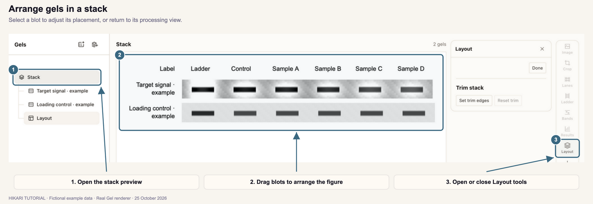

Each stack has its own layout. Drag gels between stacks or back to the top-level gel area to change membership. You can also reorder entries by dropping one before or after another.

## 14. Trim a stack to shared edges

1. Open the stack's **Layout** view.
2. Under **Trim stack**, click **Set trim edges**.
3. Drag the left and right handles to define the horizontal area to keep. Shaded margins show what will be excluded.
4. Click **Apply trim**, or press **Enter**.
5. Use **Adjust trim edges** to revise the selection, **Reset trim** to restore the full width, or **Cancel** to leave the previous trim intact.

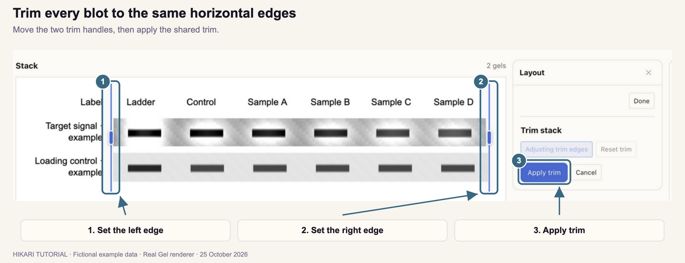

The same edges trim the stack's blots and their individual lane tables. You can focus a handle and use the arrow keys for small adjustments; hold **Shift** to move farther. The individual gels remain available for processing in the navigator.

## 15. Export figures and measurements

1. Select the individual gel or open the stack you want to export.
2. Inspect the displayed figure, including its labels, crop, and alignment.
3. Click **Export** in the right toolbar.
4. Choose **Image (PNG)** for an image, or **PowerPoint (PPTX)** for a slide with separate blot images and editable labels and table cells.
5. Follow the save prompt, then open the exported file to inspect it.

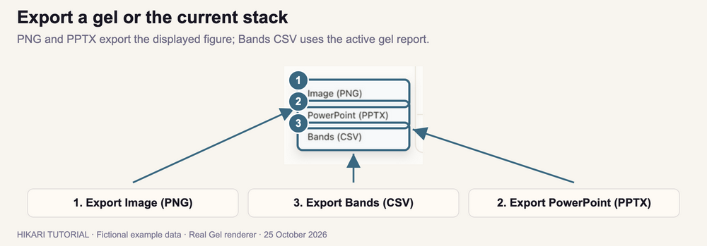

For **Bands (CSV)**, first select the individual gel whose analysis results you want, then choose that export. It exports that gel's band report. To copy the compact target-intensity table, use **Results > Band intensity > Copy table**.

For an individual gel, finish the lane dividers before exporting its figure. In a stack's view, PNG and PowerPoint export the combined stack shown in the viewer.

## 16. Keep a project backup and manage names

### Save a portable project

1. Open the stack's view.
2. Click **Save** in the right toolbar. In this view its action is **Save project**.
3. Save the downloaded `.gel-figure.json` file.
4. To reopen a project, click **Add gel > Project…** and choose the JSON file.
5. Inspect the imported layers, stacks, names, and settings.

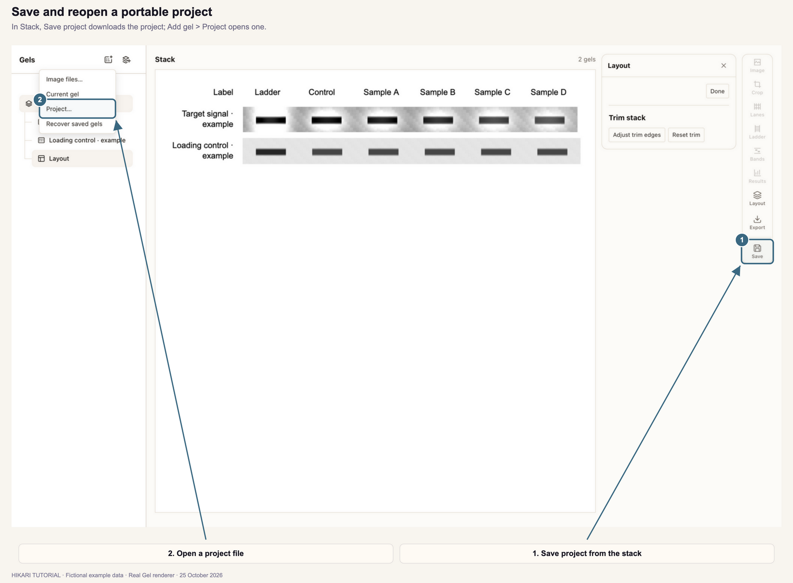

The project includes the gel images, processing settings, manual selections, lane tables, and stack placement. Opening a project merges its contents into the current workspace. You can practice with [practice.gel-figure.json](examples/practice.gel-figure.json), which contains the two simulated gels shown here.

### Rename or remove a gel

1. Double-click a gel, stack, or Layout entry in the navigator. You can also focus the entry and press **F2**.
2. Type the new name.
3. Press **Enter** to keep it, or **Escape** to cancel.

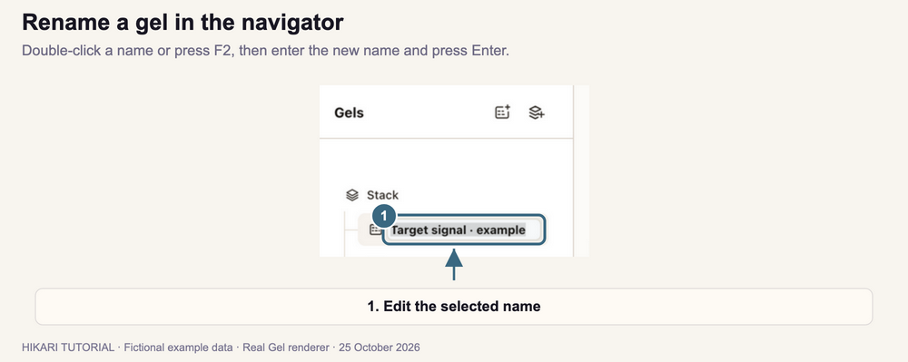

---

[Previous tutorial: Plate](../09-plate/index.html) · [Next tutorial: Figura](../11-figura/index.html) · [All tutorials](../index.html)
