# Figura

How to create an illustration, edit its components, reuse artwork, and export a figure.

**Follow the numbered steps and the highlighted controls in each screenshot.**

The screenshots use a fictional diagram with two schematic cells and a signal arrow. Artwork and labels remain separate, editable layers.

## 1. Open Figura

1. Open **More modules** in Hikari's top navigation bar and choose **Figura**.
2. Find saved figures in **Illustrations** on the left.
3. Click an illustration's row to open its canvas.
4. Use the top toolbar for the title, canvas size, drawing complexity, figure options, and exports.
5. Use the right toolbar for selection, layers, reusable assets, grouping, alignment, and zoom.

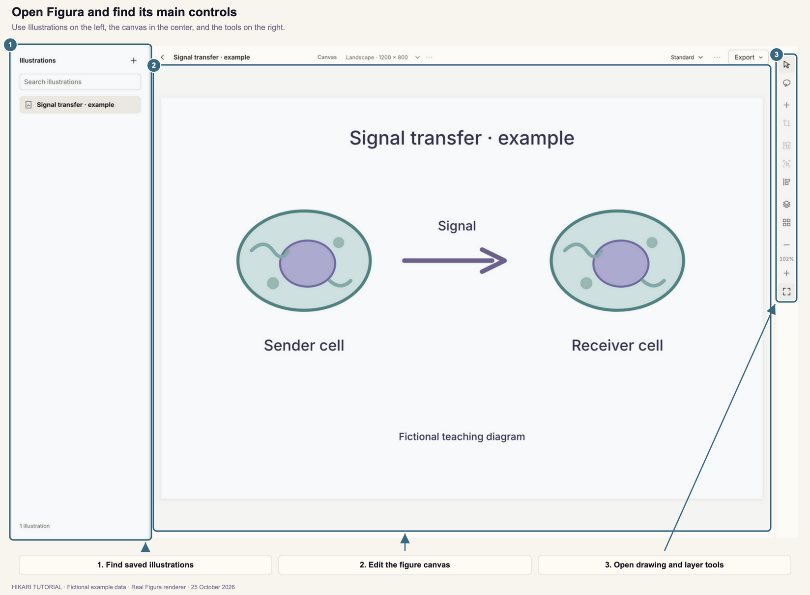

Open **Layers** or **Assets** when you need its panel. Click the active tool again, or the panel's close button, to return that space to the canvas. The chevron beside the figure title hides or shows the Illustrations rail.

## 2. Create and name an illustration

1. Click **New illustration**, the plus icon beside Illustrations.
2. Enter a descriptive title in the top-left title field, such as `Practice diagram · example`.
3. Click outside the field to finish the title edit.
4. Start with an AI description or add layers manually using the steps below.

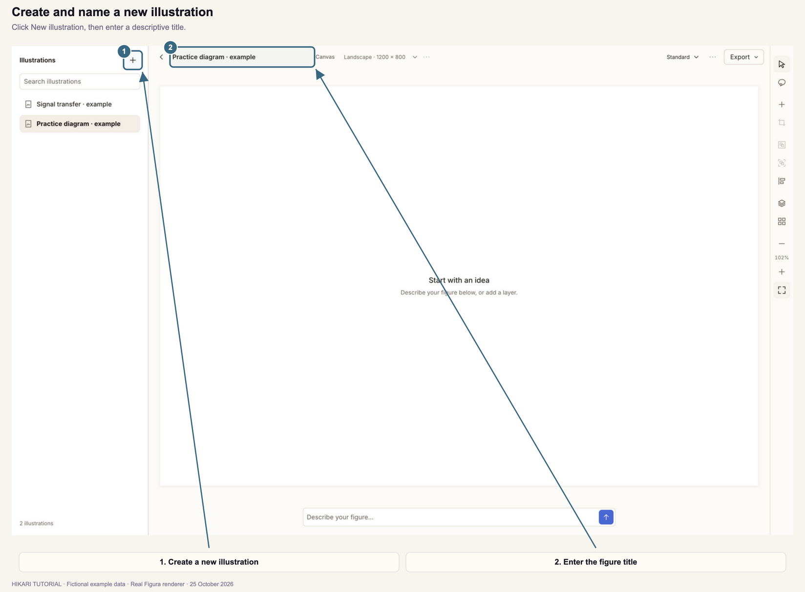

Figura saves each illustration independently as you finish edits. There is no separate Save button in the editor. If an error appears in the status line, resolve it before switching away or closing Hikari.

## 3. Describe a figure for Codex

### Start from an empty canvas

1. Choose a **Complexity** level in the top toolbar: **Simple**, **Standard**, or **Detailed**.
2. In the composer beneath the empty canvas, describe the content, relationships, labels, and arrangement you want.
3. Click **Draw with Codex**, the arrow beside the composer, or press **⌘Enter** on macOS / **Ctrl+Enter** on Windows.
4. Follow the work in Hikari's agent chat rail.
5. Inspect the resulting figure and labels before exporting it.

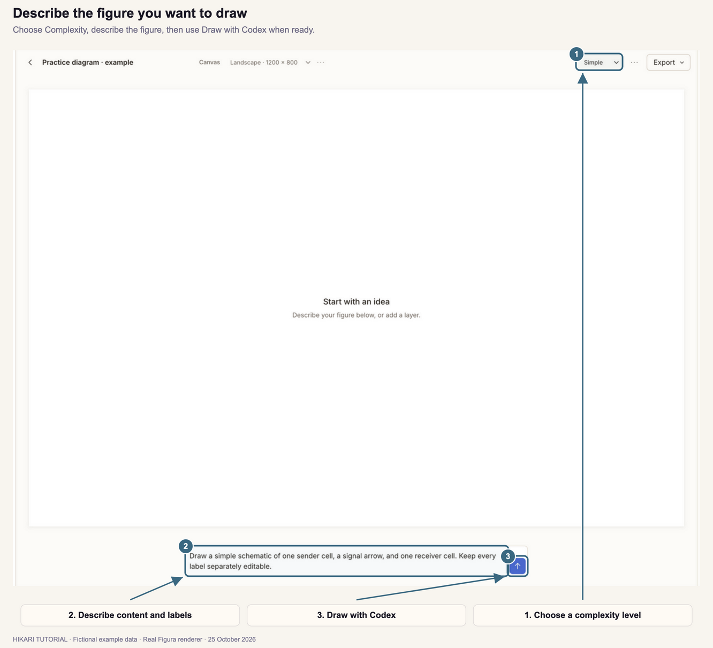

A practice description:

> Draw a simple schematic of one sender cell, a signal arrow, and one receiver cell. Keep every label separately editable.

Codex drawing requires Hikari's configured Codex access. When the illustration already contains components, open its agent chat rail to request changes; the starting composer beneath the canvas is hidden. Each illustration has its own conversation.

Use specific follow-up requests, such as “Move the receiver cell to the right and keep both cells the same size,” or “Change the arrow label to Signal A.” Changing Complexity guides the next request; it does not redraw the existing figure by itself.

### Set image-generation preferences

1. Open **Figure options**, the three-dot button beside Complexity.
2. Turn on **Image generation** if you want to specify a percentage preference.
3. Choose **0%, 25%, 50%, 75%, or 100%**. Use 0% when you want new illustrative artwork to remain SVG.
4. Choose an **Image style** and add **Style notes** when you want to describe the appearance of newly generated artwork.
5. Close the menu and make your next drawing or revision request.

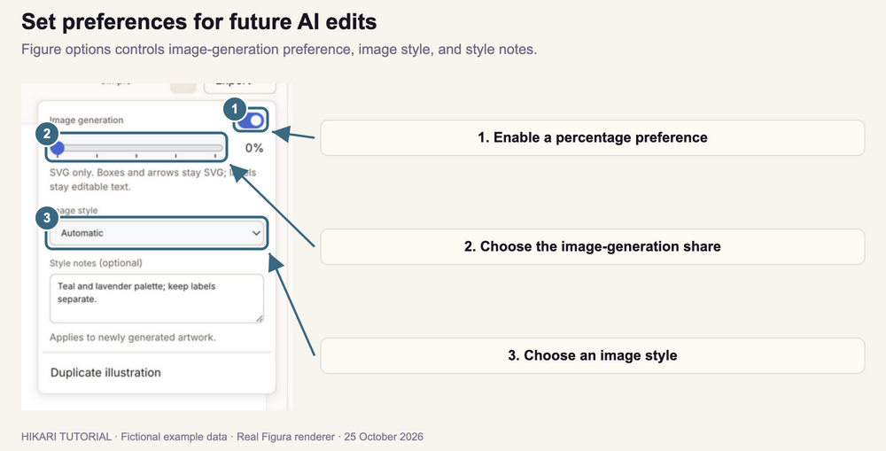

With the switch off, Figura uses **Automatic · SVG first**. The percentage guides the approximate area of eligible illustrative artwork; labels, arrows, frames, and quantitative charts stay separately editable. Preferences affect future requested edits and do not convert existing artwork automatically.

You can also start from **Protocols > Generate illustration**, or select text in a paper PDF and choose **Generate illustration**. Those actions create a new figure with the selected source context. For a data plot, give the agent the actual data, units, and intended error-bar definition, then inspect the resulting chart and calculations.

## 4. Set the canvas size

1. Open the **Canvas** size menu in the top toolbar.
2. Choose **Landscape**, **Portrait**, **Square**, **Widescreen**, or **Small**.
3. Choose **Custom…** for exact dimensions, or click the adjacent three-dot **Custom canvas size** button.
4. Enter **Width** and **Height**, then click outside each field to finish the edit.
5. Inspect the figure at its new bounds.

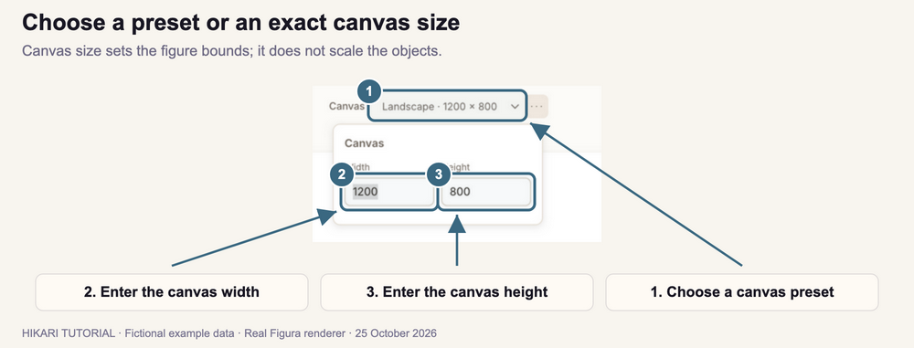

Changing canvas size changes the figure's bounds while preserving object positions and sizes. It does not scale the artwork to fit. Use **Fit** in the right toolbar to see the full canvas, and **− / +** to zoom. When zoomed in, scroll to pan; hold **⌘ / Ctrl** while scrolling to zoom at the pointer.

## 5. Add and edit text labels

1. Click **Add layer**, the plus icon in the right toolbar.
2. Choose **Text label**.
3. Enter the label's content in **Layers and properties**.
4. Adjust its font, size, color, weight, alignment, and anchor as needed.
5. Click outside the edited field to keep the change.

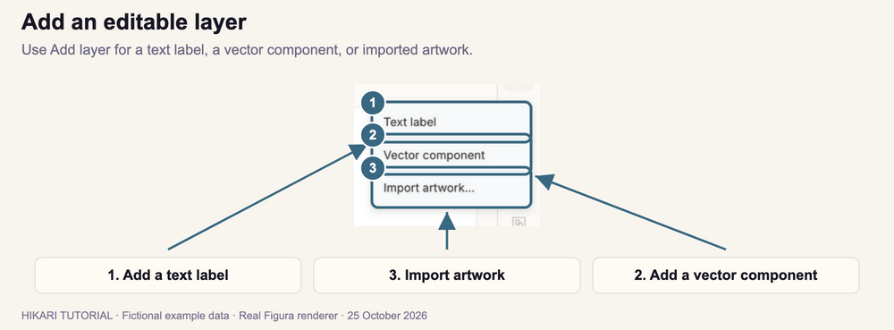

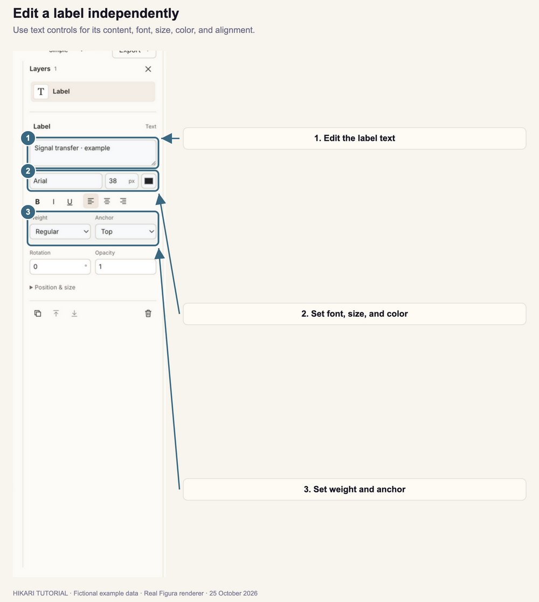

To revise a label already on the canvas, double-click it to open its text controls. Text remains independent of the underlying artwork. Resizing a text layer scales its box and font together; changing the font-size field gives you a separate size control.

Use **Position & size** for exact placement. For a label you want centered under a component, inspect its alignment and anchor as well as its position.

## 6. Add or style a vector component

1. Click **Add layer > Vector component**.
2. Select the new component on the canvas or in Layers.
3. Set **Fill**, **Stroke**, and **Stroke width** in its vector properties.
4. Move or resize the component to fit your figure.
5. For a prepared SVG component, use **Import artwork…** as described in the next section.

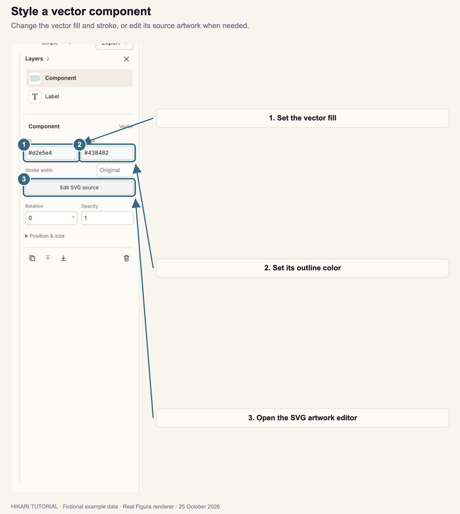

Clear a fill or stroke override to restore the original SVG styling. **Edit SVG source** opens the component's artwork source; use **Apply artwork** to keep an edited SVG or **Cancel** to leave it unchanged.

The supplied [cell-component.svg](examples/cell-component.svg) is a text-free example you can import. Add its label as a separate text layer.

## 7. Import and crop artwork

### Add artwork to the canvas

1. Click **Add layer > Import artwork…**.
2. Choose an SVG, PNG, JPEG, or WebP file, up to 5 MiB.
3. Inspect the preview. For a raster image, confirm that it contains no text by checking the review box.
4. Click **Add artwork**.
5. Position the new layer and add any labels separately.

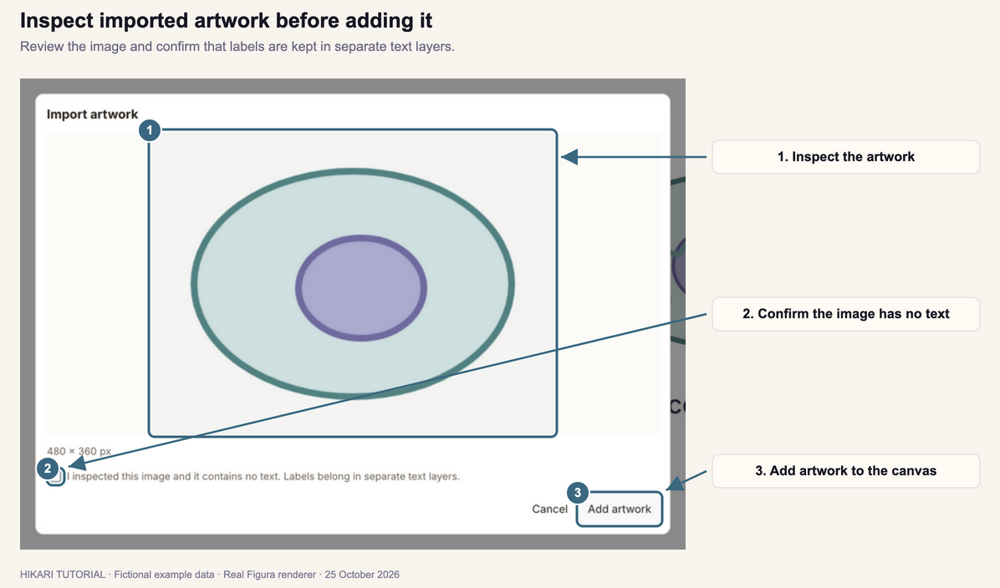

You can practice with [cell-artwork.png](examples/cell-artwork.png). It contains a schematic cell without labels. SVG imports must also contain artwork without text or embedded images.

### Crop a raster image

1. Select the imported image.
2. Click **Crop selected image** in the right toolbar.
3. Drag the crop handles, or enter exact **X**, **Y**, **Width**, and **Height** in pixels.
4. Click **Apply crop** to keep the cropped image.
5. Use **Reset** to restart the crop preview, or **Cancel / Escape** to leave the image unchanged.

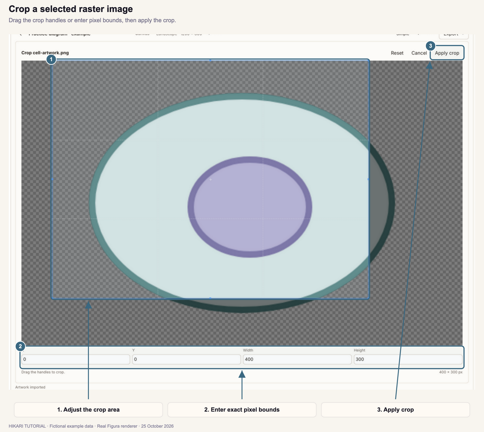

Crop applies to raster artwork. To replace an image, select its layer and use **Replace artwork…** in its properties.

## 8. Select one or several components

### Use rectangle selection

1. Choose **Select and move**, the pointer icon, or press **V** while the canvas has focus.
2. Click a component to select it.
3. Drag from empty canvas to draw a rectangle around several components.
4. Inspect the selection frames before moving or resizing anything.
5. Hold **Shift** to add to the selection. Press **Escape** to clear it.

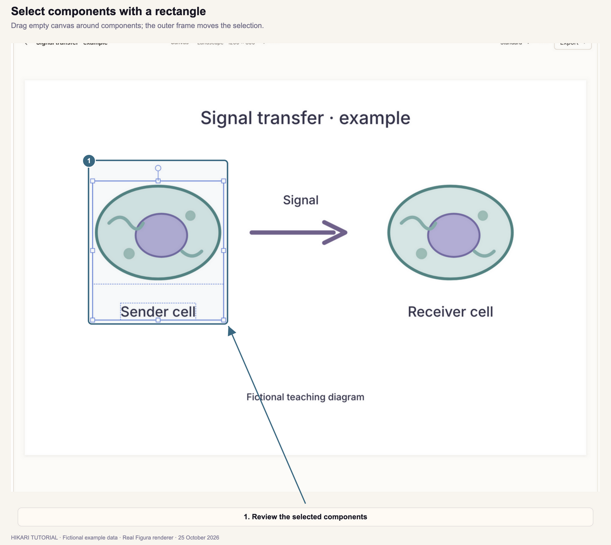

### Use a freehand outline

1. Choose **Freehand selection**, the lasso icon, or press **L**.
2. Drag a path around the components you want. The outline closes when you release the pointer.
3. Move or resize the resulting selection with its frame and handles.

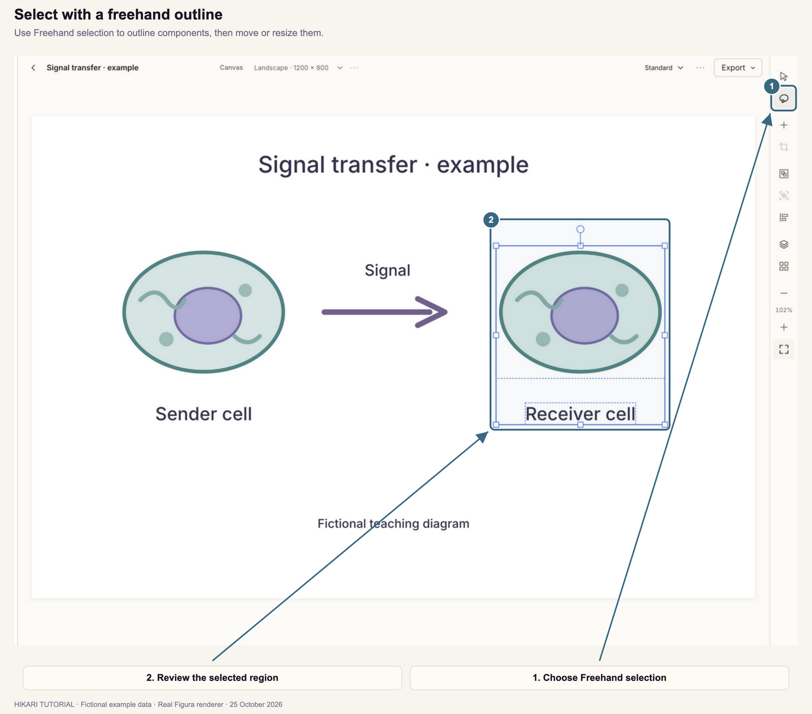

Components touched by the selection region are included. Groups select together; hold **Alt** to target individual group members. Clicking transparent space in artwork can select a visible component beneath it, so check the selected layer before editing.

## 9. Move, resize, and rotate components

### Move or enter exact dimensions

1. Select the component or components.
2. Drag a selected component to move the selection.
3. Drag a corner or edge handle to resize it.
4. For precise values, open **Layers**, select the component, and expand **Position & size**.
5. Enter **X**, **Y**, **Width**, or **Height**. Use the nearby **Rotation** and **Opacity** fields when needed.

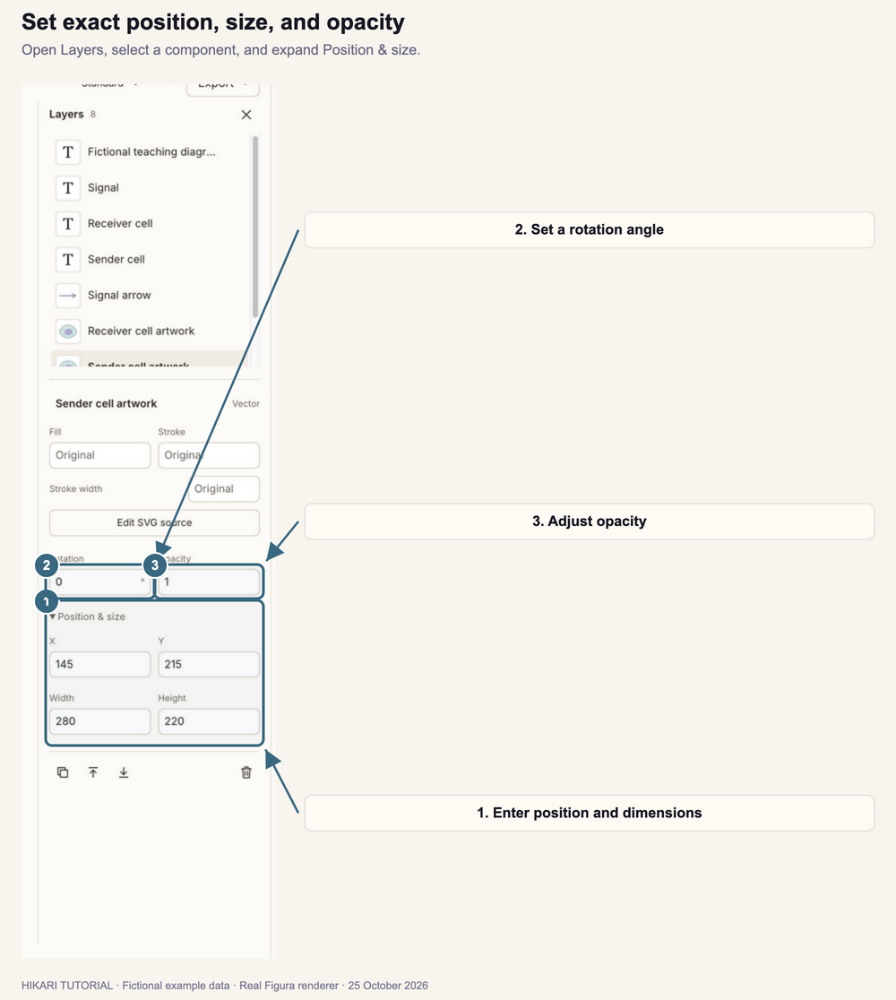

Arrow keys nudge a selection by one canvas unit; hold **Shift** to move by ten. Vector and raster handles can stretch artwork along one or both dimensions. Text handles preserve its aspect ratio and scale the font with its box.

### Rotate with the canvas handle

1. Select a component or group.
2. Drag the round handle connected to its selection frame.
3. Hold **Shift** to snap to 15-degree increments.
4. Release to keep the rotation, or press **Escape** during the drag to cancel.

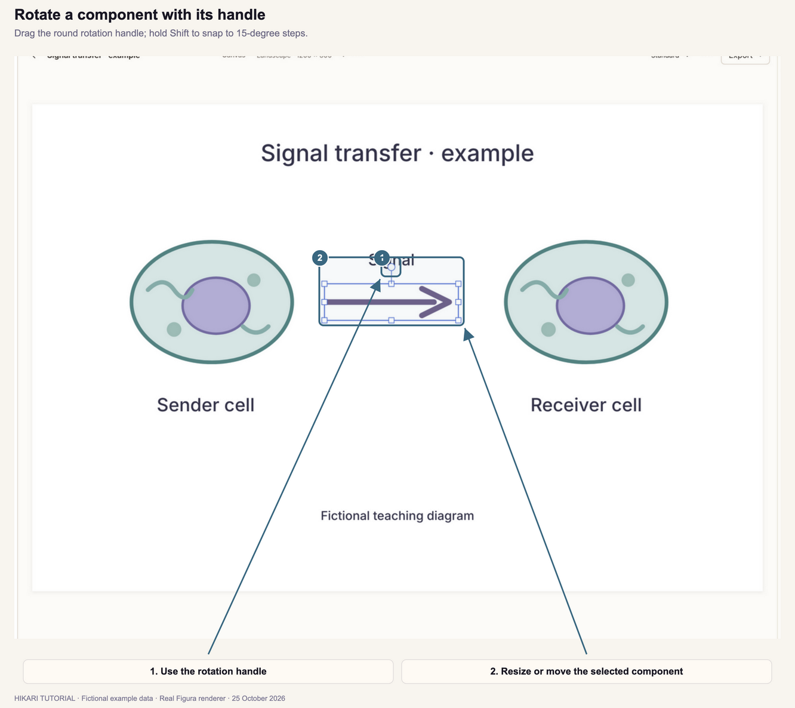

You can focus the rotation handle and use arrow keys for one-degree steps, or **Shift + arrow** for 15-degree steps. Hikari's Undo and Redo actions let you revise a completed edit; **⌘/Ctrl+Z** undoes and **⌘/Ctrl+Shift+Z** redoes.

## 10. Manage layers and visibility

1. Open **Layers and properties** from the right toolbar.
2. Click a layer row to select its component.
3. Hover over or focus the row to reveal its visibility button. Click it to hide or show the component.
4. With a component selected, use the bottom action icons to **Duplicate layer**, **Bring forward**, **Send backward**, or **Delete layer**.
5. Inspect overlapping artwork after changing layer order.

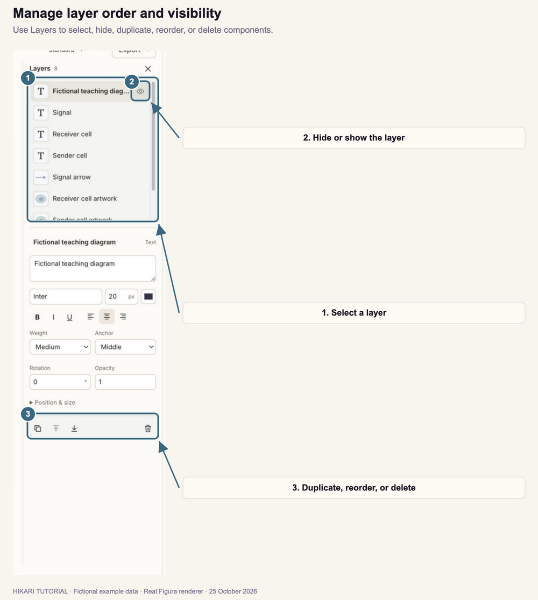

Hidden layers remain in the illustration but are omitted from exports. Layer names help you identify artwork separately from its labels. You can change the selected layer's name at the top of its properties.

## 11. Group related artwork and labels

1. Select the components you want to keep together, such as a cell and its label.
2. Click **Group selection** in the right toolbar, or press **⌘G / Ctrl+G**.
3. Move, resize, or rotate the group using its outer frame.
4. To separate the components again, select the group and click **Ungroup**, or press **⌘Shift+G / Ctrl+Shift+G**.

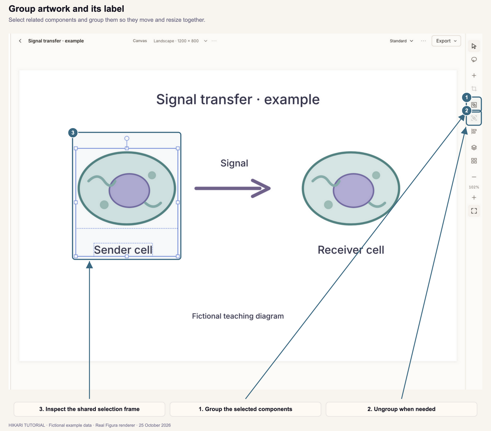

Grouping keeps artwork and text independently editable. A selected group shows its outer frame; you can select an individual member from Layers when you need to edit only that component.

### Use the context menu

Right-click a component on the canvas or its layer row for **Copy**, **Paste**, **Group**, **Ungroup**, and **Save as an asset…**. Unavailable actions are disabled. On macOS, Control-click also opens the menu.

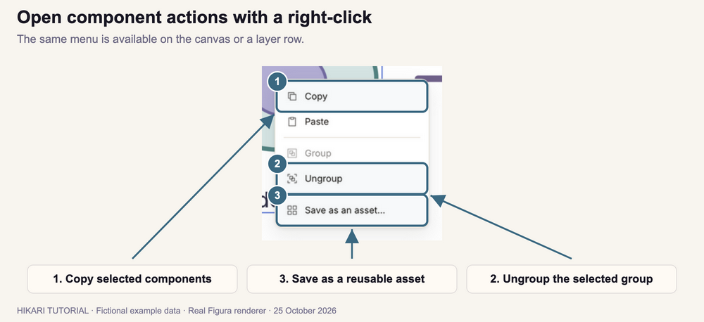

Right-clicking an already selected component keeps the current multiple selection. Press **Escape** to dismiss the menu.

## 12. Align components and distribute spacing

1. Select at least two items.
2. Open **Align and distribute** in the right toolbar.
3. Choose left, right, top, bottom, horizontal-center, or vertical-center alignment.
4. With three or more items, choose **Distribute horizontally** or **Distribute vertically** for equal gaps.
5. Inspect the result and use Undo if you want to try another arrangement.

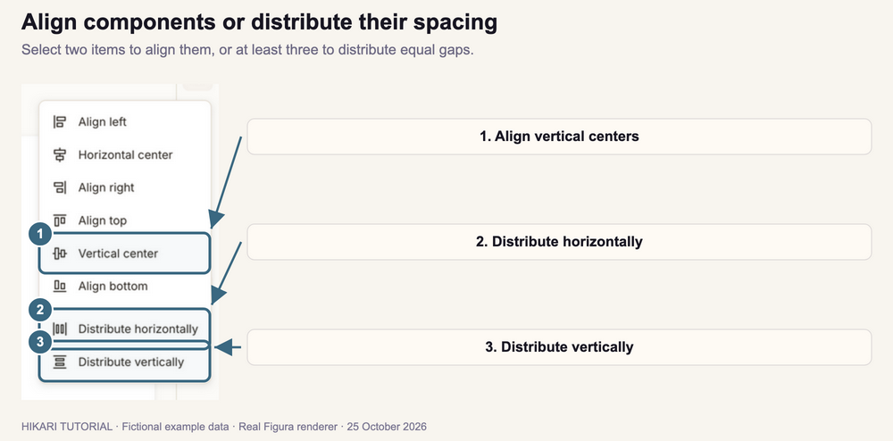

Alignment uses the selection's visible bounds. Distribution keeps the outside items in place while spacing the items between them. Complete groups count as single items; individual group members can also be selected and arranged separately.

## 13. Copy and paste editable components

1. Select a component, several components, or a group.
2. Right-click and choose **Copy**, or use **⌘C / Ctrl+C**.
3. Stay on the same canvas, or open another illustration in the left rail.
4. Right-click the destination canvas and choose **Paste**, or use **⌘V / Ctrl+V**.
5. Move the selected copies to their intended positions.

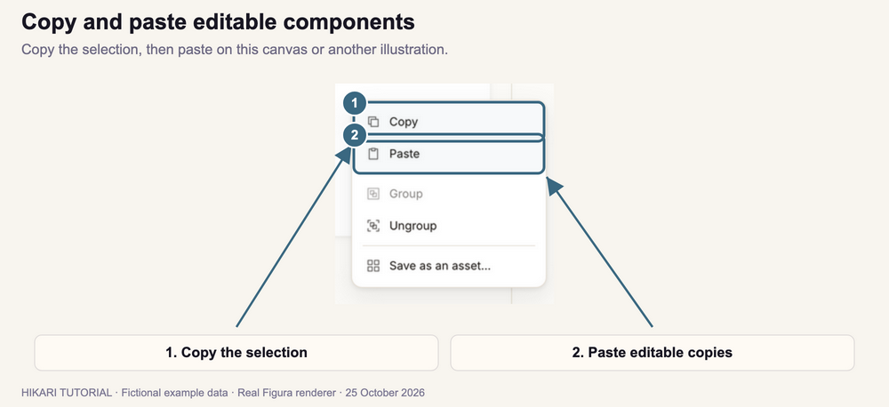

Copies retain artwork, separate labels, styles, rotation, and group membership. They appear slightly offset so you can see the new selection. Editing a copy does not alter the original. Text-field copy and paste continue to work as ordinary text editing.

## 14. Save and reuse components as assets

### Save a component or group

1. Select the artwork and labels you want to reuse.
2. Right-click and choose **Save as an asset…**.
3. Enter a descriptive **Name**.
4. Click **Save asset**.

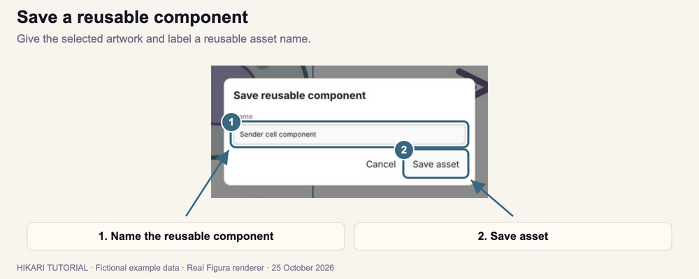

### Insert an asset

1. Open **Reusable assets** in the right toolbar.
2. Search for the component by name.
3. Click its preview or name to insert an editable copy into the active illustration.
4. Move or resize the inserted selection as needed.

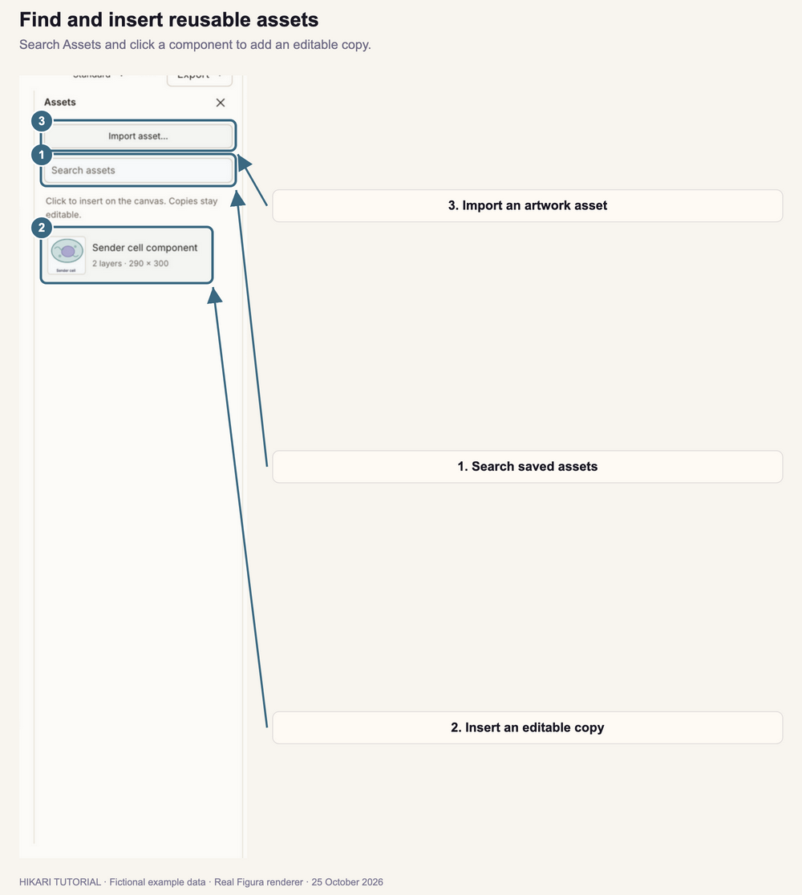

**Import asset…** adds an artwork file to the reusable library. To remove a saved asset, use its trash icon in Assets. Existing copies already placed in illustrations remain independent.

## 15. Find and duplicate saved illustrations

1. Use **Search illustrations** in the left rail to filter titles.
2. Click a matching row to open its saved canvas.
3. Clear the search to see all illustrations again.
4. If the rail is folded, use the title's chevron to show it.

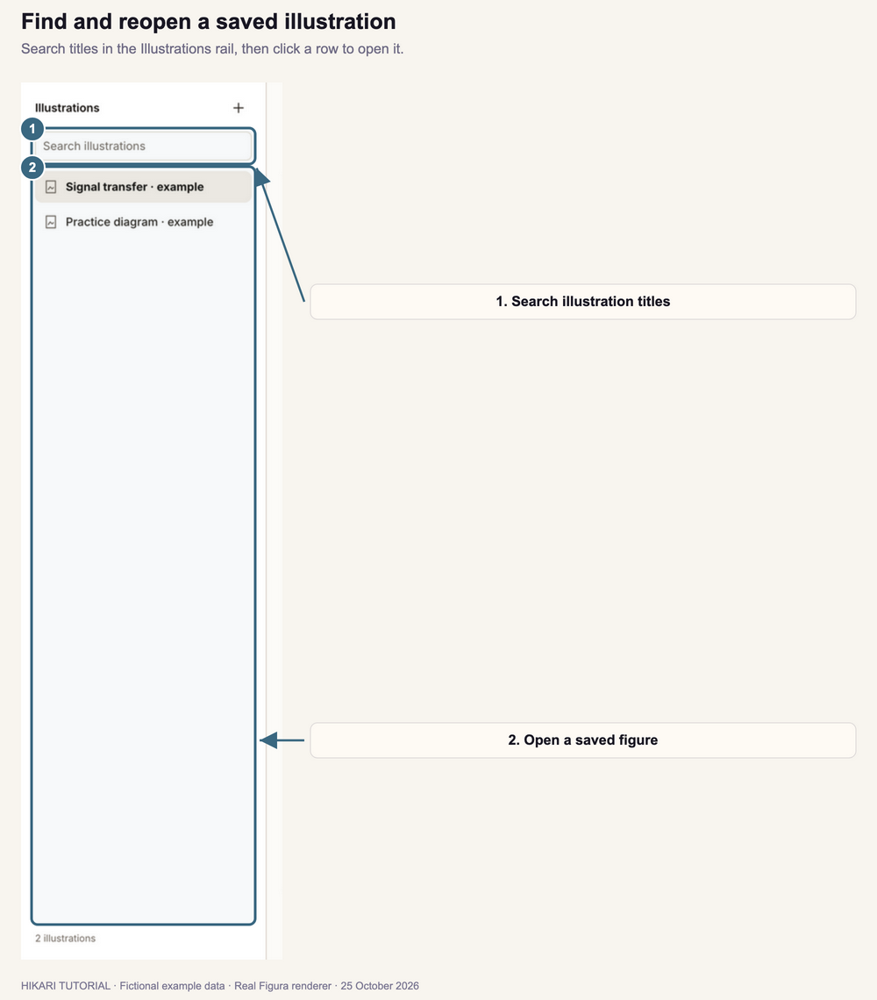

### Make a separate version

1. Open the figure you want to copy.
2. Open **Figure options** beside Complexity.
3. Click **Duplicate illustration**.
4. Give the copy a new title, then make your revisions there.

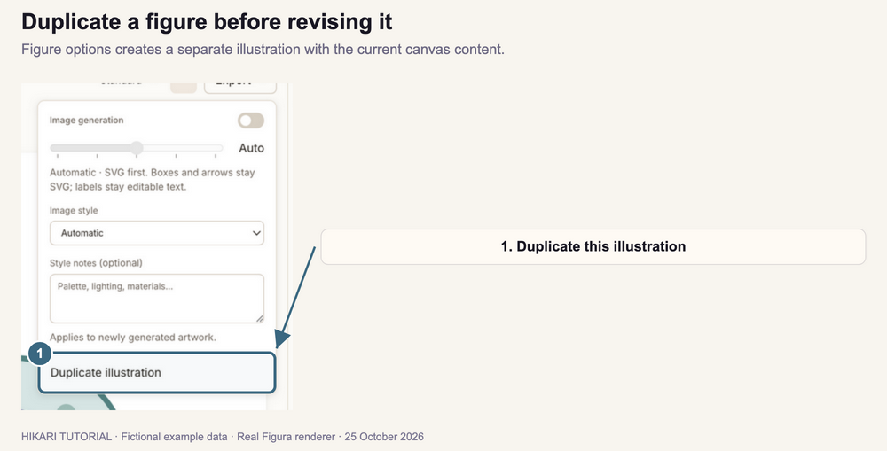

The copy starts with the figure's content and settings and has its own conversation. The original remains available in the library.

## 16. Export the finished figure

1. Inspect the full canvas with **Fit**. Check labels, positions, overlap, and which layers are visible.
2. Open **Export** in the top toolbar.
3. Choose **SVG**, **PNG**, or **PowerPoint**.
4. Follow the save prompt and open the exported file to inspect it.

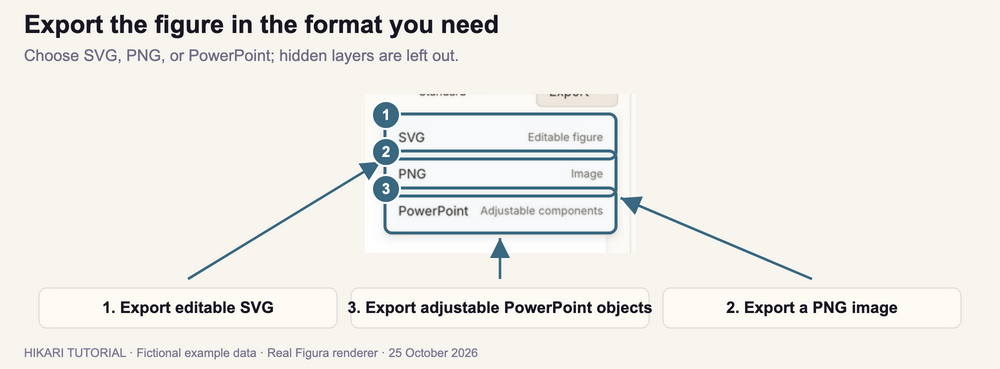

| Format | Use it for |
| --- | --- |
| **SVG** | A vector figure that retains separate artwork and text groups. |
| **PNG** | An assembled image of the visible canvas. |
| **PowerPoint** | A slide with separate components you can move, resize, rotate, or delete. Labels remain editable text boxes. |

Hidden layers and selection handles do not appear in exports. In PowerPoint, raster artwork remains an image; editing vector paths requires PowerPoint's **Convert to Shape** feature. Fonts other than the bundled Inter font may need to be installed on the computer opening the file.

You can inspect [the example exported SVG](examples/finished-figure.svg) alongside your own result.

---

[Previous tutorial: Gel](../10-gel/index.html) · [All tutorials](../index.html)
