# Figura

How to create an illustration, edit its components, reuse artwork, and export a figure.

**Follow the numbered steps and the highlighted controls in each screenshot.**

The screenshots use a fictional diagram with two schematic cells and a signal arrow. Artwork and labels remain separate, editable layers.

## 1. Open Figura

1. Open **More modules** in Hikari's top navigation bar and choose **Figura**.
2. Find saved figures under **Illustrations** on the left. The switch beside it shows **Assets**, your reusable components.
3. Click an illustration's row to open its canvas.
4. Use the top toolbar for the title, canvas size, detail level, image-generation settings, and exports.
5. Use the right toolbar for selection, grouping, alignment, adding layers, the figure palette, cropping, layers, and zoom.

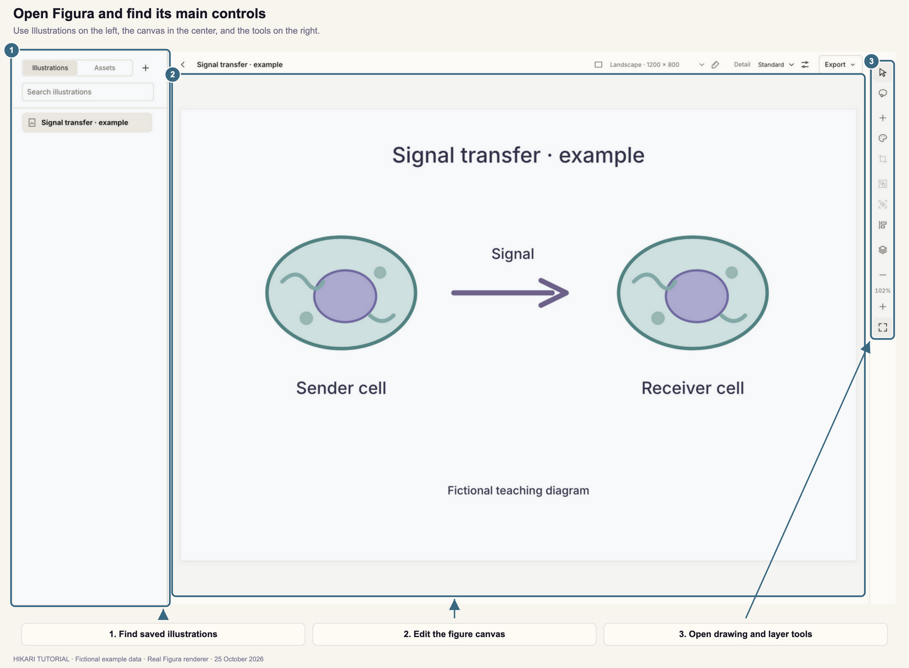

Open **Layers** when you need its panel. Click it again, or the panel's close button, to return that space to the canvas. The chevron beside the figure title hides or shows the left rail.

## 2. Create and name an illustration

1. Click **New illustration**, the plus icon beside the Illustrations and Assets switch.
2. Enter a descriptive title in the top-left title field, such as `Practice diagram · example`.
3. Click outside the field to finish the title edit.
4. Start with an AI description or add layers manually using the steps below.

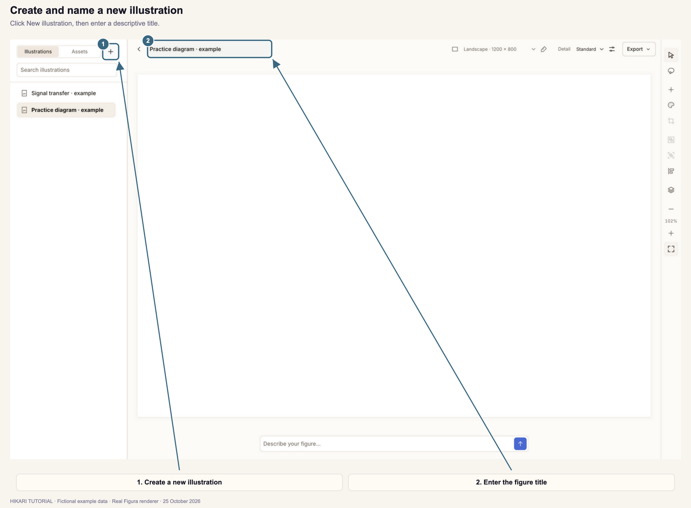

Figura saves each illustration independently as you finish edits. There is no separate Save button in the editor. If an error appears in the status line, resolve it before switching away or closing Hikari.

## 3. Describe a figure for Codex

### Start from an empty canvas

1. Choose a **Detail** level in the top toolbar: **Simple**, **Standard**, or **Detailed**.
2. In the composer beneath the empty canvas, describe the content, relationships, labels, and arrangement you want.
3. Click **Draw with Codex**, the arrow beside the composer, or press **⌘Enter** on macOS / **Ctrl+Enter** on Windows.
4. Follow the work in Hikari's agent chat rail.
5. Inspect the resulting figure and labels before exporting it.

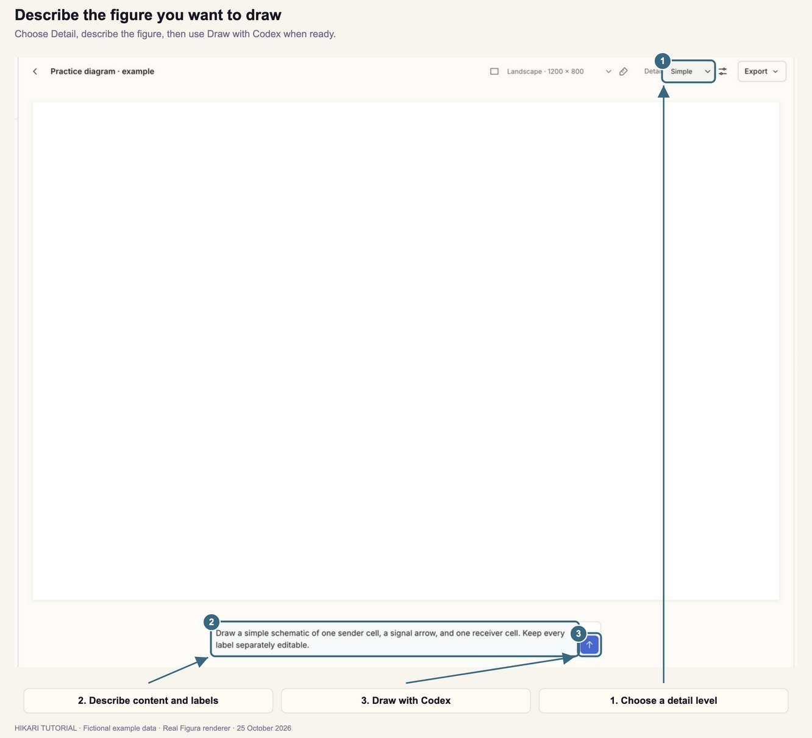

A practice description:

> Draw a simple schematic of one sender cell, a signal arrow, and one receiver cell. Keep every label separately editable.

Codex drawing requires Hikari's configured Codex access. When the illustration already contains components, open its agent chat rail to request changes; the starting composer beneath the canvas is hidden. Each illustration has its own conversation.

Use specific follow-up requests, such as “Move the receiver cell to the right and keep both cells the same size,” or “Change the arrow label to Signal A.” Changing Detail guides the next request; it does not redraw the existing figure by itself.

### Set image-generation preferences

1. Click **Image generation settings**, the sliders button beside Detail.
2. Turn on **Image generation** if you want to specify a percentage preference.
3. Choose **0%, 25%, 50%, 75%, or 100%**. Use 0% when you want new illustrative artwork to remain SVG.
4. Choose an **Image style** and add **Style notes** when you want to describe the appearance of newly generated artwork.
5. Close the menu and make your next drawing or revision request.

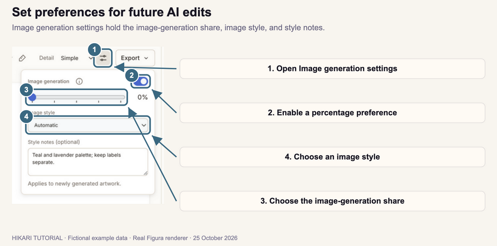

With the switch off, Figura uses **Automatic · SVG first**. The percentage guides the approximate area of eligible illustrative artwork; labels, arrows, frames, and quantitative charts stay separately editable. Preferences affect future requested edits and do not convert existing artwork automatically.

You can also start from **Protocols > Generate illustration**, or select text in a paper PDF and choose **Generate illustration**. Those actions create a new figure with the selected source context. For a data plot, give the agent the actual data, units, and intended error-bar definition, then inspect the resulting chart and calculations.

## 4. Set the canvas size

1. Open the canvas-size menu in the top toolbar.
2. Choose **Landscape**, **Portrait**, **Square**, **Widescreen**, or **Small**.
3. For exact dimensions, choose **Custom…**, or click the ruler button beside the menu (**Custom canvas size**).
4. Enter **Width** and **Height**, then click outside each field to finish the edit.
5. Inspect the figure at its new bounds.

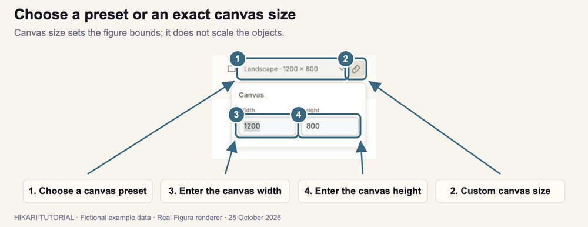

Changing canvas size changes the figure's bounds while preserving object positions and sizes. It does not scale the artwork to fit. Use **Fit** in the right toolbar to see the full canvas, and **− / +** to zoom. When zoomed in, scroll to pan; hold **⌘ / Ctrl** while scrolling to zoom at the pointer.

## 5. Add and edit text labels

1. Click **Add layer**, the plus icon in the right toolbar.
2. Choose **Text label**.
3. Enter the label's content in **Layers**.
4. Adjust its font, size, and color, then use the toolbar below for bold, italic, underline, and alignment.
5. Click outside the edited field to keep the change.

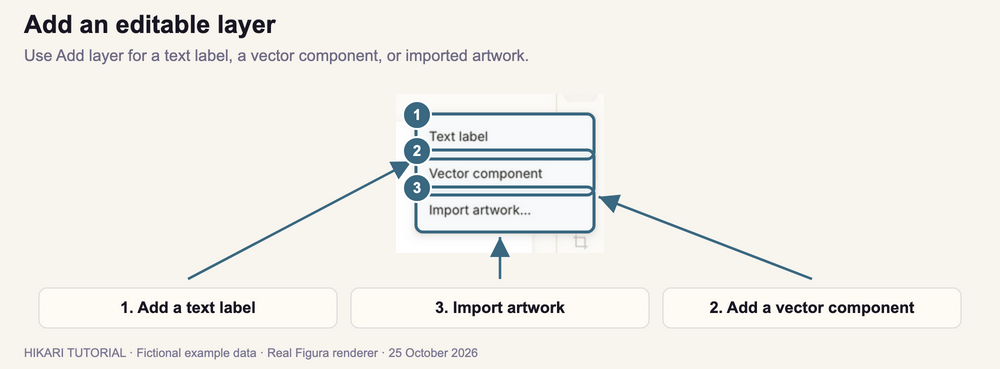

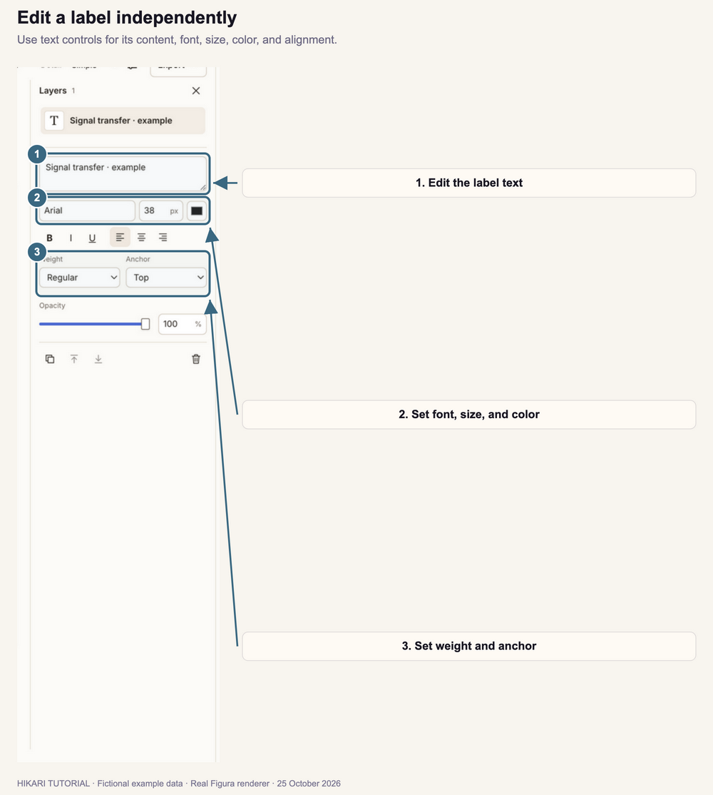

### Edit a label on the canvas

1. Double-click the label on the canvas, or its row in Layers.
2. Type the new text. Press **Shift+Enter** for a new line.
3. Press **Enter** to save, or **Escape** to cancel. Clicking elsewhere also saves.

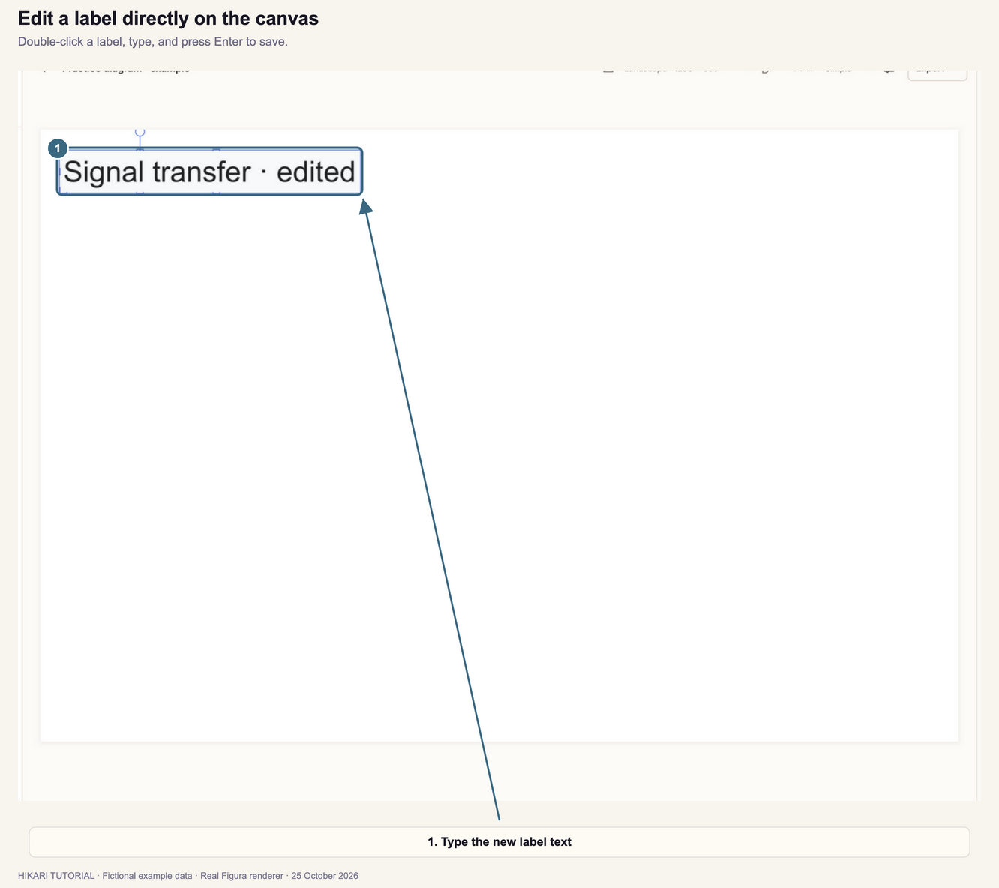

Each text change can be undone in one step. Text remains independent of the underlying artwork, and its row in Layers shows the label text. The font field suggests the fonts installed on your computer. Dragging a text layer's handles changes the size of its box and keeps the font size; the font-size field changes the type size on its own. The alignment buttons place the text inside its own box without moving the box.

## 6. Recolor vector artwork and set a palette

### Change one color

1. Select a vector component, such as a cell drawing, on the canvas or in Layers.
2. Open **Layers**. Under **Colors**, the component's colors appear as swatches.
3. Click the swatch for the color you want to change. While it is active, the canvas outlines the parts that use that color with a moving dashed line and fades the rest of the component.
4. Pick the new color. Every part painted with the old color changes together, as one undoable edit.

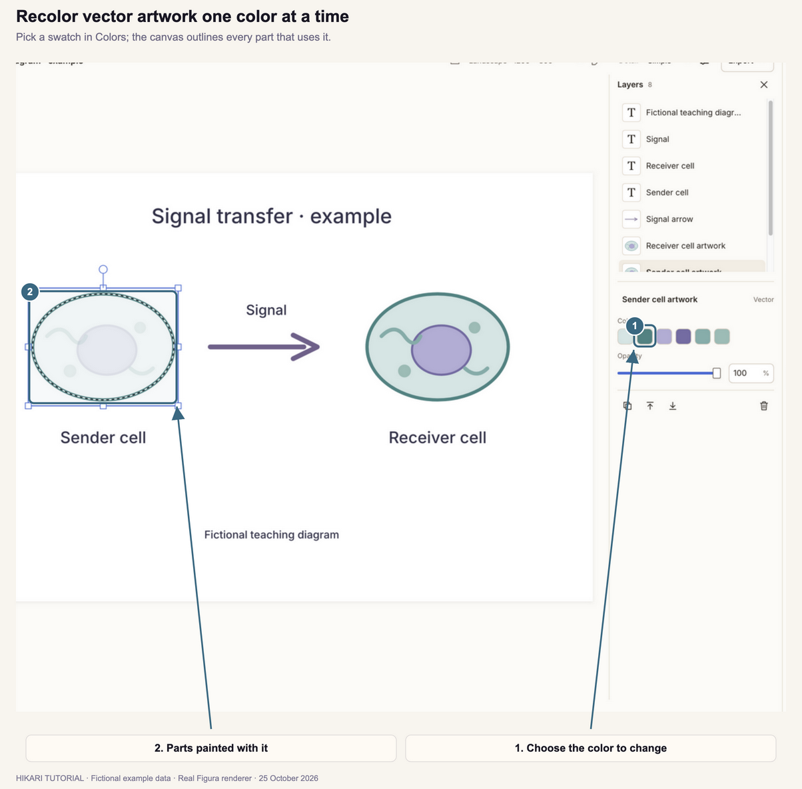

Only colors written as hex values get a swatch. For a prepared SVG component, use **Import artwork…** as described in the next section. The supplied [cell-component.svg](examples/cell-component.svg) is a text-free example you can import. Add its label as a separate text layer.

### Set the figure palette

1. Click **Figure palette**, the palette icon in the right toolbar.
2. Type a hex code, such as `#4169d8`, and click **Add color**. A figure can hold up to eight.
3. Click a swatch to change its color, or its **×** to remove it.

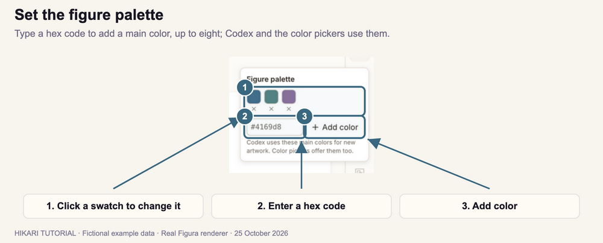

The palette is saved with the figure, and each change can be undone. Codex uses these colors for new artwork, plots, and generated images, and leaves existing artwork alone unless you ask it to recolor. The text color and Colors pickers offer the palette colors. With an empty palette, Codex chooses the colors.

## 7. Import and crop artwork

### Add artwork to the canvas

1. Click **Add layer > Import artwork…**.
2. Choose one or more SVG, PNG, JPEG, or WebP files, each up to 5 MiB.
3. Inspect the preview. For raster images, confirm that they contain no text by checking the review box.
4. Click **Add artwork**.
5. Position the new layers and add any labels separately.

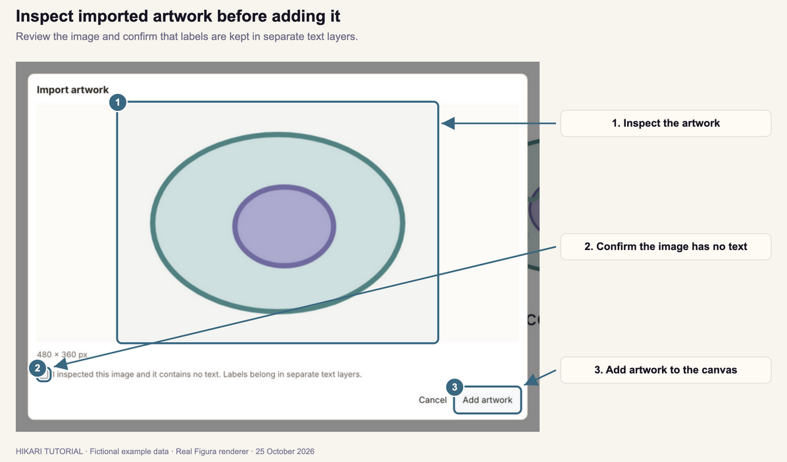

You can also drag SVG, PNG, JPEG, or WebP files from Finder or Explorer onto the canvas. One review dialog covers every dropped file; the first is placed where you drop it and the rest cascade from there. Other file types are skipped.

You can practice with [cell-artwork.png](examples/cell-artwork.png). It contains a schematic cell without labels. SVG imports must also contain artwork without text or embedded images.

### Crop a raster image

1. Select the imported image.
2. Click **Crop selected image** in the right toolbar.
3. Drag the crop handles, or enter exact **X**, **Y**, **Width**, and **Height** in pixels.
4. Click **Apply crop** to keep the cropped image.
5. Use **Reset** to restart the crop preview, or **Cancel / Escape** to leave the image unchanged.

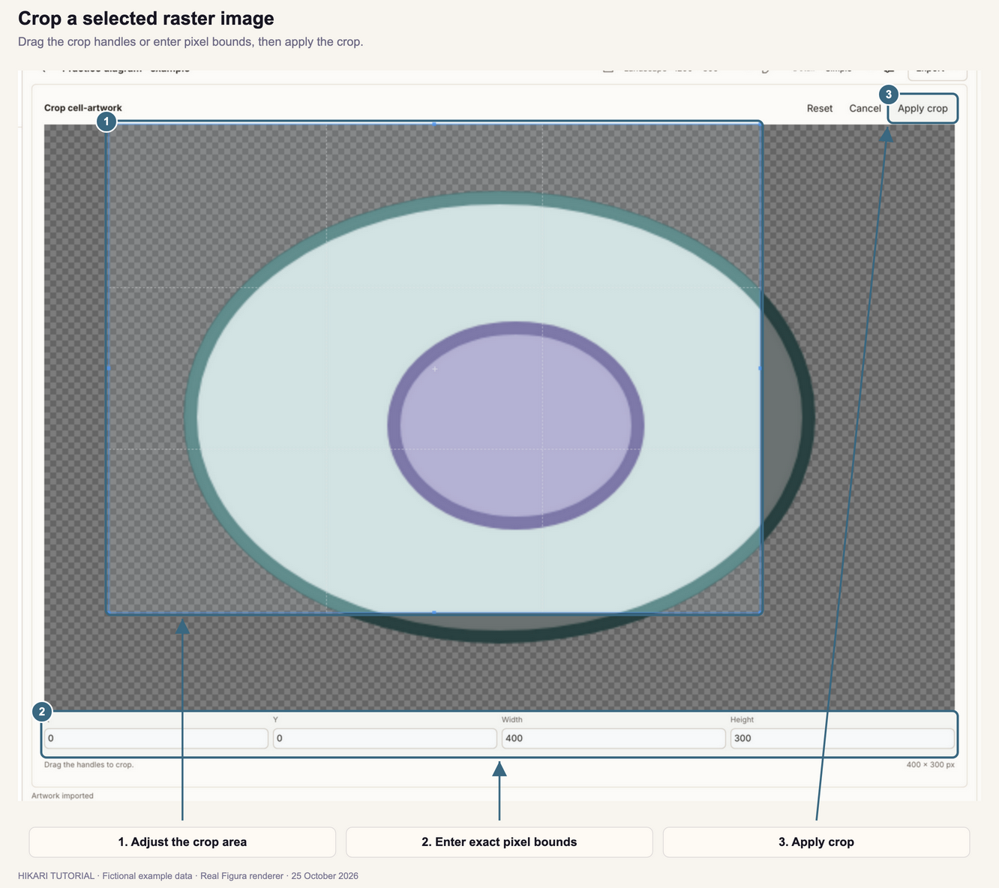

Crop applies to raster artwork. To use a different image, import the new file and delete the old layer.

## 8. Select one or several components

### Use rectangle selection

1. Choose **Select and move**, the pointer icon, or press **V** while the canvas has focus.
2. Click a component to select it. **Shift**-click adds or removes a component.
3. Drag from empty canvas to draw a rectangle around several components.
4. Inspect the outlines: each selected component shows its own.
5. Use the bar above the selection to **Group**, **Ungroup**, or **Align and distribute**. Press **Escape** to clear the selection.

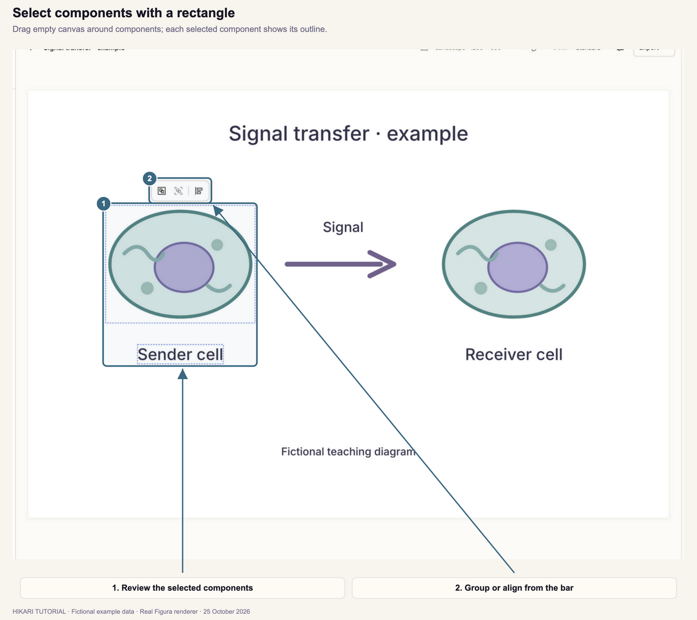

### Use a freehand outline

1. Choose **Freehand selection**, the lasso icon, or press **L**.
2. Drag a path around the components you want. The outline closes when you release the pointer.
3. Drag any selected component to move the whole selection.

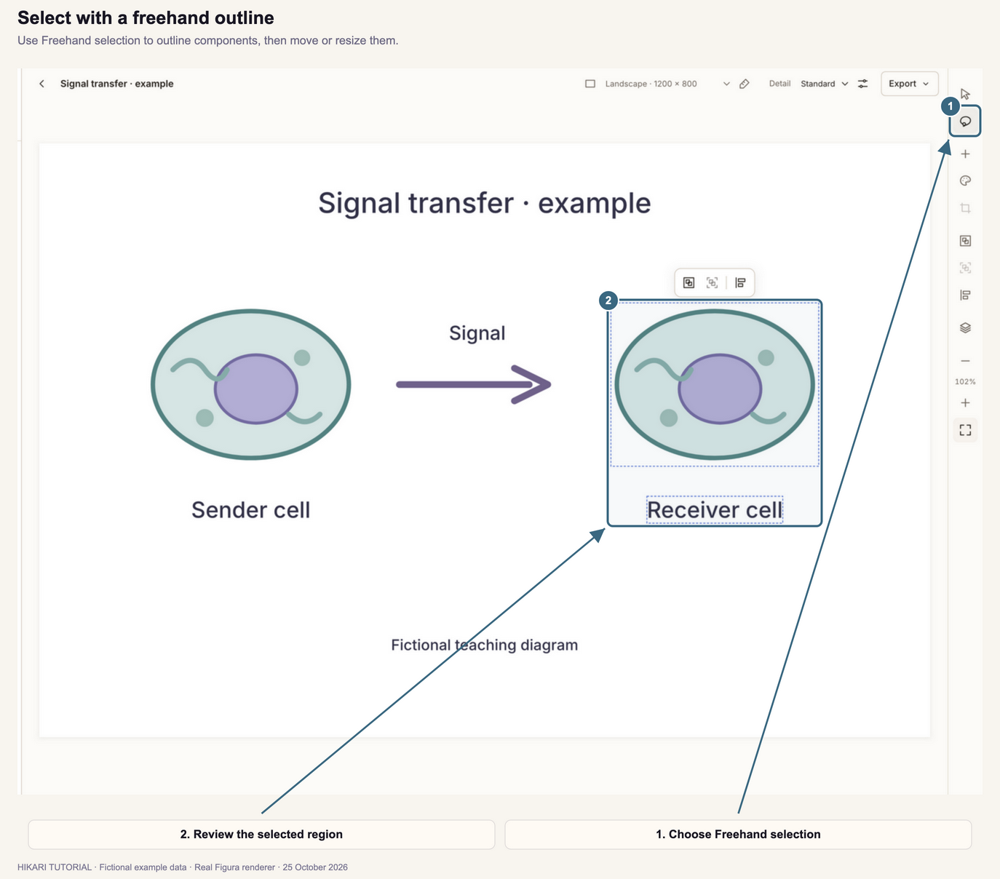

Components touched by the selection region are included. Groups select together; hold **Alt** to target individual group members. Clicking transparent space in artwork can select a visible component beneath it, so check the selected layer before editing.

## 9. Move, resize, and rotate components

### Move and resize

1. Select the component or components.
2. Drag a selected component to move the selection. Hold **Shift** while dragging to keep the move horizontal or vertical.
3. While you drag, **smart guides** snap the selection to nearby components and the canvas edges and center. Dashed lines mark alignment; markers show equal spacing.
4. Release to place the selection, or press **Escape** to cancel the move.
5. To resize a single component, drag a corner or edge handle. Hold **Shift** to keep its proportions.

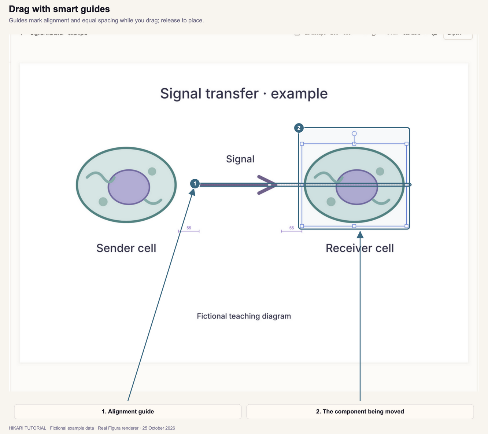

Hold **⌘** on macOS or **Ctrl** on Windows while dragging to move freely, or turn off **Smart guides** in **Align and distribute**. Arrow keys nudge a selection by one canvas unit; hold **Shift** to move by ten. Vector and raster handles can stretch artwork along one or both dimensions. Text handles preserve its aspect ratio and scale the font with its box.

### Rotate with the canvas handle

1. Select a single component.
2. Drag the round handle connected to its selection frame.
3. Hold **Shift** to snap to 15-degree increments.
4. Release to keep the rotation, or press **Escape** during the drag to cancel.

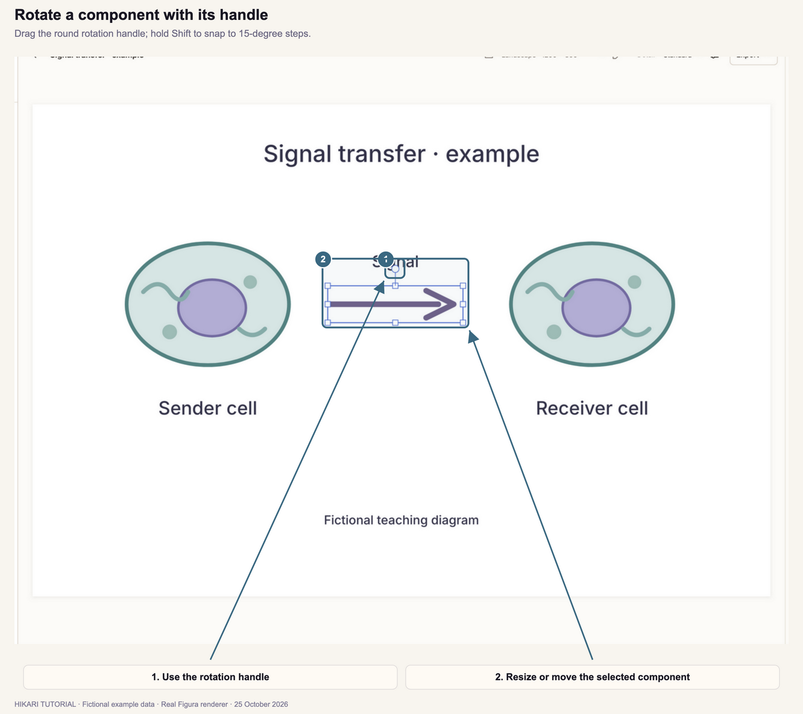

You can focus the rotation handle and use arrow keys for one-degree steps, or **Shift + arrow** for 15-degree steps. Hikari's Undo and Redo actions let you revise a completed edit; **⌘/Ctrl+Z** undoes and **⌘/Ctrl+Shift+Z** redoes.

## 10. Manage layers and visibility

1. Open **Layers** from the right toolbar.
2. Click a layer row to select its component.
3. Hover over or focus the row to reveal its visibility button. Click it to hide or show the component.
4. Drag the **Opacity** slider, or enter a percentage from 0 to 100.
5. Drag a layer row to change the stacking order, or focus a row and press **Alt + ↑ / Alt + ↓**.
6. With a component selected, use the bottom action icons to **Duplicate layer** or **Delete layer**.

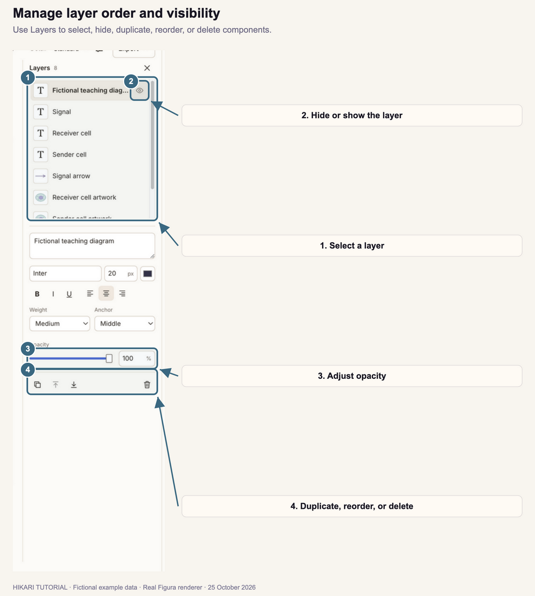

The top row of the list is the front of the figure. Hidden layers remain in the illustration but are omitted from exports. Releasing the opacity slider saves one undoable change; **Escape** cancels an unfinished slider preview. Artwork layers have a name you can change at the top of their properties; text layers are listed by their text.

## 11. Group related artwork and labels

1. Select the components you want to keep together, such as a cell and its label.
2. Click **Group selection** in the right toolbar or in the bar above the selection, or press **⌘G / Ctrl+G**.
3. Drag any member to move the whole group. Clicking one member selects the whole group.
4. To separate the components again, select the group and click **Ungroup**, or press **⌘Shift+G / Ctrl+Shift+G**.

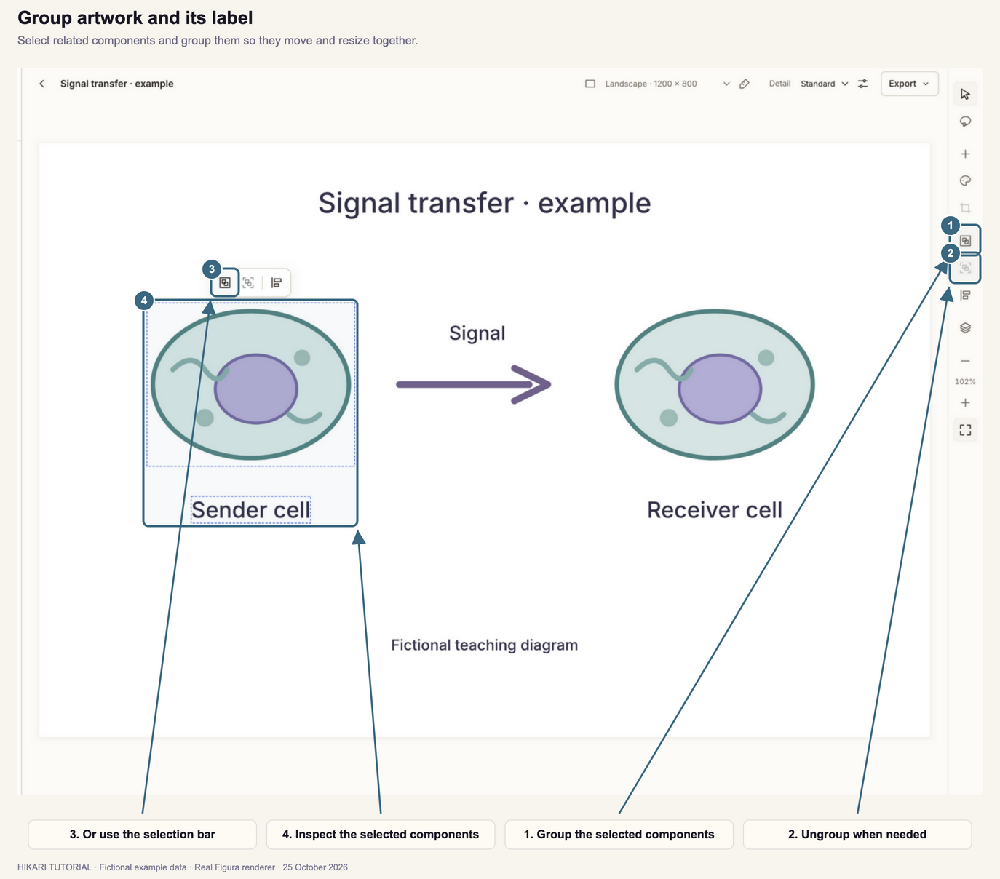

Grouping keeps artwork and text independently editable. A selected group outlines each of its members. To edit only one member, hold **Alt** while clicking it, or select it in Layers. Resize handles and the rotation handle appear when a single component is selected.

### Use the context menu

Right-click a component on the canvas or its layer row for **Copy**, **Paste**, **Group**, **Ungroup**, **Save as an asset…**, and **Generate here with Codex…**. Unavailable actions are disabled. On macOS, Control-click also opens the menu.

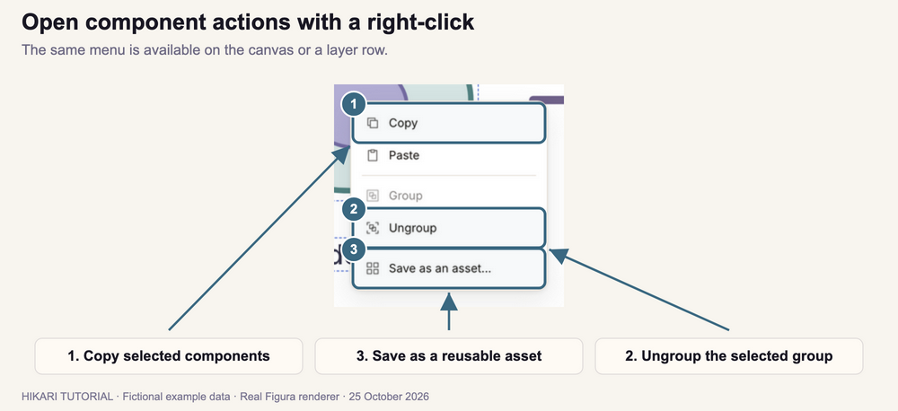

Right-clicking an already selected component keeps the current multiple selection. Press **Escape** to dismiss the menu.

### Draw one component at a chosen spot

1. Right-click the place on the canvas where the component belongs.
2. Choose **Generate here with Codex…**.
3. Describe the component.
4. Choose a **Format**: **Automatic**, **Editable SVG**, or **Image generation**.
5. Leave **Image style** on the figure's saved style, or pick another for this component only. It does not apply to **Editable SVG**.
6. Click **Generate with Codex** and follow the work in the chat rail.

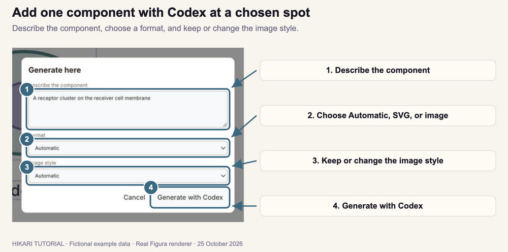

Codex centers the new component on the spot you right-clicked and leaves the rest of the figure alone. Zoom and pan do not move that spot; near an edge the component shifts just enough to stay on the canvas. A style chosen here is used once and the figure's saved style is unchanged.

## 12. Align components and distribute spacing

1. Select at least two items.
2. Open **Align and distribute** in the right toolbar or the selection bar.
3. Choose left, right, top, bottom, horizontal-center, or vertical-center alignment.
4. With three or more items, choose **Distribute horizontally** or **Distribute vertically** for equal gaps.
5. Inspect the result and use Undo if you want to try another arrangement.

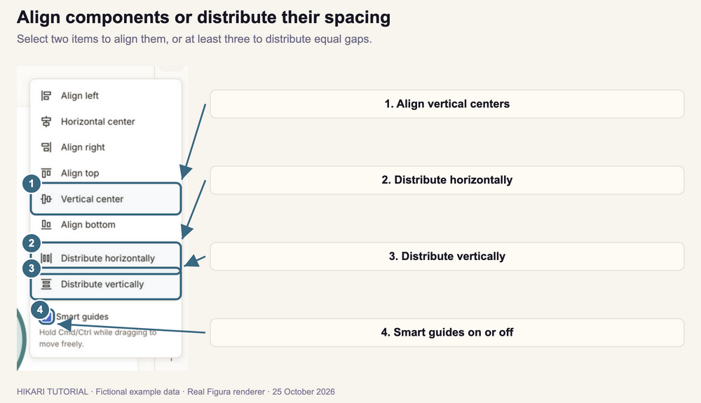

Alignment uses the selection's visible bounds. Distribution keeps the outside items in place while spacing the items between them. Complete groups count as single items; individual group members can also be selected and arranged separately. The **Smart guides** switch at the bottom of this menu turns drag snapping on or off.

## 13. Copy and paste editable components

1. Select a component, several components, or a group.
2. Right-click and choose **Copy**, or use **⌘C / Ctrl+C**.
3. Stay on the same canvas, or open another illustration in the left rail.
4. Right-click the destination canvas and choose **Paste**, or use **⌘V / Ctrl+V**.
5. Move the selected copies to their intended positions.

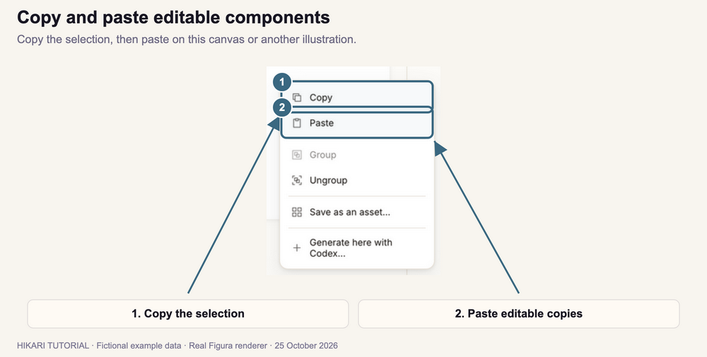

Copies retain artwork, separate labels, styles, rotation, and group membership. They appear slightly offset so you can see the new selection. Editing a copy does not alter the original. Text-field copy and paste continue to work as ordinary text editing.

### Paste a chemical structure

Copy a structure in **ChemDraw**, then paste it onto the Figura canvas with **⌘V / Ctrl+V**. Bonds, atom labels, and charges arrive as one vector layer that stays sharp when enlarged and stays vector in SVG and PowerPoint exports. To change the chemistry, edit it in ChemDraw and paste it again. If ChemDraw offers only a bitmap, Figura pastes an image and says so in the status line; copy as SVG or PDF from ChemDraw for vector quality.

## 14. Save and reuse components as assets

### Save a component or group

1. Select the artwork and labels you want to reuse.
2. Right-click and choose **Save as an asset…**.
3. Enter a descriptive **Name**, and a **Description (optional)** of the subject, visible parts, colors, style, and intended use.
4. Click **Save asset**. The left rail switches to **Assets**.

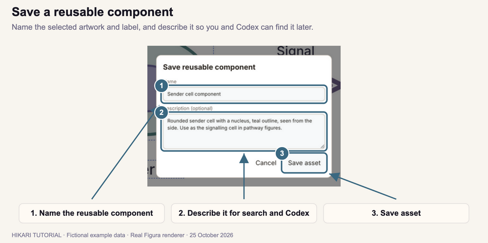

A description helps you and Codex find the right artwork later; search matches names and descriptions. It can be up to 2,000 characters.

### Insert an asset

1. Click **Assets** in the switch at the top of the left rail. Saved components appear as a grid of thumbnails.
2. Search for the component by name or by words from its description.
3. Hover over a thumbnail, or focus it with the keyboard, to see a larger preview with its full name and description in the pane under the grid.
4. Click the thumbnail to insert an editable copy into the active illustration.
5. Move or resize the inserted selection as needed.

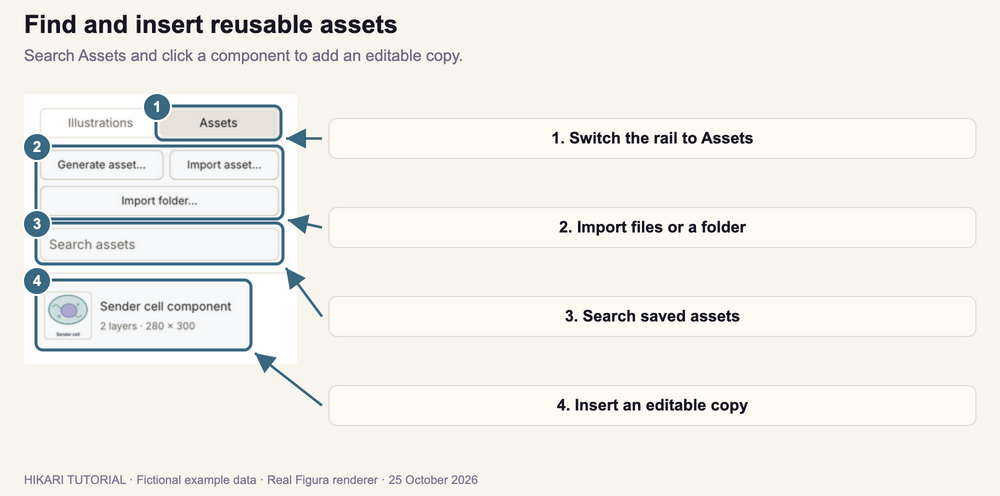

A large asset is fitted inside 70% of the canvas; a smaller one keeps its saved size. The preview pane never covers the canvas.

To add assets from files, click **Import asset…** and choose one or more SVG, PNG, JPEG, or WebP files, or click **Import folder…** to add every supported file in a folder and its subfolders, named after the files. Files that fail validation are listed in the review dialog and skipped, and artwork already in the library is reused rather than duplicated. **Generate asset…** asks Codex to make a new reusable component without changing the canvas, in the figure's image style or another you choose for that asset.

To edit an asset's name or description, or to remove it, click the **i** button on its thumbnail and use **Asset details**. Copies already placed in illustrations remain independent of the saved asset.

## 15. Find saved illustrations

1. Click **Illustrations** in the switch at the top of the left rail.
2. Use **Search illustrations** to filter titles.
3. Click a matching row to open its saved canvas.
4. Clear the search to see all illustrations again. If the rail is folded, use the title's chevron to show it.

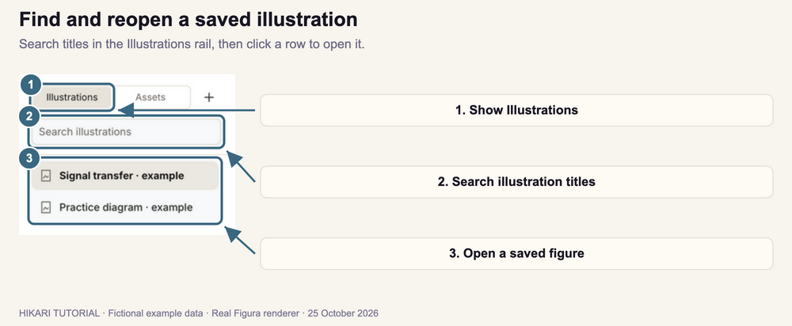

## 16. Export the finished figure

1. Inspect the full canvas with **Fit**. Check labels, positions, overlap, and which layers are visible.
2. Open **Export** in the top toolbar.
3. Choose **SVG**, **PNG**, or **PowerPoint**.
4. Follow the save prompt and open the exported file to inspect it.

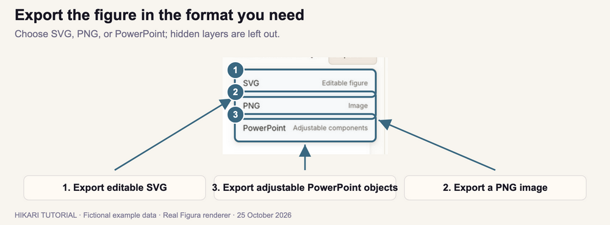

| Format | Use it for |
| --- | --- |
| **SVG** | A vector figure that retains separate artwork and text groups. |
| **PNG** | An assembled image of the visible canvas. |
| **PowerPoint** | A slide with separate components you can move, resize, rotate, or delete. Labels remain editable text boxes. |

Hidden layers and selection handles do not appear in exports. In PowerPoint, raster artwork remains an image; editing vector paths requires PowerPoint's **Convert to Shape** feature. Fonts other than the bundled Inter font may need to be installed on the computer opening the file.

You can inspect [the example exported SVG](examples/finished-figure.svg) alongside your own result.

---

[Previous tutorial: Gel](../10-gel/index.html) · [All tutorials](../index.html)
